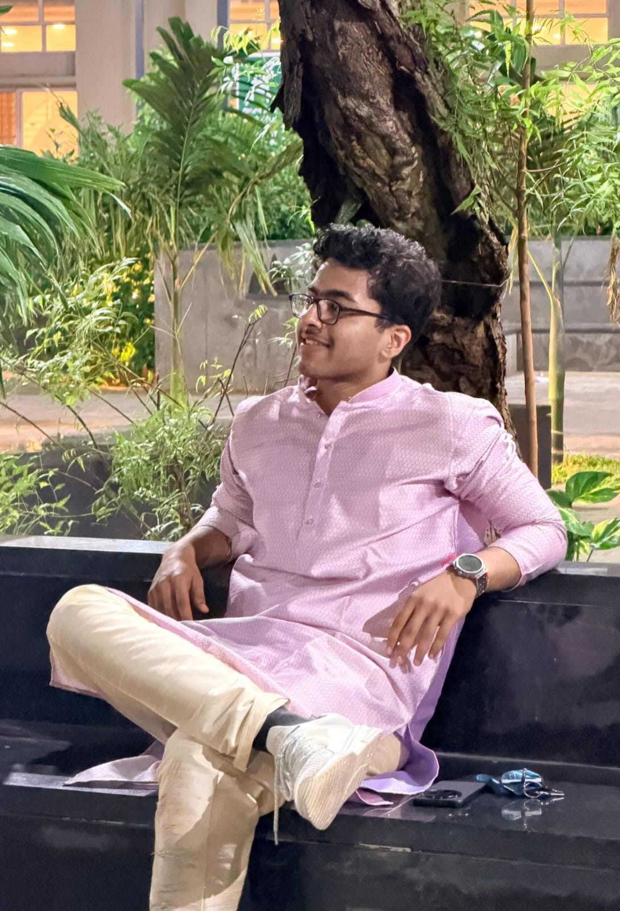

# Project Handoff Document v10.0: Suyash Sharma — 3D Disassembling Laptop & Editorial Portfolio (`My-Portfolio`)

**Document Name:** `handoff-v10.md`  
**Version:** 10.0 (Restored Vibrant Color Accents, Deeper Matte Black Laptop with Upward Tilt & Extensive Disassembly, Smaller Project Tabs with Interactive Extended Ruler Lines & 380ms Dwell Guard, Top 50 Finalist, Right-Aligned Quote & Jump Target Fix)  
**Repository:** `https://github.com/suyashcodemaster/My-Portfolio`  
**Live Production URL:** `https://suyashcodemaster.vercel.app`  
**Primary Working Directory:** `E:\Website Portfolio\My-Portfolio`

---

## 1. Summary of All 7 Fixes & Refinements in v10.0

1. **Restored Vibrant Color Theme with 60-30-10 Design Theory Principles (`data/portfolioData.js`, `styles/main.css`, `scripts/main.js`)**:
   - Restored the vibrant color accents across every section (`#38bdf8` Sky Cyan, `#10b981` Emerald Green, `#a855f7` Electric Purple, `#f59e0b` Amber Gold, `#6366f1` Indigo Blue, `#f43f5e` Rose Coral, `#2dd4bf` Teal) across the 3D laptop stage borders, skill pills, progress dots, callout pointers, 3D dynamic lighting, and 35mm camera reel frames while keeping the refined `'Newsreader'` + `'Plus Jakarta Sans'` typography and 3 background chapters.
2. **Deeper Matte Black 3D Laptop, Fixed Studio Lighting, More Upward Tilt, Upward-Shifted Extensive Disassembly & Wider Rotation (`scripts/laptop3d.js`)**:
   - **Deeper Matte Black & Fixed Lighting**: Deepened all laptop materials to stealth matte obsidian-black (`color: 0x050608` to `0x161922`, `roughness: 0.88–0.94`, low metalness) and lowered the front ambient/key glare (`ambient = 0.52`, `keyLight = 1.25`, `toneMappingExposure = 1.08`) while pairing with a dynamic colored `PointLight` (`accentLight`) so the matte black surfaces look rich and sculpted.
   - **Tilted More Upwards & Shifted Disassembling Parts More Upwards**: Tilted the laptop further upward during disassembly (`root.rotation.x = 0.24 - spread * 0.30`, reaching `-0.06 rad`) while lifting the entire assembly (`root.position.y = -0.36 + spread * 0.44`) and expanding the parts more extensively (`Display +1.05 Y`, `Keyboard +0.66 Y`, `Motherboard +0.18 Y`, `RAM Sticks ±1.18 X`, `Storage -0.30 Y`) so the lower parts remain in full view.
   - **Wider Rotation**: Started the laptop further rotated (`root.rotation.y = +0.96 rad`) and swept it across a `1.82`-radian continuous arc (`0.96 - progress * 1.82`).
3. **High-Contrast Visibility Across All Elements & Text (`styles/main.css`)**:
   - Enforced `#ffffff` headings and `#e2e8f0` / `#cbd5e1` body text on `rgba(16, 18, 26, 0.90)` dark cards, with `#09090d` bold dark ink when hovering bright colored skill pills.
4. **Smaller, Upward-Shifted, More Steeply Angled Project Tabs + Extended Interactive Ruler Lines + 380ms Hover Dwell Guard (`styles/main.css`, `scripts/main.js`)**:
   - Reduced resting tab dimensions to `clamp(160px, 15vw, 194px) × 262px`, shifted `#section-projects` upward, and angled each card more steeply (`rotateY(-58deg) rotateX(7deg)`).
   - Extended the template-repo vertical ruler lines underneath the tabs (`.projects-index-lines`, `height: 86px`, major ticks up to `76px` with `#10b981` glow) and bound hover events to each `.index-tick-group` so hovering over a line underneath brings up its corresponding card too.
   - Added a strict **`380ms` continuous dwell timer** (`scheduleHoverOpen`) on both the cards and ruler lines so a 1ms accidental mouse brush never triggers a pop-up.
5. **Updated SanitX Badge to *"Top 50 Finalist"* (`data/portfolioData.js`)**:
   - Changed `SanitX` subtitle to `"DevJams '26 Hackathon • Top 50 Finalist"`.
6. **Shifted *"If it doesn't challenge you..."* Quote to the Right, Vertically Centered Between the 2 Cards (`styles/main.css`, `scripts/main.js`)**:
   - Set `.between-stages-quote` to `width: min(46vw, 575px); align-self: flex-end; margin-right: 4.5vw; min-height: 34vh;` with crisp `#ffffff` text and a dark drop-shadow so it sits aligned with the right-hand card column, vertically centered between the *GitHub / Spoken Languages* card and the *Courses & Achievements* card.
7. **Adjusted *"Explore Projects ↓"* Button Landing Target (`index.html`, `styles/main.css`)**:
   - Pointed `#btn-jump-projects` to `#quote-before-projects` (`scroll-margin-top: 0.8rem`) and tightened `#section-projects` vertical height so clicking *Explore Projects ↓* lands where **both the Helen Keller quote and the entire Projects section + ruler lines are simultaneously visible**.

---

## 2. Complete Updated Source Files (Drop Directly into `E:\Website Portfolio\My-Portfolio`)

### File 1: `data/portfolioData.js`
```javascript
export const PORTFOLIO_DATA = {
  profile: {
    firstName: "SUYASH",
    lastName: "SHARMA",
    photoUrl: "./suyash-photo.jpeg",
    cvUrl: "./Suyash-CV.pdf",
    cvDownloadName: "Suyash-Sharma-CV.pdf",
    email: "sharma.suyash.in@gmail.com",
    linkedin: "https://linkedin.com/in/suyashsharmadev",
    github: "https://github.com/suyashcodemaster",
    githubUsername: "suyashcodemaster",
    location: "Vellore, Tamil Nadu & Pune, India"
  },

  // 3 Philosophical Quotes Sprinkled Across Spaces Between Sections
  interludeQuotes: [
    {
      id: "quote-1",
      text: "You don't have to be great to get started, but you have to get started to be great.",
      author: ""
    },
    {
      id: "quote-2",
      text: "Trust the wait. Embrace the uncertainty. Enjoy the beauty of becoming.",
      author: ""
    },
    {
      id: "quote-3",
      text: "Life is either a daring adventure or nothing at all.",
      author: "Helen Keller"
    }
  ],

  // 5 Core Laptop Disassembly Sections — Ordered Top-to-Bottom by Visibility with Vibrant Color Theory Accents:
  // 1. Display (About Me — Sky Cyan) -> 2. Keyboard (Technical Skills — Emerald) -> 3. Motherboard (The Mission — Electric Purple) -> 4. RAM Sticks (GitHub & Languages — Amber Gold) -> 5. Storage (Courses & Achievements — Indigo)
  laptopStages: [
    {
      id: "about",
      partKey: "display",
      partLabel: "Display",
      title: "About Me",
      accent: "#38bdf8",
      paragraphs: [
        "Hey! I'm Suyash — a first-year CSE student at VIT Vellore who's genuinely fascinated by how things are built from the ground up. I fell into programming because I loved the idea of turning a blank screen into something real, something that actually works.",
        "Logic has always clicked with me — I'm the kind of person who needs to understand why something works before I'm satisfied with it. Whether it's a tricky algorithm or a confusing concept, I'll keep at it until it makes sense.",
        "I'm still early in the journey, but I show up every day ready to learn — even if that means three hours debugging something that turns out to be a missing semicolon."
      ],
      cards: [
        {
          heading: "Vellore Institute of Technology (VIT)",
          sub: "B.Tech in Computer Science & Engineering • 2026 – 2030",
          meta: "Vellore, Tamil Nadu"
        },
        {
          heading: "Mahaveer English Medium School",
          sub: "Class XII, CBSE Board",
          meta: "Grade: A1"
        },
        {
          heading: "Delhi Public School, Pune",
          sub: "Class X, CBSE Board",
          meta: "Grade: A1"
        }
      ],
      pillsTitle: "Soft Skills",
      pills: [
        "Communication", "Adaptability", "Problem Solving",
        "Teamwork", "Leadership", "Critical Thinking", "Work Ethic"
      ]
    },
    {
      id: "skills",
      partKey: "keyboard",
      partLabel: "Keyboard",
      title: "Technical Skills",
      accent: "#10b981",
      skillGroups: [
        { label: "Programming Languages", color: "#10b981", items: ["Python", "HTML/CSS"] },
        { label: "Currently Learning", color: "#f59e0b", items: ["Python", "C++", "Data Structures & Algorithms (DSA)", "Learning AI"] },
        { label: "Frameworks", color: "#38bdf8", items: ["Want to learn React"] },
        { label: "Libraries", color: "#a855f7", items: ["pandas", "NumPy", "Matplotlib"] },
        { label: "Developer Tools", color: "#f43f5e", items: ["Git", "GitHub", "Docker", "VS Code", "Visual Studio", "PyCharm"] }
      ]
    },
    {
      id: "mission",
      partKey: "motherboard",
      partLabel: "Motherboard",
      title: "The Mission",
      accent: "#a855f7",
      quote: "My goal is to pair hard work with smart planning to ensure my engineering efforts are highly targeted and deliver the best possible results. Whether managing a team or competing as a regional basketball player, I have learned to adapt quickly and view challenges from multiple perspectives. I am dedicated to bringing this adaptability and grassroots approach to every technical solution I build.",
      pillsTitle: "How I Work",
      pills: ["Smart Planning", "Fast Adaptation", "Team Mindset", "Grassroots Approach"]
    },
    {
      id: "languages",
      partKey: "ram",
      partLabel: "RAM Sticks",
      title: "",
      accent: "#f59e0b",
      isCompactLanguages: true,
      casualLanguagesText: "English & Hindi",
      githubUsername: "suyashcodemaster",
      badgesTitle: "Badges",
      badgesPlaceholder: "Yet to earn",
      outsideQuote: "If it doesn't challenge you, it won't change you."
    },
    {
      id: "achievements",
      partKey: "storage",
      partLabel: "Storage",
      title: "Courses & Achievements",
      accent: "#6366f1",
      cards: [
        {
          heading: "CS50x: Introduction to Computer Science",
          sub: "Harvard University (HarvardX)",
          meta: "In Progress"
        },
        {
          heading: "AWS Workshop Certificate: Cloud Intelligence",
          sub: "Amazon Web Services",
          meta: "Certified"
        },
        {
          heading: "Basketball (Class 5 – 8)",
          sub: "Won multiple basketball competitions and competed at the District Level",
          meta: "Athletics"
        },
        {
          heading: "Mathematics & Mental Math (Class 2 – 10)",
          sub: "Won multiple inter- and intra-school mathematics and mental math competitions competing against 50+ teams",
          meta: "Competitive Math"
        }
      ]
    }
  ],

  // Section 3: Scroll-Animated 35mm Camera Reel — Hobbies (With Vibrant Color Accents & Martial Arts at 08A)
  reelFrames: [
    { frame: "01A", title: "Building Human Connections", tag: "Community", color: "#f43f5e", desc: "Meeting new people, collaborating across diverse teams, and learning from different perspectives." },
    { frame: "02A", title: "Space & Aviation", tag: "Aerospace", color: "#38bdf8", desc: "Deep fascination with spacecraft, aircraft engineering, and how flight works." },
    { frame: "03A", title: "Basketball & Sports", tag: "Sports", color: "#f59e0b", desc: "District-level basketball player bringing court vision, composure, and teamwork to everything I do." },
    { frame: "04A", title: "Finance & Markets", tag: "Finance", color: "#a855f7", desc: "Exploring how markets work, personal finance, and strategic decision-making." },
    { frame: "05A", title: "Nature, Animals & Travel", tag: "Outdoors", color: "#2dd4bf", desc: "Traveling to new places, spending time around animals, and appreciating nature." },
    { frame: "06A", title: "Video Games", tag: "Gaming", color: "#fb7185", desc: "Unwinding with immersive strategy and story-driven games that spark creativity." },
    { frame: "07A", title: "Learning About Tech & AI", tag: "Tech & AI", color: "#6366f1", desc: "Keeping up with how modern AI systems work and experimenting with new developer tools." },
    { frame: "08A", title: "Martial Arts", tag: "Discipline", color: "#10b981", desc: "Practicing martial arts for focus, discipline, and staying calm under pressure." }
  ],

  // Section 4: 6 Horizontally Stacked Project Cards (Top 50 Finalist in SanitX)
  projects: [
    {
      slot: "01",
      isPlaceholder: false,
      title: "SanitX",
      subtitle: "DevJams '26 Hackathon • Top 50 Finalist",
      accent: "#10b981",
      githubUrl: "https://github.com/suyashcodemaster/SanitX",
      tech: ["Python", "FastAPI", "PyMuPDF", "Gemini API", "Next.js", "TypeScript", "Tailwind CSS"],
      bullets: [
        "Built a document security tool detecting prompt injection hidden inside PDF and Markdown files before reaching an AI system.",
        "Two-layer pipeline: rule-based scanner for tiny/low-contrast/hidden text + Gemini safety analysis.",
        "Contributed across ideation, FastAPI backend, Next.js frontend, and system architecture."
      ]
    },
    { slot: "02", isPlaceholder: true, emptyLabel: "yet to build😝" },
    { slot: "03", isPlaceholder: true, emptyLabel: "yet to build😝" },
    { slot: "04", isPlaceholder: true, emptyLabel: "yet to build😝" },
    { slot: "05", isPlaceholder: true, emptyLabel: "yet to build😝" },
    { slot: "06", isPlaceholder: true, emptyLabel: "yet to build😝" }
  ],

  // Section 5: Julian Garnier (juliangarnier.com) Auto-Typing Chat Bubbles (~6s total)
  contactMessages: [
    "Hey there 👋",
    "You can reach me by email at <a href=\"mailto:sharma.suyash.in@gmail.com\">sharma.suyash.in@gmail.com ↗</a>",
    "Or connect with me on <a href=\"https://linkedin.com/in/suyashsharmadev\" target=\"_blank\" rel=\"noopener noreferrer\">LinkedIn ↗</a> and <a href=\"https://github.com/suyashcodemaster\" target=\"_blank\" rel=\"noopener noreferrer\">GitHub ↗</a>",
    "Need a copy of my resume? <a href=\"./Suyash-CV.pdf\" download=\"Suyash-Sharma-CV.pdf\" class=\"chat-inline-cv\" data-cv-download=\"true\">Download my CV (PDF) ↓</a>"
  ]
};
```

### File 2: `index.html`
```html
<!DOCTYPE html>
<html lang="en">
<head>
  <meta charset="UTF-8" />
  <meta name="viewport" content="width=device-width, initial-scale=1.0" />
  <title>Suyash Sharma — Portfolio</title>
  <link rel="icon" type="image/svg+xml" href="./favicon.svg" />
  <link rel="preconnect" href="https://fonts.googleapis.com">
  <link rel="preconnect" href="https://fonts.gstatic.com" crossorigin>
  <link href="https://fonts.googleapis.com/css2?family=Instrument+Serif:ital@0;1&family=JetBrains+Mono:wght@400;500&family=Newsreader:ital,opsz,wght@0,6..72,300;0,6..72,400;1,6..72,300;1,6..72,400&family=Plus+Jakarta+Sans:wght@300;400;500;600&display=swap" rel="stylesheet">
  <link rel="stylesheet" href="./styles/main.css" />
  <!-- Three.js & GSAP + ScrollTrigger CDN -->
  <script src="https://cdnjs.cloudflare.com/ajax/libs/three.js/r128/three.min.js" crossorigin="anonymous" referrerpolicy="no-referrer" defer></script>
  <script src="https://cdnjs.cloudflare.com/ajax/libs/gsap/3.12.5/gsap.min.js" crossorigin="anonymous" referrerpolicy="no-referrer" defer></script>
  <script src="https://cdnjs.cloudflare.com/ajax/libs/gsap/3.12.5/ScrollTrigger.min.js" crossorigin="anonymous" referrerpolicy="no-referrer" defer></script>
  <script type="module" src="./scripts/main.js" defer></script>
</head>
<body class="is-loading">
  <!-- INITIAL TEMPLATE REPO LOADING SCREEN (~2.35s Smooth Duration) -->
  <div id="loader-overlay" class="loader-overlay" aria-label="Loading portfolio">
    <div class="loader-inner">
      <div class="loader-counter-wrap">
        <span id="loader-count" class="loader-count">000</span>
        <span class="loader-percent">%</span>
      </div>
      <div class="loader-bar-track">
        <div id="loader-bar-fill" class="loader-bar-fill"></div>
      </div>
    </div>
  </div>

  <!-- Full-Viewport Blur Backdrop when Focusing a Project Card in Center -->
  <div id="projects-focus-backdrop" class="projects-focus-backdrop" aria-hidden="true"></div>

  <!-- ========================================================================
       COLOR CHAPTER 1: DEEP MATTE OBSIDIAN CHARCOAL (#0c0d12)
       ======================================================================== -->
  <div class="chapter-charcoal">
    <!-- 1. HERO SECTION -->
    <section id="section-hero" class="hero-section">
      <div class="hero-center">
        <h1 class="hero-title">
          <span class="hero-word-slot"><span id="hero-first" class="typewriter-word"></span></span>
          <span class="hero-photo-frame">
            
          </span>
          <span class="hero-word-slot"><span id="hero-last" class="typewriter-word"></span></span>
        </h1>
      </div>

      <!-- Lands at #quote-before-projects so BOTH the Helen Keller quote AND the full Projects section are visible! -->
      <a href="#quote-before-projects" id="btn-jump-projects" class="hero-projects-btn">
        <span class="btn-main-text">Explore Projects ↓</span>
      </a>

      <div class="hero-scroll-indicator">
        <span class="mono-tag">Scroll</span>
        <div class="scroll-line"><div class="scroll-pulse"></div></div>
      </div>
    </section>

    <!-- PHILOSOPHICAL QUOTE INTERLUDE 1 -->
    <div class="quote-interlude first-quote-interlude">
      <div class="quote-frame">
        <svg class="quote-leaf leaf-left" viewBox="0 0 64 40" fill="none" xmlns="http://www.w3.org/2000/svg" aria-hidden="true">
          <path d="M58 34C42 32 24 24 8 8" stroke="#34d399" stroke-width="1.5" stroke-linecap="round"/>
          <path d="M44 31C42 22 34 18 28 20C30 27 37 31 44 31Z" fill="rgba(52,211,153,0.2)" stroke="#34d399" stroke-width="1.2"/>
          <path d="M30 24C28 15 20 11 14 13C16 20 23 24 30 24Z" fill="rgba(52,211,153,0.2)" stroke="#34d399" stroke-width="1.2"/>
          <path d="M36 28C43 24 49 26 52 31C45 33 39 31 36 28Z" fill="rgba(52,211,153,0.15)" stroke="#34d399" stroke-width="1.2"/>
          <path d="M21 19C28 15 34 17 37 22C30 24 24 22 21 19Z" fill="rgba(52,211,153,0.15)" stroke="#34d399" stroke-width="1.2"/>
        </svg>
        <blockquote class="interlude-text">
          “You don't have to be great to get started, but you have to get started to be great.”
        </blockquote>
        <svg class="quote-leaf leaf-right" viewBox="0 0 64 40" fill="none" xmlns="http://www.w3.org/2000/svg" aria-hidden="true">
          <path d="M6 34C22 32 40 24 56 8" stroke="#34d399" stroke-width="1.5" stroke-linecap="round"/>
          <path d="M20 31C22 22 30 18 36 20C34 27 27 31 20 31Z" fill="rgba(52,211,153,0.2)" stroke="#34d399" stroke-width="1.2"/>
          <path d="M34 24C36 15 44 11 50 13C48 20 41 24 34 24Z" fill="rgba(52,211,153,0.2)" stroke="#34d399" stroke-width="1.2"/>
          <path d="M28 28C21 24 15 26 12 31C19 33 25 31 28 28Z" fill="rgba(52,211,153,0.15)" stroke="#34d399" stroke-width="1.2"/>
          <path d="M43 19C36 15 30 17 27 22C34 24 40 22 43 19Z" fill="rgba(52,211,153,0.15)" stroke="#34d399" stroke-width="1.2"/>
        </svg>
      </div>
    </div>

    <!-- 2. 3D LAPTOP DISASSEMBLY SCROLLABLE SECTION -->
    <section id="section-laptop" class="laptop-section">
      <div class="laptop-sticky-viewport">
        <canvas id="laptop-canvas"></canvas>

        <!-- Vibrant, High-Contrast 3D Part Pointer -->
        <div id="part-link-callout" class="part-link-callout" aria-hidden="true">
          <span class="callout-dot"></span>
          <span class="callout-line"></span>
          <div class="callout-badge">
            <span id="callout-part-name" class="callout-part">Display</span>
          </div>
        </div>

        <!-- Hover Tooltip -->
        <div id="part-hover-tooltip" class="part-hover-tooltip" aria-hidden="true"></div>

        <!-- Centered Touchpad "Download CV" Button at Scroll Completion -->
        <div id="touchpad-cv-overlay" class="touchpad-cv-overlay">
          <a id="touchpad-cv-anchor" href="./Suyash-CV.pdf" download="Suyash-Sharma-CV.pdf" class="touchpad-floating-btn">
            <span class="touchpad-btn-dot"></span>
            <span>Download CV</span>
          </a>
        </div>

        <div class="stage-progress-bar">
          <div id="stage-dots" class="stage-dots"></div>
        </div>
      </div>

      <div id="laptop-stages-container" class="laptop-stages-container"></div>
    </section>
  </div>

  <!-- Seamless Transition 1: Deep Matte Charcoal (#0c0d12) -> Rich Midnight Graphite-Slate (#151621) -->
  <div class="transition-charcoal-to-stone" aria-hidden="true"></div>

  <!-- ========================================================================
       COLOR CHAPTER 2: RICH MIDNIGHT GRAPHITE-SLATE (#151621)
       ======================================================================== -->
  <div class="chapter-stone">
    <!-- PHILOSOPHICAL QUOTE INTERLUDE 2 -->
    <div class="quote-interlude">
      <div class="quote-frame">
        <svg class="quote-leaf leaf-left" viewBox="0 0 64 40" fill="none" xmlns="http://www.w3.org/2000/svg" aria-hidden="true">
          <path d="M58 34C42 32 24 24 8 8" stroke="#34d399" stroke-width="1.5" stroke-linecap="round"/>
          <path d="M44 31C42 22 34 18 28 20C30 27 37 31 44 31Z" fill="rgba(52,211,153,0.2)" stroke="#34d399" stroke-width="1.2"/>
          <path d="M30 24C28 15 20 11 14 13C16 20 23 24 30 24Z" fill="rgba(52,211,153,0.2)" stroke="#34d399" stroke-width="1.2"/>
          <path d="M36 28C43 24 49 26 52 31C45 33 39 31 36 28Z" fill="rgba(52,211,153,0.15)" stroke="#34d399" stroke-width="1.2"/>
          <path d="M21 19C28 15 34 17 37 22C30 24 24 22 21 19Z" fill="rgba(52,211,153,0.15)" stroke="#34d399" stroke-width="1.2"/>
        </svg>
        <blockquote class="interlude-text">
          “Trust the wait. Embrace the uncertainty. Enjoy the beauty of becoming.”
        </blockquote>
        <svg class="quote-leaf leaf-right" viewBox="0 0 64 40" fill="none" xmlns="http://www.w3.org/2000/svg" aria-hidden="true">
          <path d="M6 34C22 32 40 24 56 8" stroke="#34d399" stroke-width="1.5" stroke-linecap="round"/>
          <path d="M20 31C22 22 30 18 36 20C34 27 27 31 20 31Z" fill="rgba(52,211,153,0.2)" stroke="#34d399" stroke-width="1.2"/>
          <path d="M34 24C36 15 44 11 50 13C48 20 41 24 34 24Z" fill="rgba(52,211,153,0.2)" stroke="#34d399" stroke-width="1.2"/>
          <path d="M28 28C21 24 15 26 12 31C19 33 25 31 28 28Z" fill="rgba(52,211,153,0.15)" stroke="#34d399" stroke-width="1.2"/>
          <path d="M43 19C36 15 30 17 27 22C34 24 40 22 43 19Z" fill="rgba(52,211,153,0.15)" stroke="#34d399" stroke-width="1.2"/>
        </svg>
      </div>
    </div>

    <!-- 3. SCROLL-ANIMATED 35MM CAMERA REEL SECTION (HOBBIES) -->
    <section id="section-reel" class="reel-scroll-section">
      <div class="reel-sticky-viewport">
        <div class="reel-top-bar">
          <div>
            <h2 class="section-heading">Hobbies</h2>
          </div>
          <div class="reel-counter-box">
            <span id="reel-active-indicator" class="reel-counter-val">Frame 01A / 08A</span>
          </div>
        </div>

        <div class="film-strip-stage">
          <div class="film-strip-wrapper" id="film-strip-wrapper">
            <div class="film-edge-code top-edge">
              <span>35MM ARCHIVE</span>
              <span>01A</span><span>02A</span><span>03A</span><span>04A</span><span>05A</span><span>06A</span><span>07A</span><span>08A</span>
            </div>
            <div class="sprocket-row"></div>
            <div id="reel-track" class="reel-track"></div>
            <div class="sprocket-row"></div>
            <div class="film-edge-code bottom-edge">
              <span>SUYASH SHARMA</span>
              <span>SCROLL TO ADVANCE →</span>
            </div>
          </div>
        </div>

        <div class="reel-progress-bar-wrap">
          <div id="reel-progress-fill" class="reel-progress-fill"></div>
        </div>
      </div>
    </section>

    <!-- PHILOSOPHICAL QUOTE INTERLUDE 3 (Anchor for Explore Projects Button so both Quote & Projects fit on screen!) -->
    <div id="quote-before-projects" class="quote-interlude helen-keller-quote">
      <div class="quote-frame">
        <svg class="quote-leaf leaf-left" viewBox="0 0 64 40" fill="none" xmlns="http://www.w3.org/2000/svg" aria-hidden="true">
          <path d="M58 34C42 32 24 24 8 8" stroke="#34d399" stroke-width="1.5" stroke-linecap="round"/>
          <path d="M44 31C42 22 34 18 28 20C30 27 37 31 44 31Z" fill="rgba(52,211,153,0.2)" stroke="#34d399" stroke-width="1.2"/>
          <path d="M30 24C28 15 20 11 14 13C16 20 23 24 30 24Z" fill="rgba(52,211,153,0.2)" stroke="#34d399" stroke-width="1.2"/>
          <path d="M36 28C43 24 49 26 52 31C45 33 39 31 36 28Z" fill="rgba(52,211,153,0.15)" stroke="#34d399" stroke-width="1.2"/>
          <path d="M21 19C28 15 34 17 37 22C30 24 24 22 21 19Z" fill="rgba(52,211,153,0.15)" stroke="#34d399" stroke-width="1.2"/>
        </svg>
        <blockquote class="interlude-text">
          “Life is either a daring adventure or nothing at all.”
          <cite class="interlude-cite">— Helen Keller</cite>
        </blockquote>
        <svg class="quote-leaf leaf-right" viewBox="0 0 64 40" fill="none" xmlns="http://www.w3.org/2000/svg" aria-hidden="true">
          <path d="M6 34C22 32 40 24 56 8" stroke="#34d399" stroke-width="1.5" stroke-linecap="round"/>
          <path d="M20 31C22 22 30 18 36 20C34 27 27 31 20 31Z" fill="rgba(52,211,153,0.2)" stroke="#34d399" stroke-width="1.2"/>
          <path d="M34 24C36 15 44 11 50 13C48 20 41 24 34 24Z" fill="rgba(52,211,153,0.2)" stroke="#34d399" stroke-width="1.2"/>
          <path d="M28 28C21 24 15 26 12 31C19 33 25 31 28 28Z" fill="rgba(52,211,153,0.15)" stroke="#34d399" stroke-width="1.2"/>
          <path d="M43 19C36 15 30 17 27 22C34 24 40 22 43 19Z" fill="rgba(52,211,153,0.15)" stroke="#34d399" stroke-width="1.2"/>
        </svg>
      </div>
    </div>

    <!-- 4. 6 HORIZONTALLY STACKED PHOTO-FRAME PROJECT CARDS + EXTENDED TEMPLATE REPO RULER LINES -->
    <section id="section-projects" class="projects-section">
      <div class="section-header-wrap">
        <h2 class="section-heading">Projects</h2>
      </div>
      <div id="projects-stack" class="template-horizontal-stack"></div>
      <!-- Extended Template Repository Index Lines (Hovering a line also brings up its card!) -->
      <div id="projects-index-lines" class="projects-index-lines" aria-label="Project index lines"></div>
    </section>
  </div>

  <!-- Seamless Transition 2: Midnight Graphite-Slate (#151621) -> Minimalist Alabaster White (#f5f3ed) -->
  <div class="dark-to-white-transition" aria-hidden="true"></div>

  <!-- ========================================================================
       COLOR CHAPTER 3: MINIMALIST WARM ALABASTER WHITE (#f5f3ed)
       ======================================================================== -->
  <section id="section-contact" class="minimal-white-contact">
    <div class="minimal-contact-inner">
      <h2 class="contact-me-title">Contact Me</h2>
      <div class="minimal-chat-stream" id="chat-messages"></div>

      <footer class="minimal-contact-footer">
        <span>© 2026 Suyash Sharma</span>
        <span class="footer-sep">·</span>
        <a href="#section-hero">Back to top ↑</a>
      </footer>
    </div>
  </section>
</body>
</html>
```

### File 3: `styles/main.css`
```css
:root {
  --bg-charcoal: #0c0d12;
  --bg-stone: #141520;
  --bg-alabaster: #f5f3ed;
  --bg-panel: rgba(16, 18, 26, 0.90);
  --text-main: #f8fafc;
  --text-muted: #94a3b8;
  --border-subtle: rgba(248, 250, 252, 0.14);
  --font-display: 'Instrument Serif', Georgia, serif;
  --font-quote: 'Newsreader', Georgia, serif;
  --font-sans: 'Plus Jakarta Sans', -apple-system, BlinkMacSystemFont, sans-serif;
  --font-mono: 'JetBrains Mono', monospace;
}

* { box-sizing: border-box; margin: 0; padding: 0; }
html { scroll-behavior: smooth; background: var(--bg-charcoal); color: var(--text-main); font-family: var(--font-sans); }
body { overflow-x: hidden; background: var(--bg-charcoal); -webkit-font-smoothing: antialiased; }
body.is-loading { overflow: hidden; }

/* ==========================================================================
   3 INTENTIONAL COLOR CHAPTERS & SEAMLESS TRANSITIONS
   ========================================================================== */
.chapter-charcoal {
  background: var(--bg-charcoal);
}

.transition-charcoal-to-stone {
  width: 100%;
  height: 140px;
  background: linear-gradient(180deg, var(--bg-charcoal) 0%, var(--bg-stone) 100%);
}

.chapter-stone {
  background: var(--bg-stone);
}

.dark-to-white-transition {
  width: 100%;
  height: 150px;
  background: linear-gradient(180deg, var(--bg-stone) 0%, var(--bg-alabaster) 100%);
}

/* ==========================================================================
   0. INITIAL TEMPLATE REPO LOADING SCREEN (~2.35s Total)
   ========================================================================== */
.loader-overlay {
  position: fixed;
  inset: 0;
  z-index: 9999;
  background: var(--bg-charcoal);
  display: flex;
  align-items: center;
  justify-content: center;
  transition: transform 0.85s cubic-bezier(0.76, 0, 0.24, 1), opacity 0.6s ease;
}

.loader-overlay.loaded {
  transform: translateY(-100%);
  pointer-events: none;
}

.loader-inner {
  width: min(340px, 80vw);
  display: flex;
  flex-direction: column;
  gap: 1rem;
}

.loader-counter-wrap {
  display: flex;
  align-items: baseline;
  justify-content: center;
  gap: 0.2rem;
}

.loader-count {
  font-family: var(--font-display);
  font-size: clamp(4rem, 8.5vw, 5.6rem);
  line-height: 1;
  color: var(--text-main);
}

.loader-percent {
  font-family: var(--font-mono);
  font-size: 0.95rem;
  color: #f59e0b;
}

.loader-bar-track {
  width: 100%;
  height: 2px;
  background: rgba(255, 255, 255, 0.12);
  overflow: hidden;
}

.loader-bar-fill {
  width: 0%;
  height: 100%;
  background: linear-gradient(90deg, #38bdf8, #10b981, #f59e0b);
  transition: width 0.04s linear;
}

.mono-tag {
  font-family: var(--font-mono);
  font-size: 0.72rem;
  letter-spacing: 0.13em;
  text-transform: uppercase;
  color: var(--text-muted);
}

/* ==========================================================================
   1. HERO SECTION — Typewriter Name Effect After Loading + Single Line
   ========================================================================== */
.hero-section {
  position: relative;
  min-height: 100vh;
  display: flex;
  align-items: center;
  justify-content: center;
  padding: 4rem 2vw;
  overflow: hidden;
  background: radial-gradient(circle at 50% 22%, #171a26 0%, var(--bg-charcoal) 72%);
}

.hero-center {
  width: 100%;
  max-width: 96vw;
  text-align: center;
  z-index: 2;
}

.hero-title {
  font-family: var(--font-display);
  font-weight: 400;
  font-size: clamp(2.1rem, 6.6vw, 7.2rem);
  line-height: 1;
  letter-spacing: -0.015em;
  display: flex;
  align-items: center;
  justify-content: center;
  flex-wrap: nowrap;
  white-space: nowrap;
  gap: clamp(0.18em, 2.2vw, 0.34em);
  width: 100%;
}

.hero-word-slot {
  display: inline-flex;
  align-items: center;
  min-width: 3.1em;
}

.hero-word-slot:first-child {
  justify-content: flex-end;
}

.hero-word-slot:last-child {
  justify-content: flex-start;
}

.typewriter-word {
  display: inline-block;
  position: relative;
}

.typewriter-word.typing::after {
  content: '|';
  display: inline-block;
  margin-left: 2px;
  color: #f59e0b;
  font-weight: 300;
  animation: cursorBlink 0.65s steps(2, start) infinite;
}

@keyframes cursorBlink {
  0%, 100% { opacity: 1; }
  50% { opacity: 0; }
}

.hero-photo-frame {
  flex-shrink: 0;
  display: inline-flex;
  width: clamp(140px, 18vw, 280px);
  height: clamp(180px, 23vw, 360px);
  border-radius: 18px;
  overflow: hidden;
  border: 2px solid rgba(245, 158, 11, 0.72);
  box-shadow: 0 20px 50px rgba(0, 0, 0, 0.65), 0 0 34px rgba(245, 158, 11, 0.28);
  transition: transform 0.45s cubic-bezier(0.22, 1, 0.36, 1), border-color 0.3s;
}

.hero-photo-frame:hover {
  transform: scale(1.05) rotate(-1.5deg);
  border-color: #38bdf8;
}

.hero-photo-frame img {
  width: 100%;
  height: 100%;
  object-fit: cover;
  object-position: center 22%;
}

.hero-projects-btn {
  position: absolute;
  bottom: 2.5rem;
  left: 2.5rem;
  z-index: 5;
  display: inline-flex;
  align-items: center;
  padding: 0.8rem 1.3rem;
  border-radius: 999px;
  text-decoration: none;
  background: rgba(56, 189, 248, 0.08);
  border: 1px solid rgba(56, 189, 248, 0.45);
  color: var(--text-main);
  transition: all 0.25s ease;
}

.hero-projects-btn:hover {
  background: #38bdf8;
  color: #09090d;
  transform: translateY(-2px);
  box-shadow: 0 10px 25px rgba(56, 189, 248, 0.3);
}

.hero-projects-btn .btn-main-text {
  font-family: var(--font-sans);
  font-weight: 500;
  font-size: 0.85rem;
  letter-spacing: 0.02em;
}

.hero-scroll-indicator {
  position: absolute;
  bottom: 2rem;
  left: 50%;
  transform: translateX(-50%);
  display: flex;
  flex-direction: column;
  align-items: center;
  gap: 0.6rem;
}

.scroll-line {
  width: 2px;
  height: 44px;
  background: rgba(255, 255, 255, 0.12);
  position: relative;
  overflow: hidden;
}

.scroll-pulse {
  width: 100%;
  height: 50%;
  background: linear-gradient(180deg, transparent, #f59e0b, #38bdf8);
  animation: pulseDown 1.6s infinite ease-in-out;
}

@keyframes pulseDown {
  0% { transform: translateY(-100%); }
  100% { transform: translateY(200%); }
}

/* ==========================================================================
   LITERARY QUOTES IN 'NEWSREADER' ITALIC WITH PEACEFUL BOTANICAL LEAVES
   ========================================================================== */
.quote-interlude {
  padding: 3.2rem 5vw;
  display: flex;
  justify-content: center;
  align-items: center;
  text-align: center;
  position: relative;
  z-index: 5;
}

.quote-interlude.first-quote-interlude {
  padding: 1.8rem 5vw 0.4rem;
}

/* Anchor for Explore Projects button so both the Helen Keller quote AND the whole Projects section fit on screen! */
.quote-interlude.helen-keller-quote {
  scroll-margin-top: 0.8rem;
  padding: 1.4rem 5vw 0.15rem;
}

.quote-frame {
  display: inline-flex;
  align-items: center;
  justify-content: center;
  gap: clamp(0.9rem, 2.2vw, 1.75rem);
  max-width: 840px;
  padding: 0.4rem 1.5rem;
}

.quote-leaf {
  width: clamp(36px, 4vw, 48px);
  height: auto;
  flex-shrink: 0;
  opacity: 0.88;
  filter: drop-shadow(0 0 8px rgba(52, 211, 153, 0.22));
  animation: leafBreeze 5s ease-in-out infinite alternate;
}

.quote-leaf.leaf-right {
  animation-delay: -2.5s;
}

@keyframes leafBreeze {
  0% { transform: translateY(0px) rotate(0deg); }
  100% { transform: translateY(-3px) rotate(2deg); }
}

.interlude-text {
  font-family: var(--font-quote);
  font-style: italic;
  font-weight: 300;
  font-size: clamp(1.18rem, 1.8vw, 1.5rem);
  line-height: 1.5;
  letter-spacing: -0.005em;
  color: #f1f5f9;
}

.interlude-cite {
  display: block;
  margin-top: 0.35rem;
  font-family: var(--font-sans);
  font-style: normal;
  font-weight: 400;
  font-size: 0.78rem;
  letter-spacing: 0.12em;
  text-transform: uppercase;
  color: #94a3b8;
}

/* ==========================================================================
   2. 3D LAPTOP DISASSEMBLY SECTION (Restored Vibrant Color Theory Accents)
   ========================================================================== */
.laptop-section {
  position: relative;
  width: 100%;
  background: var(--bg-charcoal);
}

.laptop-sticky-viewport {
  position: sticky;
  top: 0;
  width: 100%;
  height: 100vh;
  overflow: hidden;
  z-index: 1;
  background: radial-gradient(circle at 28% 52%, rgba(56, 189, 248, 0.09) 0%, rgba(15, 23, 42, 0.05) 45%, var(--bg-charcoal) 72%);
}

#laptop-canvas {
  width: 100%;
  height: 100%;
  display: block;
  background: transparent;
}

/* Vibrant 3D Part Pointer */
.part-link-callout {
  position: absolute;
  left: 0;
  top: 0;
  pointer-events: none;
  z-index: 12;
  opacity: 0;
  transition: opacity 0.2s ease;
}

.part-link-callout.visible {
  opacity: 1;
}

.callout-dot {
  position: absolute;
  left: 0;
  top: 0;
  width: 10px;
  height: 10px;
  border-radius: 50%;
  transform: translate(-50%, -50%);
  background: var(--callout-color, #38bdf8);
  box-shadow: 0 0 14px var(--callout-color, #38bdf8);
}

.callout-dot::after {
  content: '';
  position: absolute;
  inset: -4px;
  border-radius: 50%;
  border: 1.5px solid var(--callout-color, #38bdf8);
  animation: pingRing 1.8s infinite ease-out;
}

@keyframes pingRing {
  0% { transform: scale(0.85); opacity: 0.9; }
  100% { transform: scale(1.9); opacity: 0; }
}

.callout-line {
  position: absolute;
  left: 6px;
  top: -1px;
  width: 34px;
  height: 1.5px;
  background: var(--callout-color, #38bdf8);
}

.callout-badge {
  position: absolute;
  left: 42px;
  top: 0;
  transform: translateY(-50%);
  white-space: nowrap;
  padding: 0.3rem 0.72rem;
  border-radius: 999px;
  background: rgba(12, 13, 18, 0.92);
  border: 1px solid var(--callout-color, #38bdf8);
  backdrop-filter: blur(8px);
  box-shadow: 0 6px 20px rgba(0, 0, 0, 0.6);
}

.callout-part {
  font-family: var(--font-sans);
  font-size: 0.75rem;
  font-weight: 500;
  color: #ffffff;
  letter-spacing: 0.02em;
}

/* 3D Part Hover Tooltip */
.part-hover-tooltip {
  position: fixed;
  left: 0;
  top: 0;
  pointer-events: none;
  z-index: 40;
  padding: 0.36rem 0.75rem;
  border-radius: 999px;
  background: rgba(12, 13, 18, 0.95);
  border: 1px solid rgba(56, 189, 248, 0.5);
  font-family: var(--font-sans);
  font-size: 0.75rem;
  font-weight: 500;
  color: #ffffff;
  opacity: 0;
  visibility: hidden;
  transform: translate(14px, -50%);
  transition: opacity 0.12s ease;
}

.part-hover-tooltip.visible {
  opacity: 1;
  visibility: visible;
}

/* Centered Touchpad "Download CV" Button Overlay at End of Scroll */
.touchpad-cv-overlay {
  position: absolute;
  left: 50%;
  top: 64%;
  transform: translate(-50%, -50%) scale(0.92);
  z-index: 30;
  opacity: 0;
  pointer-events: none;
  transition: opacity 0.35s cubic-bezier(0.22, 1, 0.36, 1), transform 0.35s cubic-bezier(0.22, 1, 0.36, 1);
}

.touchpad-cv-overlay.visible {
  opacity: 1;
  pointer-events: auto;
  transform: translate(-50%, -50%) scale(1);
}

.touchpad-floating-btn {
  display: inline-flex;
  align-items: center;
  gap: 0.6rem;
  padding: 0.78rem 1.55rem;
  border-radius: 999px;
  background: rgba(14, 15, 22, 0.94);
  border: 1.5px solid #ec4899;
  color: #ffffff;
  font-family: var(--font-sans);
  font-size: 0.85rem;
  font-weight: 600;
  text-decoration: none;
  backdrop-filter: blur(12px);
  box-shadow: 0 14px 36px rgba(0, 0, 0, 0.8), 0 0 26px rgba(236, 72, 153, 0.45);
  transition: transform 0.22s ease, background 0.22s ease, color 0.22s ease;
}

.touchpad-floating-btn:hover {
  background: #ec4899;
  color: #09090d;
  transform: scale(1.06);
}

.touchpad-btn-dot {
  width: 8px;
  height: 8px;
  border-radius: 50%;
  background: #ec4899;
  box-shadow: 0 0 10px #ec4899;
}

.touchpad-floating-btn:hover .touchpad-btn-dot {
  background: #09090d;
}

.stage-progress-bar {
  position: absolute;
  left: 2rem;
  top: 50%;
  transform: translateY(-50%);
  z-index: 10;
}

.stage-dots {
  display: flex;
  flex-direction: column;
  gap: 0.75rem;
}

.stage-dot {
  width: 9px;
  height: 9px;
  border-radius: 50%;
  background: rgba(255, 255, 255, 0.2);
  transition: transform 0.3s, background 0.3s;
}

.stage-dot.active {
  transform: scale(1.45);
}

.laptop-stages-container {
  position: relative;
  z-index: 5;
  margin-top: -100vh;
  pointer-events: none;
  display: flex;
  flex-direction: column;
}

.laptop-stage.laptop-intro-stage {
  min-height: 118vh;
  pointer-events: none;
}

.laptop-stage {
  min-height: 102vh;
  display: flex;
  flex-direction: column;
  align-items: flex-end;
  justify-content: center;
  padding: 4rem 4.5vw;
  gap: 1.5rem;
}

.laptop-stage.compact-stage {
  min-height: 82vh;
  padding: 2rem 4.5vw;
}

.laptop-stage.final-disassembly-hold {
  min-height: 108vh;
  pointer-events: none;
}

/* Vibrant, High-Contrast Section Cards (Design Theory 60-30-10 Balance) */
.stage-bento-panel {
  pointer-events: auto;
  width: min(46vw, 575px);
  padding: 2.05rem 2.25rem;
  border-radius: 20px;
  background: var(--bg-panel);
  backdrop-filter: blur(20px);
  border: 1px solid var(--stage-accent, #38bdf8);
  box-shadow: 0 24px 60px rgba(0, 0, 0, 0.7), 0 0 36px color-mix(in srgb, var(--stage-accent, #38bdf8) 15%, transparent);
  display: flex;
  flex-direction: column;
  justify-content: center;
  gap: 1.15rem;
}

.stage-bento-panel.compact-panel {
  padding: 1.75rem 2rem;
  gap: 0.9rem;
}

/* Shifted to the RIGHT & Vertically Centered Between the 2 Cards with High Text Visibility */
.between-stages-quote {
  width: min(46vw, 575px);
  align-self: flex-end;
  margin-right: 4.5vw;
  min-height: 34vh;
  display: flex;
  align-items: center;
  justify-content: center;
  padding: 2.2rem 1rem;
  pointer-events: none;
}

.between-stages-quote .interlude-text {
  font-size: clamp(1.32rem, 2.05vw, 1.68rem);
  font-weight: 400;
  color: #ffffff;
  text-shadow: 0 2px 20px rgba(0, 0, 0, 0.92);
}

.stage-part-chip {
  display: inline-flex;
  align-items: center;
  align-self: flex-start;
  padding: 0.25rem 0.72rem;
  border-radius: 999px;
  background: color-mix(in srgb, var(--stage-accent, #38bdf8) 12%, transparent);
  border: 1px solid var(--stage-accent, #38bdf8);
  font-family: var(--font-sans);
  font-size: 0.72rem;
  font-weight: 600;
  letter-spacing: 0.04em;
  color: var(--stage-accent, #38bdf8);
}

.stage-title {
  font-family: var(--font-quote);
  font-size: clamp(1.95rem, 3vw, 2.6rem);
  font-weight: 400;
  line-height: 1.08;
  letter-spacing: -0.015em;
  color: #ffffff;
}

.stage-paragraphs {
  display: flex;
  flex-direction: column;
  gap: 0.78rem;
}

.stage-summary {
  font-size: 0.95rem;
  line-height: 1.65;
  color: #e2e8f0;
  font-weight: 400;
}

.stage-quote {
  font-family: var(--font-quote);
  font-style: italic;
  font-weight: 300;
  font-size: clamp(1.15rem, 1.62vw, 1.38rem);
  line-height: 1.55;
  color: #f8fafc;
  border-left: 3px solid var(--stage-accent, #a855f7);
  padding-left: 1.15rem;
}

.stage-cards-grid {
  display: grid;
  grid-template-columns: repeat(auto-fit, minmax(195px, 1fr));
  gap: 0.78rem;
}

.stage-subcard {
  padding: 0.95rem 1.05rem;
  border-radius: 12px;
  background: rgba(255, 255, 255, 0.035);
  border: 1px solid rgba(255, 255, 255, 0.1);
}

.stage-subcard h4 {
  font-size: 0.92rem;
  font-weight: 600;
  color: #ffffff;
  margin-bottom: 0.25rem;
}

.stage-subcard p {
  font-size: 0.82rem;
  color: #cbd5e1;
  line-height: 1.45;
}

.stage-subcard .subcard-meta {
  display: inline-block;
  margin-top: 0.42rem;
  font-family: var(--font-mono);
  font-size: 0.68rem;
  font-weight: 500;
  color: var(--stage-accent, #38bdf8);
}

.github-contrib-card {
  padding: 1rem 1.1rem;
  border-radius: 12px;
  background: rgba(9, 10, 15, 0.72);
  border: 1px solid rgba(245, 158, 11, 0.25);
  display: flex;
  flex-direction: column;
  gap: 0.6rem;
}

.github-contrib-header {
  display: flex;
  justify-content: space-between;
  align-items: center;
  font-size: 0.8rem;
  font-weight: 500;
  color: #f8fafc;
}

.github-contrib-header a {
  color: #f59e0b;
  text-decoration: none;
  font-family: var(--font-mono);
  font-size: 0.73rem;
}

.github-contrib-header a:hover {
  text-decoration: underline;
}

.github-chart-wrap {
  width: 100%;
  overflow-x: auto;
  padding: 0.2rem 0;
}

.github-chart-img {
  width: 100%;
  min-width: 380px;
  height: auto;
  display: block;
  filter: contrast(1.08);
}

.github-badges-row {
  display: flex;
  align-items: center;
  justify-content: space-between;
  padding-top: 0.45rem;
  border-top: 1px solid rgba(255, 255, 255, 0.1);
}

.badges-title {
  font-family: var(--font-sans);
  font-size: 0.78rem;
  font-weight: 500;
  color: #e2e8f0;
}

.badges-placeholder {
  font-family: var(--font-mono);
  font-size: 0.69rem;
  color: #f59e0b;
  padding: 0.18rem 0.6rem;
  border-radius: 999px;
  background: rgba(245, 158, 11, 0.08);
  border: 1px dashed rgba(245, 158, 11, 0.35);
}

.casual-lang-line {
  display: flex;
  align-items: center;
  justify-content: space-between;
  padding-top: 0.45rem;
  border-top: 1px solid rgba(255, 255, 255, 0.1);
  font-size: 0.8rem;
  color: #cbd5e1;
}

.casual-lang-line strong {
  font-weight: 600;
  color: #ffffff;
}

.skill-groups-wrap {
  display: flex;
  flex-direction: column;
  gap: 0.78rem;
}

.skill-group-row {
  display: flex;
  flex-direction: column;
  gap: 0.34rem;
}

.skill-group-label {
  font-family: var(--font-sans);
  font-size: 0.76rem;
  font-weight: 600;
}

.pills-wrap {
  display: flex;
  flex-wrap: wrap;
  gap: 0.42rem;
}

/* Vibrant Color-Coded Pills with High-Contrast White Text & Dark Hover Ink */
.color-pill {
  padding: 0.35rem 0.78rem;
  border-radius: 7px;
  font-family: var(--font-sans);
  font-size: 0.78rem;
  font-weight: 500;
  background: rgba(255, 255, 255, 0.05);
  border: 1px solid var(--pill-color, #38bdf8);
  color: #ffffff;
  box-shadow: inset 0 0 10px color-mix(in srgb, var(--pill-color, #38bdf8) 18%, transparent);
  transition: background 0.2s ease, color 0.2s ease, transform 0.2s ease;
}

.color-pill:hover {
  transform: translateY(-2px);
  background: var(--pill-color, #38bdf8);
  color: #09090d;
  font-weight: 600;
}

/* ==========================================================================
   3. SCROLL-ANIMATED 35MM CAMERA REEL (HOBBIES — Restored Vibrant Frame Colors)
   ========================================================================== */
.reel-scroll-section {
  position: relative;
  height: 380vh;
  z-index: 5;
}

.reel-sticky-viewport {
  position: sticky;
  top: 0;
  height: 100vh;
  width: 100%;
  overflow: hidden;
  display: flex;
  flex-direction: column;
  justify-content: space-between;
  padding: 4.5rem 0 3.5rem;
  background: var(--bg-stone);
}

.reel-top-bar {
  display: flex;
  justify-content: space-between;
  align-items: flex-end;
  padding: 0 4.5vw;
}

.section-heading {
  font-family: var(--font-quote);
  font-size: clamp(2.4rem, 4.2vw, 3.6rem);
  font-weight: 400;
  letter-spacing: -0.02em;
  color: #ffffff;
}

.reel-counter-box {
  display: flex;
  flex-direction: column;
  align-items: flex-end;
}

.reel-counter-val {
  font-family: var(--font-mono);
  font-size: 0.86rem;
  font-weight: 600;
  color: #f59e0b;
}

.film-strip-stage {
  width: 100%;
  overflow: hidden;
  display: flex;
  align-items: center;
  padding: 1rem 0;
}

.film-strip-wrapper {
  background: #0d0e14;
  border-top: 2px solid #282a38;
  border-bottom: 2px solid #282a38;
  padding: 0.65rem 0;
  width: max-content;
  box-shadow: 0 28px 70px rgba(0, 0, 0, 0.8);
  will-change: transform;
  transform: rotate(-0.8deg);
}

.film-edge-code {
  display: flex;
  justify-content: space-between;
  padding: 0.15rem 3rem;
  font-family: var(--font-mono);
  font-size: 0.64rem;
  letter-spacing: 0.16em;
  color: rgba(245, 158, 11, 0.75);
}

.sprocket-row {
  height: 16px;
  margin: 0.35rem 0;
  background-image: repeating-linear-gradient(
    90deg,
    transparent 0 14px,
    #06070a 14px 32px
  );
  border-top: 1px solid rgba(255, 255, 255, 0.05);
  border-bottom: 1px solid rgba(255, 255, 255, 0.05);
}

.reel-track {
  display: flex;
  gap: 2rem;
  padding: 1.4rem 8vw;
  min-width: max-content;
}

.reel-card {
  width: 325px;
  min-height: 250px;
  padding: 1.7rem;
  border-radius: 14px;
  background: #171924;
  border-top: 4px solid var(--frame-color, #38bdf8);
  border-left: 1px solid rgba(255, 255, 255, 0.09);
  border-right: 1px solid rgba(255, 255, 255, 0.09);
  border-bottom: 1px solid rgba(255, 255, 255, 0.09);
  display: flex;
  flex-direction: column;
  justify-content: space-between;
  gap: 1rem;
  opacity: 0.18;
  transform: scale(0.94) translateY(12px);
  filter: grayscale(0.88) brightness(0.48);
  transition: opacity 0.45s ease, transform 0.45s cubic-bezier(0.22, 1, 0.36, 1), filter 0.45s ease, box-shadow 0.45s ease;
}

.reel-card.revealed {
  opacity: 1;
  transform: scale(1) translateY(0);
  filter: grayscale(0) brightness(1);
  box-shadow: 0 20px 45px rgba(0, 0, 0, 0.65), 0 0 28px color-mix(in srgb, var(--frame-color, #38bdf8) 20%, transparent);
}

.reel-frame-meta {
  display: flex;
  justify-content: space-between;
  font-family: var(--font-mono);
  font-size: 0.72rem;
  font-weight: 600;
  letter-spacing: 0.08em;
  text-transform: uppercase;
  color: var(--frame-color, #38bdf8);
}

.reel-card-body {
  display: flex;
  flex-direction: column;
  gap: 0.55rem;
}

.reel-card h3 {
  font-family: var(--font-quote);
  font-size: 1.8rem;
  font-weight: 400;
  color: #ffffff;
}

.reel-card p {
  font-size: 0.9rem;
  line-height: 1.6;
  color: #cbd5e1;
}

.reel-progress-bar-wrap {
  margin: 0 4.5vw;
  height: 3px;
  background: rgba(255, 255, 255, 0.1);
  border-radius: 999px;
  overflow: hidden;
}

.reel-progress-fill {
  width: 0%;
  height: 100%;
  background: linear-gradient(90deg, #f43f5e, #f59e0b, #10b981, #38bdf8, #a855f7);
  transition: width 0.12s linear;
}

/* ==========================================================================
   4. SMALLER, UPWARD-SHIFTED, MORE STEEPLY ANGLED 6-CARD PROJECT STACK
      + EXTENDED TEMPLATE REPO RULER LINES THAT ALSO TRIGGER CARDS ON HOVER!
   ========================================================================== */
.projects-focus-backdrop {
  position: fixed;
  inset: 0;
  z-index: 45;
  background: rgba(8, 9, 14, 0.65);
  backdrop-filter: blur(8px);
  -webkit-backdrop-filter: blur(8px);
  opacity: 0;
  pointer-events: none;
  transition: opacity 0.4s ease;
}

.projects-focus-backdrop.active {
  opacity: 1;
}

/* Shifted Upwards so both Quote 3 and the entire Projects section + lines fit in one screen! */
.projects-section {
  padding: 0.15rem 4.5vw 4.5rem;
  margin-top: -0.35rem;
  position: relative;
  z-index: 50;
  overflow: visible;
}

.section-header-wrap {
  margin-bottom: 0.5rem;
  text-align: center;
  transition: filter 0.4s ease, opacity 0.4s ease;
}

.projects-section.has-focused-card .section-header-wrap {
  filter: blur(4px);
  opacity: 0.35;
}

.template-horizontal-stack {
  position: relative;
  width: 100%;
  min-height: 315px;
  display: flex;
  flex-direction: row;
  align-items: center;
  justify-content: center;
  perspective: 1400px;
  padding: 0.5rem 0;
}

.stack-card-slot {
  position: relative;
  margin: 0 -46px;
  flex-shrink: 0;
  transform-style: preserve-3d;
  pointer-events: none;
}

.stack-card-slot.slot-focused {
  pointer-events: auto;
}

.stack-card-slot.slot-focused::before {
  content: '';
  position: absolute;
  top: -30px;
  bottom: -95px;
  left: -300px;
  right: -300px;
  z-index: 1;
}

/* Smaller Resting Tabs, Angled Even More Steeply (-58deg) */
.stack-card {
  pointer-events: auto;
  cursor: pointer;
  width: clamp(160px, 15vw, 194px);
  height: 262px;
  border-radius: 12px;
  position: relative;
  overflow: hidden;
  transform-style: preserve-3d;
  background: #181a24;
  border: 1px solid rgba(248, 250, 252, 0.16);
  padding: 0.8rem;
  display: flex;
  flex-direction: column;
  justify-content: space-between;
  transform: translate3d(0px, 0px, 0px) rotateY(-58deg) rotateX(7deg) scale(0.88);
  transition: transform 0.52s cubic-bezier(0.22, 1, 0.36, 1), box-shadow 0.45s ease, filter 0.38s ease, opacity 0.38s ease, background 0.35s ease, border-color 0.35s ease;
  box-shadow: -16px 14px 32px rgba(0, 0, 0, 0.78);
}

.stack-card.active-project-card {
  border-color: rgba(16, 185, 129, 0.65);
}

/* When opened/hovered in center: Enlarges & Switches to Contrasting Warm Ivory Editorial Surface (#f4f1ea)! */
.stack-card.is-centered {
  transform: translate3d(var(--center-shift, 0px), -10px, 230px) rotateY(0deg) rotateX(0deg) scale(1.48);
  background: #f4f1ea;
  border-color: #10b981;
  color: #141413;
  box-shadow: 0 34px 80px rgba(0, 0, 0, 0.88), 0 0 36px rgba(16, 185, 129, 0.28);
  filter: none !important;
  opacity: 1 !important;
}

.stack-card.blurred-left {
  transform: translate3d(-115px, 0px, -50px) rotateY(-60deg) rotateX(7deg) scale(0.82);
  filter: blur(5px) brightness(0.42);
  opacity: 0.48;
}

.stack-card.blurred-right {
  transform: translate3d(115px, 0px, -50px) rotateY(-60deg) rotateX(7deg) scale(0.82);
  filter: blur(5px) brightness(0.42);
  opacity: 0.48;
}

.stack-card-top {
  display: flex;
  justify-content: space-between;
  align-items: center;
}

.stack-frame-label {
  font-family: var(--font-mono);
  font-size: 0.56rem;
  color: #94a3b8;
  letter-spacing: 0.1em;
}

.stack-slot-num {
  font-family: var(--font-mono);
  font-size: 0.62rem;
  font-weight: 600;
  color: #10b981;
}

.grey-layer-card .stack-slot-num {
  color: #94a3b8;
}

.stack-card.is-centered .stack-frame-label,
.stack-card.is-centered .stack-slot-num {
  color: #141413;
}

/* Resting Photo Frame inside Card 01 */
.project-photo-frame {
  flex: 1;
  width: 100%;
  margin-top: 0.45rem;
  border-radius: 8px;
  background: radial-gradient(circle at 50% 42%, rgba(16, 185, 129, 0.2) 0%, #10121a 78%);
  border: 1px solid rgba(16, 185, 129, 0.35);
  display: flex;
  flex-direction: column;
  align-items: center;
  justify-content: center;
  gap: 0.5rem;
  position: relative;
  overflow: hidden;
}

.photo-frame-title {
  font-family: var(--font-quote);
  font-size: 1.25rem;
  color: #ffffff;
}

/* Contrasting Warm Ivory Opened Pop-Up inside Card 01 */
.project-hover-popup {
  position: absolute;
  inset: 0;
  padding: 0.85rem;
  background: #f4f1ea;
  color: #141413;
  display: flex;
  flex-direction: column;
  justify-content: space-between;
  gap: 0.35rem;
  opacity: 0;
  transform: translateY(8px);
  pointer-events: none;
  transition: opacity 0.28s ease, transform 0.28s cubic-bezier(0.22, 1, 0.36, 1);
}

.stack-card.is-centered .project-hover-popup {
  opacity: 1;
  transform: translateY(0);
  pointer-events: auto;
}

.popup-header h3 {
  font-family: var(--font-quote);
  font-size: 1.15rem;
  font-weight: 500;
  color: #141413;
}

.popup-header p {
  font-family: var(--font-mono);
  font-size: 0.46rem;
  font-weight: 600;
  color: #059669;
  margin-top: 0.1rem;
}

.popup-pills-wrap {
  display: flex;
  flex-wrap: wrap;
  gap: 0.18rem;
}

.popup-pill {
  padding: 0.12rem 0.32rem;
  border-radius: 3px;
  background: #e2dfd5;
  color: #141413;
  font-family: var(--font-mono);
  font-size: 0.45rem;
  font-weight: 500;
}

.project-bullets {
  padding-left: 0.7rem;
  display: flex;
  flex-direction: column;
  gap: 0.16rem;
  color: #27272a;
  font-size: 0.48rem;
  line-height: 1.32;
}

.popup-github-btn {
  display: inline-flex;
  align-items: center;
  justify-content: center;
  padding: 0.38rem 0.65rem;
  border-radius: 5px;
  background: #10b981;
  color: #09090d;
  font-family: var(--font-sans);
  font-size: 0.54rem;
  font-weight: 600;
  text-decoration: none;
  transition: background 0.2s ease;
}

.popup-github-btn:hover {
  background: #38bdf8;
}

/* Cards 02–06: Grey Photo Frame Cards (Switch to contrasting Warm Ivory on Hover!) */
.grey-photo-frame {
  flex: 1;
  width: 100%;
  margin-top: 0.45rem;
  border-radius: 8px;
  background: #232530;
  border: 1px solid rgba(255, 255, 255, 0.08);
  position: relative;
  display: flex;
  align-items: center;
  justify-content: center;
  padding: 0.65rem;
  transition: background 0.35s ease, border-color 0.35s ease;
}

.stack-card.is-centered .grey-photo-frame {
  background: #e5e2d8;
  border-color: #d0ccc0;
}

.yet-to-build-text {
  font-family: var(--font-mono);
  font-size: 0.62rem;
  color: #94a3b8;
  letter-spacing: 0.04em;
  text-align: center;
  transition: color 0.35s ease;
}

.stack-card.is-centered .yet-to-build-text {
  color: #141413;
  font-weight: 500;
}

/* Extended Template Repository Ruler / Tick Lines Underneath the Project Tabs (Interactive on Hover!) */
.projects-index-lines {
  margin: 0.4rem auto 0;
  max-width: 580px;
  display: flex;
  align-items: flex-end;
  justify-content: space-between;
  padding: 0 0.75rem;
  height: 86px;
  position: relative;
  z-index: 95;
}

.index-tick-group {
  display: flex;
  align-items: flex-end;
  gap: 6px;
  padding: 0.4rem 0.6rem;
  cursor: pointer;
}

.index-tick {
  width: 1.5px;
  height: 28px;
  background: rgba(248, 250, 252, 0.22);
  transition: height 0.3s cubic-bezier(0.22, 1, 0.36, 1), background 0.3s ease, box-shadow 0.3s ease;
}

.index-tick.mid-tick {
  height: 40px;
  background: rgba(248, 250, 252, 0.32);
}

.index-tick.major-tick {
  width: 2px;
  height: 58px;
  background: rgba(248, 250, 252, 0.6);
  position: relative;
}

.index-tick.major-tick::after {
  content: attr(data-slot);
  position: absolute;
  top: -20px;
  left: 50%;
  transform: translateX(-50%);
  font-family: var(--font-mono);
  font-size: 0.66rem;
  font-weight: 500;
  color: #94a3b8;
  transition: color 0.3s ease, transform 0.3s ease;
}

.index-tick-group:hover .index-tick.major-tick,
.index-tick.major-tick.active {
  height: 76px;
  background: #10b981;
  box-shadow: 0 0 12px rgba(16, 185, 129, 0.6);
}

.index-tick-group:hover .index-tick.mid-tick {
  height: 50px;
  background: rgba(16, 185, 129, 0.65);
}

.index-tick-group:hover .index-tick.major-tick::after,
.index-tick.major-tick.active::after {
  color: #10b981;
  transform: translateX(-50%) translateY(-2px);
}

/* ==========================================================================
   5. JULIAN GARNIER (juliangarnier.com) CHAT-FORM CONTACT ME SECTION
   ========================================================================== */
.minimal-white-contact {
  background: var(--bg-alabaster);
  color: #141413;
  min-height: 86vh;
  display: flex;
  align-items: center;
  justify-content: center;
  padding: 6rem 5vw 4.5rem;
  position: relative;
  z-index: 10;
}

.minimal-contact-inner {
  width: 100%;
  max-width: 640px;
  display: flex;
  flex-direction: column;
  gap: 2.4rem;
}

.contact-me-title {
  font-family: var(--font-quote);
  font-weight: 300;
  font-size: clamp(2.4rem, 4.2vw, 3.4rem);
  color: #141413;
  letter-spacing: -0.02em;
}

.minimal-chat-stream {
  display: flex;
  flex-direction: column;
  align-items: flex-start;
  gap: 1.25rem;
  min-height: 360px;
  padding: 0.5rem 0;
}

.minimal-bubble {
  max-width: 88%;
  padding: 1.05rem 1.45rem;
  border-radius: 24px;
  border-bottom-left-radius: 6px;
  background: #e6e3da;
  color: #141413;
  font-size: 1.04rem;
  line-height: 1.56;
  letter-spacing: -0.01em;
  animation: minimalFadeUp 0.45s cubic-bezier(0.22, 1, 0.36, 1) forwards;
}

@keyframes minimalFadeUp {
  from { opacity: 0; transform: translateY(10px) scale(0.97); }
  to { opacity: 1; transform: translateY(0) scale(1); }
}

.minimal-bubble a {
  color: #141413;
  font-weight: 500;
  text-decoration: underline;
  text-underline-offset: 3px;
  transition: opacity 0.2s;
}

.minimal-bubble a:hover {
  opacity: 0.6;
}

.minimal-typing {
  display: inline-flex;
  align-items: center;
  gap: 5px;
  padding: 1.05rem 1.3rem;
  border-radius: 24px;
  border-bottom-left-radius: 6px;
  background: #e6e3da;
}

.minimal-typing span {
  width: 6px;
  height: 6px;
  border-radius: 50%;
  background: #78756e;
  animation: minimalBounce 1.1s infinite ease-in-out;
}

.minimal-typing span:nth-child(2) { animation-delay: 0.15s; }
.minimal-typing span:nth-child(3) { animation-delay: 0.3s; }

@keyframes minimalBounce {
  0%, 80%, 100% { transform: translateY(0); opacity: 0.4; }
  40% { transform: translateY(-4px); opacity: 1; }
}

.minimal-contact-footer {
  margin-top: 1.5rem;
  padding-top: 1.5rem;
  border-top: 1px solid #dfdcd3;
  display: flex;
  align-items: center;
  gap: 0.75rem;
  font-size: 0.86rem;
  color: #78756e;
}

.minimal-contact-footer a {
  color: #141413;
  text-decoration: none;
}

.minimal-contact-footer a:hover {
  opacity: 0.6;
}

@media (max-width: 900px) {
  .stage-bento-panel, .between-stages-quote { width: 92vw; margin-right: 0; }
  .part-link-callout { display: none; }
  .stack-card-slot { margin: 0 -42px; }
  .stack-card { width: 150px; height: 235px; }
}
```

### File 4: `scripts/laptop3d.js`
```javascript
export function initLaptop3D(canvas, onTouchpadClick, onPartHover, onScreenProjectUpdate) {
  const scene = new THREE.Scene();
  const camera = new THREE.PerspectiveCamera(36, window.innerWidth / window.innerHeight, 0.1, 100);
  camera.position.set(0, 1.42, 6.35);
  camera.lookAt(0, 0.05, 0);

  const renderer = new THREE.WebGLRenderer({
    canvas,
    antialias: true,
    alpha: true,
    powerPreference: 'high-performance'
  });
  renderer.setSize(window.innerWidth, window.innerHeight);
  renderer.setPixelRatio(Math.min(window.devicePixelRatio || 1, 1.5));
  renderer.toneMapping = THREE.ACESFilmicToneMapping;
  renderer.toneMappingExposure = 1.08;

  canvas.addEventListener('webglcontextlost', (e) => {
    e.preventDefault();
  }, false);

  canvas.addEventListener('webglcontextrestored', () => {
    renderer.render(scene, camera);
  }, false);

  // Sculpted Studio Lighting for Deep Matte Black Finish (No washed-out front white glare!)
  const ambient = new THREE.AmbientLight(0xffffff, 0.52);
  const keyLight = new THREE.DirectionalLight(0xe2e8f0, 1.25);
  keyLight.position.set(3.5, 6.5, 4.5);
  const rimLight = new THREE.DirectionalLight(0x94a3b8, 1.45);
  rimLight.position.set(-5, 4, -5);
  const bottomFill = new THREE.DirectionalLight(0x64748b, 0.95);
  bottomFill.position.set(0, -5, 3.5);
  const accentLight = new THREE.PointLight(0x38bdf8, 2.2, 16);
  accentLight.position.set(-1.8, 1.8, 4.0);
  scene.add(ambient, keyLight, rimLight, bottomFill, accentLight);

  const root = new THREE.Group();
  root.scale.setScalar(0.88);
  root.position.set(0, -0.36, 0);
  // Starts rotated further to the right (+0.96 rad) so it rotates across a wider, more dramatic arc!
  root.rotation.set(0.24, 0.96, 0);
  scene.add(root);

  function makeMatteMaterial(opts) {
    return new THREE.MeshStandardMaterial({
      ...opts,
      transparent: false,
      depthWrite: true,
      depthTest: true,
      polygonOffset: true,
      polygonOffsetFactor: 1,
      polygonOffsetUnits: 1
    });
  }

  // Deep Stealth Matte Black Materials (High Roughness 0.88–0.94, Low Metalness)
  const matOuterChassis = makeMatteMaterial({ color: 0x090a0f, metalness: 0.16, roughness: 0.90 });
  const matBezel = makeMatteMaterial({ color: 0x050608, metalness: 0.10, roughness: 0.94 });
  const matScreenPanel = makeMatteMaterial({ color: 0x070b14, emissive: 0x0f172a, emissiveIntensity: 0.42, roughness: 0.45 });
  const matMotherboardPcb = makeMatteMaterial({ color: 0x080b11, metalness: 0.18, roughness: 0.88 });
  const matCpuPackage = makeMatteMaterial({ color: 0x161922, emissive: 0x1e1b4b, emissiveIntensity: 0.35, metalness: 0.35, roughness: 0.65 });
  const matCopperPipe = makeMatteMaterial({ color: 0x92400e, emissive: 0x451a03, emissiveIntensity: 0.24, metalness: 0.48, roughness: 0.52 });
  const matGoldContacts = makeMatteMaterial({ color: 0xf59e0b, emissive: 0x78350f, emissiveIntensity: 0.28, metalness: 0.60, roughness: 0.42 });
  const matKeyDeck = makeMatteMaterial({ color: 0x08090d, metalness: 0.15, roughness: 0.92 });
  const matKeyCap = makeMatteMaterial({ color: 0x0e1017, metalness: 0.12, roughness: 0.90 });
  const matBacklightMatrix = makeMatteMaterial({ color: 0x062019, emissive: 0x10b981, emissiveIntensity: 0.45, roughness: 0.5 });
  const matRamSpreader = makeMatteMaterial({ color: 0x0c0e14, emissive: 0x0f172a, emissiveIntensity: 0.25, metalness: 0.28, roughness: 0.82 });
  const matRamChip = makeMatteMaterial({ color: 0x050608, metalness: 0.15, roughness: 0.90 });
  const matStoragePcb = makeMatteMaterial({ color: 0x090c14, metalness: 0.22, roughness: 0.86 });
  const matStorageSink = makeMatteMaterial({ color: 0x12151f, metalness: 0.30, roughness: 0.78 });
  const matBatteryCell = makeMatteMaterial({ color: 0x0a0c12, metalness: 0.20, roughness: 0.88 });
  const matTouchpadSurface = makeMatteMaterial({ color: 0x0d0f16, emissive: 0x1e1b4b, emissiveIntensity: 0.28, roughness: 0.78, metalness: 0.20 });

  const pickableMeshes = [];
  const partEdgeLines = {};

  function addCrispEdges(mesh, partKey, edgeColor = 0xcbd5e1, baseOpacity = 0.88) {
    const edges = new THREE.EdgesGeometry(mesh.geometry);
    const lineMat = new THREE.LineBasicMaterial({
      color: edgeColor,
      transparent: true,
      opacity: baseOpacity,
      depthTest: true,
      depthWrite: false
    });
    lineMat.userData = { baseOpacity };
    const line = new THREE.LineSegments(edges, lineMat);
    mesh.add(line);
    if (!partEdgeLines[partKey]) partEdgeLines[partKey] = [];
    partEdgeLines[partKey].push(lineMat);
  }

  // =========================================================================
  // 1. DISPLAY
  // =========================================================================
  const display = new THREE.Group();
  display.position.set(0, 0.03, -1.00);

  const lidMesh = new THREE.Mesh(new THREE.BoxGeometry(3.04, 2.00, 0.055), matOuterChassis);
  lidMesh.position.set(0, 1.00, -0.028);
  addCrispEdges(lidMesh, 'display', 0xe2e8f0, 0.94);

  const bezelMesh = new THREE.Mesh(new THREE.PlaneGeometry(2.94, 1.88), matBezel);
  bezelMesh.position.set(0, 1.00, 0.002);

  const lcdMesh = new THREE.Mesh(new THREE.PlaneGeometry(2.78, 1.70), matScreenPanel);
  lcdMesh.position.set(0, 1.00, 0.004);
  addCrispEdges(lcdMesh, 'display', 0x38bdf8, 0.84);

  const barGeo = new THREE.PlaneGeometry(1.0, 0.036);
  const uiColors = [0x38bdf8, 0x10b981, 0xa855f7, 0xf59e0b, 0xec4899];
  for (let i = 0; i < 5; i++) {
    const barMat = new THREE.MeshBasicMaterial({ color: uiColors[i % uiColors.length], transparent: true, opacity: 0.45 });
    const bar = new THREE.Mesh(barGeo, barMat);
    bar.scale.x = 0.65 + (i % 3) * 0.4;
    bar.position.set(-1.1 + (bar.scale.x * 0.5), 1.45 - i * 0.16, 0.006);
    display.add(bar);
  }

  const hingeGeo = new THREE.CylinderGeometry(0.032, 0.032, 0.42, 12);
  const hingeL = new THREE.Mesh(hingeGeo, matOuterChassis);
  hingeL.rotation.z = Math.PI / 2;
  hingeL.position.set(-0.85, 0, -0.025);
  const hingeR = hingeL.clone();
  hingeR.position.set(0.85, 0, -0.025);

  const displayAnchor = new THREE.Object3D();
  displayAnchor.position.set(-0.75, 1.05, 0.02);
  display.add(lidMesh, bezelMesh, lcdMesh, hingeL, hingeR, displayAnchor);

  // =========================================================================
  // 2. KEYBOARD & TOP-CASE PALMREST DECK
  // =========================================================================
  const keyboard = new THREE.Group();
  const topCasePalmrest = new THREE.Mesh(new THREE.BoxGeometry(3.04, 0.03, 2.00), matOuterChassis);
  topCasePalmrest.position.set(0, 0.015, 0);
  addCrispEdges(topCasePalmrest, 'keyboard', 0xe2e8f0, 0.92);
  keyboard.add(topCasePalmrest);

  const backlightPlate = new THREE.Mesh(new THREE.BoxGeometry(2.64, 0.014, 1.02), matBacklightMatrix);
  backlightPlate.position.set(0, 0.024, -0.26);
  addCrispEdges(backlightPlate, 'keyboard', 0x10b981, 0.85);
  keyboard.add(backlightPlate);

  const sharedKeyGeo = new THREE.BoxGeometry(0.185, 0.028, 0.175);
  const cascadeKeys = [];
  const rows = 4;
  const cols = 11;
  for (let r = 0; r < rows; r++) {
    for (let c = 0; c < cols; c++) {
      const key = new THREE.Mesh(sharedKeyGeo, matKeyCap);
      const baseX = -1.0 + c * 0.2;
      const baseY = 0.032;
      const baseZ = -0.60 + r * 0.22;
      key.position.set(baseX, baseY, baseZ);
      keyboard.add(key);

      const wavePhase = (c / (cols - 1)) * 0.65 + (r / (rows - 1)) * 0.35;
      cascadeKeys.push({ mesh: key, baseX, baseY, baseZ, wavePhase });
    }
  }
  const keyboardAnchor = new THREE.Object3D();
  keyboardAnchor.position.set(-0.75, 0.08, -0.25);
  keyboard.add(keyboardAnchor);

  // =========================================================================
  // 3. ENLARGED PRECISION TOUCHPAD (Attached to Front Palmrest of Keyboard Deck)
  // =========================================================================
  const touchpad = new THREE.Group();
  const padRim = new THREE.Mesh(
    new THREE.BoxGeometry(1.38, 0.024, 0.74),
    makeMatteMaterial({ color: 0x161922, metalness: 0.25, roughness: 0.82 })
  );
  const padMesh = new THREE.Mesh(new THREE.BoxGeometry(1.32, 0.030, 0.68), matTouchpadSurface);
  padRim.position.set(0, 0.024, 0.56);
  padMesh.position.set(0, 0.028, 0.56);
  addCrispEdges(padMesh, 'touchpad', 0xec4899, 0.96);
  padMesh.userData.isTouchpad = true;
  const touchpadAnchor = new THREE.Object3D();
  touchpadAnchor.position.set(0, 0.045, 0.56);
  touchpad.add(padRim, padMesh, touchpadAnchor);
  keyboard.add(touchpad);

  // =========================================================================
  // 4. MOTHERBOARD
  // =========================================================================
  const motherboard = new THREE.Group();
  motherboard.position.set(0, -0.02, 0);

  const pcb = new THREE.Mesh(new THREE.BoxGeometry(2.66, 0.042, 1.60), matMotherboardPcb);
  addCrispEdges(pcb, 'motherboard', 0xe2e8f0, 0.94);
  motherboard.add(pcb);

  const cpuSocket = new THREE.Mesh(new THREE.BoxGeometry(0.68, 0.05, 0.68), matOuterChassis);
  cpuSocket.position.set(-0.22, 0.025, -0.06);
  const cpuDie = new THREE.Mesh(new THREE.BoxGeometry(0.46, 0.068, 0.46), matCpuPackage);
  cpuDie.position.set(-0.22, 0.038, -0.06);
  addCrispEdges(cpuDie, 'motherboard', 0xa855f7, 0.98);

  const gpuSocket = new THREE.Mesh(new THREE.BoxGeometry(0.56, 0.048, 0.56), matOuterChassis);
  gpuSocket.position.set(0.38, 0.024, -0.06);
  const gpuDie = new THREE.Mesh(new THREE.BoxGeometry(0.38, 0.064, 0.38), matCpuPackage);
  gpuDie.position.set(0.38, 0.036, -0.06);
  addCrispEdges(gpuDie, 'motherboard', 0x38bdf8, 0.95);
  motherboard.add(cpuSocket, cpuDie, gpuSocket, gpuDie);

  const pipe1 = new THREE.Mesh(new THREE.BoxGeometry(2.12, 0.026, 0.10), matCopperPipe);
  pipe1.position.set(0, 0.046, -0.42);
  const pipe2 = new THREE.Mesh(new THREE.BoxGeometry(1.75, 0.026, 0.08), matCopperPipe);
  pipe2.position.set(0, 0.046, -0.26);
  addCrispEdges(pipe1, 'motherboard', 0xf59e0b, 0.88);
  motherboard.add(pipe1, pipe2);

  const sharedBladeGeo = new THREE.BoxGeometry(0.22, 0.028, 0.03);
  function createCoolingFan(xPos, ringColor) {
    const fanGroup = new THREE.Group();
    fanGroup.position.set(xPos, 0.034, -0.38);
    const shroud = new THREE.Mesh(new THREE.CylinderGeometry(0.37, 0.37, 0.046, 20), matOuterChassis);
    addCrispEdges(shroud, 'motherboard', 0xe2e8f0, 0.92);

    const ringGeo = new THREE.RingGeometry(0.30, 0.34, 24);
    const ringMat = new THREE.MeshBasicMaterial({ color: ringColor, side: THREE.DoubleSide, transparent: true, opacity: 0.85 });
    const ringMesh = new THREE.Mesh(ringGeo, ringMat);
    ringMesh.rotation.x = -Math.PI / 2;
    ringMesh.position.y = 0.024;

    const hub = new THREE.Mesh(new THREE.CylinderGeometry(0.11, 0.11, 0.056, 12), matCpuPackage);
    fanGroup.add(shroud, ringMesh, hub);

    const rotorGroup = new THREE.Group();
    for (let b = 0; b < 8; b++) {
      const blade = new THREE.Mesh(sharedBladeGeo, matKeyCap);
      const angle = (b / 8) * Math.PI * 2;
      blade.position.set(Math.cos(angle) * 0.18, 0.01, Math.sin(angle) * 0.18);
      blade.rotation.y = -angle + 0.42;
      rotorGroup.add(blade);
    }
    fanGroup.add(rotorGroup);
    fanGroup.userData.rotor = rotorGroup;
    return fanGroup;
  }
  const fanL = createCoolingFan(-0.84, 0x38bdf8);
  const fanR = createCoolingFan(0.84, 0xa855f7);
  motherboard.add(fanL, fanR);

  const sharedVrmGeo = new THREE.BoxGeometry(0.10, 0.052, 0.10);
  for (let v = 0; v < 7; v++) {
    const vrm = new THREE.Mesh(sharedVrmGeo, matStorageSink);
    vrm.position.set(-0.45 + v * 0.15, 0.032, -0.62);
    motherboard.add(vrm);
  }

  const tracePoints = [];
  const traceCoords = [
    [-1.15, 0.024, 0.56, -0.38, 0.024, 0.56],
    [-0.38, 0.024, 0.56, -0.14, 0.024, 0.24],
    [1.15, 0.024, 0.56, 0.38, 0.024, 0.56],
    [0.38, 0.024, 0.56, 0.14, 0.024, 0.24],
    [-1.05, 0.024, 0.42, -0.32, 0.024, 0.42],
    [-0.32, 0.024, 0.42, -0.08, 0.024, 0.22],
    [1.05, 0.024, 0.42, 0.32, 0.024, 0.42],
    [0.32, 0.024, 0.42, 0.08, 0.024, 0.22],
    [-0.95, 0.024, 0.28, -0.35, 0.024, 0.28],
    [0.95, 0.024, 0.28, 0.35, 0.024, 0.28],
    [-0.32, 0.024, 0.68, 0.32, 0.024, 0.68],
    [0, 0.024, 0.24, 0, 0.024, 0.72]
  ];
  traceCoords.forEach(([x1, y1, z1, x2, y2, z2]) => {
    tracePoints.push(new THREE.Vector3(x1, y1, z1), new THREE.Vector3(x2, y2, z2));
  });
  const traceGeo = new THREE.BufferGeometry().setFromPoints(tracePoints);
  const traceMat = new THREE.LineBasicMaterial({ color: 0xf59e0b, transparent: true, opacity: 0.9, depthTest: true });
  motherboard.add(new THREE.LineSegments(traceGeo, traceMat));

  const motherboardAnchor = new THREE.Object3D();
  motherboardAnchor.position.set(-0.35, 0.035, 0.48);
  motherboard.add(motherboardAnchor);

  // =========================================================================
  // 5. RAM STICKS
  // =========================================================================
  const ram = new THREE.Group();
  const sharedChipGeo = new THREE.BoxGeometry(0.13, 0.05, 0.16);
  function createRamStick(side) {
    const stickGroup = new THREE.Group();
    const board = new THREE.Mesh(new THREE.BoxGeometry(0.78, 0.038, 0.32), matRamSpreader);
    addCrispEdges(board, 'ram', 0xf59e0b, 0.94);
    stickGroup.add(board);

    const goldStrip = new THREE.Mesh(new THREE.BoxGeometry(0.74, 0.04, 0.045), matGoldContacts);
    goldStrip.position.set(0, 0, side > 0 ? -0.145 : 0.145);
    stickGroup.add(goldStrip);

    for (let m = 0; m < 4; m++) {
      const chip = new THREE.Mesh(sharedChipGeo, matRamChip);
      chip.position.set(-0.255 + m * 0.17, 0.008, 0);
      stickGroup.add(chip);
    }
    return stickGroup;
  }
  const ramL = createRamStick(-1);
  const ramR = createRamStick(1);
  ramL.position.set(-0.62, -0.02, 0.24);
  ramR.position.set(0.62, -0.02, 0.24);

  const ramAnchor = new THREE.Object3D();
  ramAnchor.position.set(0, 0.03, 0);
  ramL.add(ramAnchor);
  ram.add(ramL, ramR);

  // =========================================================================
  // 6. STORAGE & UNIBODY CHASSIS
  // =========================================================================
  const storage = new THREE.Group();
  const baseMesh = new THREE.Mesh(new THREE.BoxGeometry(3.04, 0.09, 2.00), matOuterChassis);
  baseMesh.position.set(0, -0.045, 0);
  addCrispEdges(baseMesh, 'storage', 0xe2e8f0, 0.92);

  const sharedBatGeo = new THREE.BoxGeometry(0.82, 0.045, 0.48);
  for (let cell = 0; cell < 3; cell++) {
    const batCell = new THREE.Mesh(sharedBatGeo, matBatteryCell);
    batCell.position.set(-0.88 + cell * 0.88, 0.035, -0.42);
    baseMesh.add(batCell);
  }

  function createNvmeSsd(xOffset) {
    const ssdGroup = new THREE.Group();
    ssdGroup.position.set(xOffset, -0.01, 0.38);
    const ssdPcb = new THREE.Mesh(new THREE.BoxGeometry(1.02, 0.04, 0.42), matStoragePcb);
    addCrispEdges(ssdPcb, 'storage', 0x6366f1, 0.94);
    const heatsink = new THREE.Mesh(new THREE.BoxGeometry(0.76, 0.062, 0.36), matStorageSink);
    heatsink.position.set(-0.06, 0.016, 0);
    addCrispEdges(heatsink, 'storage', 0xe2e8f0, 0.9);
    const connector = new THREE.Mesh(new THREE.BoxGeometry(0.08, 0.042, 0.34), matGoldContacts);
    connector.position.set(0.48, 0, 0);
    ssdGroup.add(ssdPcb, heatsink, connector);
    return ssdGroup;
  }
  const ssd1 = createNvmeSsd(-0.64);
  const ssd2 = createNvmeSsd(0.64);
  const storageAnchor = new THREE.Object3D();
  storageAnchor.position.set(-0.64, 0.02, 0.38);
  storage.add(baseMesh, ssd1, ssd2, storageAnchor);

  const topLevelGroups = { display, keyboard, motherboard, ram, storage };
  const allParts = { display, keyboard, motherboard, ram, touchpad, storage };
  const anchors = {
    display: displayAnchor,
    keyboard: keyboardAnchor,
    motherboard: motherboardAnchor,
    ram: ramAnchor,
    touchpad: touchpadAnchor,
    storage: storageAnchor
  };

  const partLabels = {
    display: "Display",
    keyboard: "Keyboard",
    motherboard: "Motherboard",
    ram: "RAM Sticks",
    storage: "Storage",
    touchpad: "Touchpad — Click to Download CV"
  };

  Object.entries(allParts).forEach(([key, group]) => {
    group.traverse((child) => {
      if (child.isMesh && !child.userData.partKey) {
        child.userData.partKey = key;
        child.userData.partLabel = partLabels[key];
        pickableMeshes.push(child);
      }
    });
  });
  touchpad.traverse((child) => {
    if (child.isMesh) {
      child.userData.partKey = 'touchpad';
      child.userData.partLabel = partLabels.touchpad;
    }
  });

  Object.values(topLevelGroups).forEach((g) => root.add(g));

  display.rotation.x = Math.PI / 2;
  motherboard.visible = false;
  ram.visible = false;
  ssd1.visible = false;
  ssd2.visible = false;

  const raycaster = new THREE.Raycaster();
  const mouse = new THREE.Vector2(-999, -999);
  let currentActiveKey = 'display';
  let currentProgress = 0;

  function clearHover() {
    canvas.style.cursor = 'default';
    if (onPartHover) onPartHover(null, 0, 0);
  }

  canvas.addEventListener('pointermove', (e) => {
    if (e.target !== canvas || currentProgress <= 0.01 || currentProgress >= 0.995) {
      clearHover();
      return;
    }
    const rect = canvas.getBoundingClientRect();
    if (rect.bottom <= 0 || rect.top >= window.innerHeight) {
      clearHover();
      return;
    }
    mouse.x = ((e.clientX - rect.left) / rect.width) * 2 - 1;
    mouse.y = -((e.clientY - rect.top) / rect.height) * 2 + 1;
    raycaster.setFromCamera(mouse, camera);

    const visiblePickables = pickableMeshes.filter((m) => m.visible && (!m.parent || m.parent.visible));
    const hits = raycaster.intersectObjects(visiblePickables, false);
    if (hits.length > 0) {
      const hitMesh = hits[0].object;
      canvas.style.cursor = hitMesh.userData.partKey === 'touchpad' ? 'pointer' : 'crosshair';
      if (onPartHover) onPartHover(hitMesh.userData.partLabel, e.clientX, e.clientY);
    } else {
      clearHover();
    }
  });

  canvas.addEventListener('pointerleave', clearHover);
  window.addEventListener('scroll', clearHover, { passive: true });

  canvas.addEventListener('click', (e) => {
    const rect = canvas.getBoundingClientRect();
    mouse.x = ((e.clientX - rect.left) / rect.width) * 2 - 1;
    mouse.y = -((e.clientY - rect.top) / rect.height) * 2 + 1;
    raycaster.setFromCamera(mouse, camera);
    const hits = raycaster.intersectObjects([padMesh, padRim], false);
    if (hits.length > 0 && onTouchpadClick) onTouchpadClick();
  });

  const tempWorldVec = new THREE.Vector3();
  function getAnchorScreenCoords(anchorObj) {
    const rect = canvas.getBoundingClientRect();
    anchorObj.getWorldPosition(tempWorldVec);
    tempWorldVec.project(camera);
    return {
      x: rect.left + (tempWorldVec.x * 0.5 + 0.5) * rect.width,
      y: rect.top + (-(tempWorldVec.y * 0.5) + 0.5) * rect.height
    };
  }

  function setDisassemblyState(progress, activeKey, hexAccent) {
    currentProgress = progress;
    currentActiveKey = activeKey;

    // 1. Seamless Unibody Lid Hinge Opening (0.00 -> 0.13)
    const openRatio = Math.min(1, progress / 0.13);
    const smoothOpen = 1 - Math.pow(1 - openRatio, 2.4);
    const closedAngle = Math.PI / 2;
    const openAngle = -0.18;

    // 2. Extensive, Dramatic Disassembly Spread (0.11 -> 0.80):
    //    Parts shift MORE UPWARDS so the lower parts (Motherboard, RAM, Storage) get full visibility at the end!
    const rawSpread = Math.max(0, Math.min(1, (progress - 0.11) / 0.69));
    const spread = 1 - Math.pow(1 - rawSpread, 1.85);

    const showInternals = rawSpread > 0.015;
    motherboard.visible = showInternals;
    ram.visible = showInternals;
    ssd1.visible = showInternals;
    ssd2.visible = showInternals;

    // 3. Smooth shift to left while cards scroll (0.05 -> 0.15)
    const leftShift = Math.max(0, Math.min(1, (progress - 0.05) / 0.10));
    const smoothLeft = 1 - Math.pow(1 - leftShift, 2.2);

    // 4. End-of-Animation Centering (progress >= 0.81)
    const endCenterRatio = Math.max(0, Math.min(1, (progress - 0.81) / 0.16));
    const smoothEndCenter = 1 - Math.pow(1 - endCenterRatio, 2.2);

    // Extensive, Dramatic Upward Disassembly so Lower Parts Have Maximum Visibility!
    display.position.set(0, 0.03 + spread * 1.05, -1.00 - spread * 0.16);
    display.rotation.x = closedAngle * (1 - smoothOpen) + (openAngle - spread * 0.08) * smoothOpen;

    keyboard.position.set(0, spread * 0.66, 0);

    // Dramatic Keycap Wave Cascade
    const keyCascadeProgress = Math.max(0, Math.min(1, (progress - 0.13) / 0.35));
    cascadeKeys.forEach(({ mesh, baseX, baseY, baseZ, wavePhase }) => {
      const localWave = Math.max(0, Math.min(1, (keyCascadeProgress * 1.6) - wavePhase * 0.6));
      const smoothWave = Math.sin(localWave * Math.PI * 0.5);
      mesh.position.set(baseX, baseY + smoothWave * 0.20, baseZ);
    });

    // Touchpad stays attached to the front palmrest of the keyboard
    touchpad.position.set(0, smoothEndCenter * 0.045, smoothEndCenter * 0.06);

    // Motherboard shifts upward (+0.18 * spread) so it sits high and clear above Storage!
    motherboard.position.set(0, -0.02 + spread * 0.18, 0);

    // RAM Sticks eject extensively outward (±1.18 units) from the Motherboard slots
    const ramOut = Math.max(0, Math.min(1, (progress - 0.16) / 0.48));
    ram.position.set(0, -0.02 + spread * 0.18, 0);
    ramL.position.set(-0.62 - ramOut * 1.18, 0, 0.24);
    ramR.position.set(0.62 + ramOut * 1.18, 0, 0.24);

    // Storage & Lower Unibody separate below Motherboard while the whole root lifts upward so Storage is in full view!
    storage.position.set(0, -spread * 0.30, 0);
    ssd1.position.set(-0.64 - spread * 0.16, -0.01 + spread * 0.18, 0.38 + spread * 0.18);
    ssd2.position.set(0.64 + spread * 0.16, -0.01 + spread * 0.18, 0.38 + spread * 0.18);

    // Root shifts upward as spread increases (-0.36 -> +0.08) so all lower parts get prime visibility!
    root.position.x = -1.22 * smoothLeft * (1 - smoothEndCenter);
    root.position.y = -0.36 + spread * 0.44 - smoothEndCenter * 0.22;

    // Tilt Laptop MORE UPWARDS (rotation.x tilts up from +0.24 to -0.06 rad!)
    root.rotation.x = 0.24 - spread * 0.30 + smoothEndCenter * 0.22;

    // Wider Continuous Rotation: Starts further rotated (+0.96 rad) and sweeps 1.82 rad to -0.86 rad, easing to center at final touchpad stage
    const mainYaw = 0.96 - progress * 1.82;
    root.rotation.y = mainYaw * (1 - smoothEndCenter * 0.72);

    if (hexAccent) accentLight.color.set(hexAccent);

    Object.entries(allParts).forEach(([key, group]) => {
      const isFocused = (smoothEndCenter > 0.45 && key === 'touchpad') || (leftShift >= 0.8 && smoothEndCenter <= 0.45 && key === activeKey);
      const lines = partEdgeLines[key] || [];
      lines.forEach((lMat) => {
        lMat.color.set(isFocused ? (hexAccent || '#38bdf8') : '#cbd5e1');
        lMat.opacity = isFocused ? 1.0 : 0.72;
      });
    });
  }

  let isLaptopInView = true;
  const laptopSectionEl = document.getElementById('section-laptop');
  if ('IntersectionObserver' in window && laptopSectionEl) {
    const viewObs = new IntersectionObserver((entries) => {
      entries.forEach((entry) => {
        isLaptopInView = entry.isIntersecting;
      });
    }, { rootMargin: '200px 0px' });
    viewObs.observe(laptopSectionEl);
  }

  window.addEventListener('resize', () => {
    camera.aspect = window.innerWidth / window.innerHeight;
    camera.updateProjectionMatrix();
    renderer.setSize(window.innerWidth, window.innerHeight);
  });

  function animate() {
    requestAnimationFrame(animate);
    if (!isLaptopInView) return;

    if (fanL.userData.rotor) fanL.userData.rotor.rotation.y += 0.038;
    if (fanR.userData.rotor) fanR.userData.rotor.rotation.y -= 0.038;

    renderer.render(scene, camera);
    scene.updateMatrixWorld(true);

    if (onScreenProjectUpdate) {
      const activeAnchor = anchors[currentActiveKey] || anchors.display;
      const activeCoords = getAnchorScreenCoords(activeAnchor);
      const touchpadCoords = getAnchorScreenCoords(anchors.touchpad);
      onScreenProjectUpdate({
        activeCoords,
        touchpadCoords,
        progress: currentProgress
      });
    }
  }
  animate();

  return { setDisassemblyState };
}
```

### File 5: `scripts/main.js`
```javascript
import { PORTFOLIO_DATA } from '../data/portfolioData.js';
import { initLaptop3D } from './laptop3d.js';

function buildFallbackGithubChartSvg() {
  const cols = 52;
  const rows = 7;
  const cell = 10;
  const gap = 3;
  const w = cols * (cell + gap);
  const h = rows * (cell + gap);
  const palette = ['#161b22', '#0e4429', '#006d32', '#26a641', '#39d353'];
  let rects = '';
  for (let c = 0; c < cols; c++) {
    for (let r = 0; r < rows; r++) {
      const hash = (c * 17 + r * 31 + c * r) % 19;
      const level = hash > 15 ? 4 : hash > 12 ? 3 : hash > 9 ? 2 : hash > 6 ? 1 : 0;
      const x = c * (cell + gap);
      const y = r * (cell + gap);
      rects += `<rect x="${x}" y="${y}" width="${cell}" height="${cell}" rx="2" fill="${palette[level]}"/>`;
    }
  }
  const svg = `<svg xmlns="http://www.w3.org/2000/svg" viewBox="0 0 ${w} ${h}">${rects}</svg>`;
  return 'data:image/svg+xml;utf8,' + encodeURIComponent(svg);
}

function runHeroTypewriter(firstName, lastName) {
  const firstEl = document.getElementById('hero-first');
  const lastEl = document.getElementById('hero-last');
  if (!firstEl || !lastEl) return;

  firstEl.textContent = '';
  lastEl.textContent = '';
  firstEl.classList.add('typing');

  let i = 0;
  const firstTimer = setInterval(() => {
    i += 1;
    firstEl.textContent = firstName.slice(0, i);
    if (i >= firstName.length) {
      clearInterval(firstTimer);
      firstEl.classList.remove('typing');
      lastEl.classList.add('typing');

      let j = 0;
      const lastTimer = setInterval(() => {
        j += 1;
        lastEl.textContent = lastName.slice(0, j);
        if (j >= lastName.length) {
          clearInterval(lastTimer);
          setTimeout(() => lastEl.classList.remove('typing'), 450);
        }
      }, 90);
    }
  }, 90);
}

window.addEventListener('DOMContentLoaded', () => {
  const { profile, laptopStages, reelFrames, projects, contactMessages } = PORTFOLIO_DATA;

  // 0. Initial Loading Screen (~2.35s total)
  const loaderOverlay = document.getElementById('loader-overlay');
  const loaderCount = document.getElementById('loader-count');
  const loaderBarFill = document.getElementById('loader-bar-fill');

  let loadVal = 0;
  const loadTimer = setInterval(() => {
    loadVal = Math.min(100, loadVal + 1);
    if (loaderCount) loaderCount.textContent = String(loadVal).padStart(3, '0');
    if (loaderBarFill) loaderBarFill.style.width = `${loadVal}%`;
    if (loadVal >= 100) {
      clearInterval(loadTimer);
      setTimeout(() => {
        if (loaderOverlay) loaderOverlay.classList.add('loaded');
        document.body.classList.remove('is-loading');
        setTimeout(() => runHeroTypewriter(profile.firstName, profile.lastName), 280);
      }, 350);
    }
  }, 20);

  // 2. Render Laptop Disassembly Stages (With Restored Vibrant Color Accents)
  const stagesContainer = document.getElementById('laptop-stages-container');
  const dotsContainer = document.getElementById('stage-dots');

  const introLeadStage = document.createElement('div');
  introLeadStage.className = 'laptop-stage laptop-intro-stage';
  stagesContainer.appendChild(introLeadStage);

  const fallbackChartUri = buildFallbackGithubChartSvg();

  laptopStages.forEach((st, idx) => {
    const dot = document.createElement('div');
    dot.className = `stage-dot ${idx === 0 ? 'active' : ''}`;
    dot.style.background = idx === 0 ? st.accent : 'rgba(255,255,255,0.2)';
    dotsContainer.appendChild(dot);

    const paragraphsHtml = st.paragraphs
      ? `<div class="stage-paragraphs">${st.paragraphs.map(p => `<p class="stage-summary">${p}</p>`).join('')}</div>`
      : (st.summary ? `<p class="stage-summary">${st.summary}</p>` : '');

    const cardsHtml = st.cards ? `<div class="stage-cards-grid">${st.cards.map(c => `
      <div class="stage-subcard">
        <h4>${c.heading}</h4>
        <p>${c.sub}</p>
        <span class="subcard-meta">${c.meta}</span>
      </div>`).join('')}</div>` : '';

    const compactLangHtml = st.isCompactLanguages ? `
      <div class="github-contrib-card">
        <div class="github-contrib-header">
          <span>GitHub Contributions</span>
          <a href="${profile.github}" target="_blank" rel="noopener noreferrer">@${st.githubUsername} ↗</a>
        </div>
        <div class="github-chart-wrap">
          
        </div>
        <div class="github-badges-row">
          <span class="badges-title">${st.badgesTitle || 'Badges'}</span>
          <span class="badges-placeholder">${st.badgesPlaceholder || 'Yet to earn'}</span>
        </div>
        <div class="casual-lang-line">
          <span>Spoken Languages</span>
          <strong>${st.casualLanguagesText || 'English & Hindi'}</strong>
        </div>
      </div>
    ` : '';

    const skillsHtml = st.skillGroups ? `<div class="skill-groups-wrap">${st.skillGroups.map(g => `
      <div class="skill-group-row">
        <span class="skill-group-label" style="color:${g.color || st.accent}">${g.label}</span>
        <div class="pills-wrap">${g.items.map(item => `<span class="color-pill" style="--pill-color:${g.color || st.accent}">${item}</span>`).join('')}</div>
      </div>`).join('')}</div>` : '';

    const pillsHtml = st.pills ? `
      <div>
        <p class="mono-tag" style="margin-bottom:0.4rem;color:${st.accent}">${st.pillsTitle}</p>
        <div class="pills-wrap">${st.pills.map(p => `<span class="color-pill" style="--pill-color:${st.accent}">${p}</span>`).join('')}</div>
      </div>` : '';

    const section = document.createElement('div');
    section.className = `laptop-stage ${st.isCompactLanguages ? 'compact-stage' : ''}`;
    section.dataset.stageIndex = String(idx);
    section.innerHTML = `
      <article class="stage-bento-panel ${st.isCompactLanguages ? 'compact-panel' : ''}" style="--stage-accent:${st.accent}">
        <span class="stage-part-chip">${st.partLabel}</span>
        ${st.title ? `<h2 class="stage-title">${st.title}</h2>` : ''}
        ${paragraphsHtml}
        ${st.quote ? `<blockquote class="stage-quote">“${st.quote}”</blockquote>` : ''}
        ${cardsHtml}
        ${compactLangHtml}
        ${skillsHtml}
        ${pillsHtml}
      </article>`;

    const chartImg = section.querySelector('.github-chart-img');
    if (chartImg) {
      chartImg.addEventListener('error', () => {
        chartImg.src = fallbackChartUri;
      }, { once: true });
    }

    stagesContainer.appendChild(section);

    // Shifted to the RIGHT & Vertically Centered Between the 2 Cards with High Text Visibility
    if (st.outsideQuote) {
      const betweenQuote = document.createElement('div');
      betweenQuote.className = 'between-stages-quote';
      betweenQuote.innerHTML = `
        <div class="quote-frame">
          <svg class="quote-leaf leaf-left" viewBox="0 0 64 40" fill="none" xmlns="http://www.w3.org/2000/svg" aria-hidden="true">
            <path d="M58 34C42 32 24 24 8 8" stroke="#34d399" stroke-width="1.5" stroke-linecap="round"/>
            <path d="M44 31C42 22 34 18 28 20C30 27 37 31 44 31Z" fill="rgba(52,211,153,0.2)" stroke="#34d399" stroke-width="1.2"/>
            <path d="M30 24C28 15 20 11 14 13C16 20 23 24 30 24Z" fill="rgba(52,211,153,0.2)" stroke="#34d399" stroke-width="1.2"/>
          </svg>
          <blockquote class="interlude-text">“${st.outsideQuote}”</blockquote>
          <svg class="quote-leaf leaf-right" viewBox="0 0 64 40" fill="none" xmlns="http://www.w3.org/2000/svg" aria-hidden="true">
            <path d="M6 34C22 32 40 24 56 8" stroke="#34d399" stroke-width="1.5" stroke-linecap="round"/>
            <path d="M20 31C22 22 30 18 36 20C34 27 27 31 20 31Z" fill="rgba(52,211,153,0.2)" stroke="#34d399" stroke-width="1.2"/>
            <path d="M34 24C36 15 44 11 50 13C48 20 41 24 34 24Z" fill="rgba(52,211,153,0.2)" stroke="#34d399" stroke-width="1.2"/>
          </svg>
        </div>`;
      stagesContainer.appendChild(betweenQuote);
    }
  });

  const finalHoldStage = document.createElement('div');
  finalHoldStage.className = 'laptop-stage final-disassembly-hold';
  stagesContainer.appendChild(finalHoldStage);

  const calloutEl = document.getElementById('part-link-callout');
  const calloutPartName = document.getElementById('callout-part-name');
  const hoverTooltip = document.getElementById('part-hover-tooltip');
  const touchpadOverlay = document.getElementById('touchpad-cv-overlay');
  const touchpadAnchor = document.getElementById('touchpad-cv-anchor');

  if (touchpadAnchor) {
    touchpadAnchor.href = profile.cvUrl;
    touchpadAnchor.download = profile.cvDownloadName;
  }

  const canvas = document.getElementById('laptop-canvas');
  const laptop3D = initLaptop3D(
    canvas,
    () => {
      const link = document.createElement('a');
      link.href = profile.cvUrl;
      link.download = profile.cvDownloadName;
      link.click();
    },
    (label, clientX, clientY) => {
      if (label) {
        hoverTooltip.textContent = label;
        hoverTooltip.style.left = `${clientX}px`;
        hoverTooltip.style.top = `${clientY}px`;
        hoverTooltip.classList.add('visible');
      } else {
        hoverTooltip.classList.remove('visible');
      }
    },
    ({ activeCoords, touchpadCoords, progress }) => {
      if (progress >= 0.13 && progress < 0.81) {
        calloutEl.classList.add('visible');
        const clampedX = Math.max(40, Math.min(window.innerWidth * 0.50, activeCoords.x));
        const clampedY = Math.max(70, Math.min(window.innerHeight - 70, activeCoords.y));
        calloutEl.style.left = `${clampedX}px`;
        calloutEl.style.top = `${clampedY}px`;
      } else {
        calloutEl.classList.remove('visible');
      }

      if (progress >= 0.81) {
        touchpadOverlay.classList.add('visible');
        const padX = Math.max(120, Math.min(window.innerWidth - 120, touchpadCoords.x));
        const padY = Math.max(100, Math.min(window.innerHeight - 80, touchpadCoords.y));
        touchpadOverlay.style.left = `${padX}px`;
        touchpadOverlay.style.top = `${padY}px`;
      } else {
        touchpadOverlay.classList.remove('visible');
      }
    }
  );

  // 3. Render 35mm Camera Reel (Hobbies — With Vibrant Frame Colors)
  const reelTrack = document.getElementById('reel-track');
  reelFrames.forEach((rf) => {
    const card = document.createElement('article');
    card.className = 'reel-card';
    card.style.setProperty('--frame-color', rf.color || '#38bdf8');
    card.innerHTML = `
      <div class="reel-frame-meta">
        <span>Frame ${rf.frame}</span>
        <span>${rf.tag}</span>
      </div>
      <div class="reel-card-body">
        <h3>${rf.title}</h3>
        <p>${rf.desc}</p>
      </div>`;
    reelTrack.appendChild(card);
  });

  // 4. Render 6 Smaller, Steeply Angled Project Cards + Extended Template Repo Ruler Lines Underneath
  const projectsSection = document.getElementById('section-projects');
  const projectsStack = document.getElementById('projects-stack');
  const indexLinesContainer = document.getElementById('projects-index-lines');
  const focusBackdrop = document.getElementById('projects-focus-backdrop');
  const totalLayers = projects.length;

  projects.forEach((proj, idx) => {
    const slot = document.createElement('div');
    slot.className = 'stack-card-slot';
    slot.style.zIndex = String(totalLayers - idx);

    const card = document.createElement('article');
    if (!proj.isPlaceholder) {
      card.className = 'stack-card active-project-card';
      card.innerHTML = `
        <div class="stack-card-top">
          <span class="stack-frame-label">PROJECT</span>
          <span class="stack-slot-num">${proj.slot}</span>
        </div>
        <div class="project-photo-frame">
          <svg width="62" height="62" viewBox="0 0 96 96" fill="none" xmlns="http://www.w3.org/2000/svg">
            <path d="M48 8L16 22V46C16 67.2 29.6 86.8 48 92C66.4 86.8 80 67.2 80 46V22L48 8Z" stroke="#10b981" stroke-width="3.5" fill="rgba(16,185,129,0.14)"/>
            <rect x="34" y="28" width="28" height="36" rx="4" stroke="#38bdf8" stroke-width="2.8"/>
            <path d="M41 40H55M41 48H55M41 56H49" stroke="#f59e0b" stroke-width="2.8" stroke-linecap="round"/>
          </svg>
          <span class="photo-frame-title">${proj.title}</span>
        </div>
        <div class="project-hover-popup">
          <div class="popup-header">
            <div class="stack-card-top">
              <h3>${proj.title}</h3>
              <span class="stack-slot-num">${proj.slot}</span>
            </div>
            <p>${proj.subtitle}</p>
          </div>
          <div class="popup-pills-wrap">${proj.tech.map(t => `<span class="popup-pill">${t}</span>`).join('')}</div>
          <ul class="project-bullets">${proj.bullets.map(b => `<li>${b}</li>`).join('')}</ul>
          <a href="${proj.githubUrl}" target="_blank" rel="noopener noreferrer" class="popup-github-btn">
            <span>View on GitHub ↗</span>
          </a>
        </div>`;
    } else {
      card.className = 'stack-card grey-layer-card';
      card.innerHTML = `
        <div class="stack-card-top">
          <span class="stack-frame-label">ARCHIVE</span>
          <span class="stack-slot-num">${proj.slot}</span>
        </div>
        <div class="grey-photo-frame">
          <span class="yet-to-build-text">${proj.emptyLabel || 'yet to build😝'}</span>
        </div>`;
    }

    slot.appendChild(card);
    projectsStack.appendChild(slot);

    // Extended Template Repository Ruler / Tick Lines Beneath Each Tab (Also Interactive on Hover!)
    if (indexLinesContainer) {
      const tickGroup = document.createElement('div');
      tickGroup.className = 'index-tick-group';
      tickGroup.dataset.tickIndex = String(idx);
      tickGroup.innerHTML = `
        <span class="index-tick"></span>
        <span class="index-tick mid-tick"></span>
        <span class="index-tick major-tick" data-slot="${proj.slot}"></span>
        <span class="index-tick mid-tick"></span>
        <span class="index-tick"></span>`;
      indexLinesContainer.appendChild(tickGroup);
    }
  });

  const allSlots = projectsStack.querySelectorAll('.stack-card-slot');
  const allStackCards = projectsStack.querySelectorAll('.stack-card');
  const allTickGroups = indexLinesContainer ? indexLinesContainer.querySelectorAll('.index-tick-group') : [];
  const allMajorTicks = indexLinesContainer ? indexLinesContainer.querySelectorAll('.major-tick') : [];

  let currentFocusedIdx = -1;
  let hoverDwellTimer = null;
  let closeGraceTimer = null;

  function focusCardToViewportCenter(targetIdx) {
    clearTimeout(closeGraceTimer);
    currentFocusedIdx = targetIdx;
    const targetSlot = allSlots[targetIdx];
    const targetCard = allStackCards[targetIdx];
    if (!targetSlot || !targetCard) return;

    const slotRect = targetSlot.getBoundingClientRect();
    const slotCenterX = slotRect.left + slotRect.width / 2;
    const viewportCenterX = window.innerWidth / 2;
    const deltaX = viewportCenterX - slotCenterX;
    targetCard.style.setProperty('--center-shift', `${deltaX}px`);

    if (focusBackdrop) focusBackdrop.classList.add('active');
    if (projectsSection) projectsSection.classList.add('has-focused-card');
    allSlots.forEach((s, i) => s.classList.toggle('slot-focused', i === targetIdx));
    allMajorTicks.forEach((t, i) => t.classList.toggle('active', i === targetIdx));

    allStackCards.forEach((c, i) => {
      c.classList.remove('is-centered', 'blurred-left', 'blurred-right');
      allSlots[i].style.zIndex = i === targetIdx ? '90' : String(totalLayers - i);
      if (i === targetIdx) {
        c.classList.add('is-centered');
      } else if (i < targetIdx) {
        c.classList.add('blurred-left');
      } else {
        c.classList.add('blurred-right');
      }
    });
  }

  function resetProjectStack() {
    clearTimeout(hoverDwellTimer);
    currentFocusedIdx = -1;
    if (focusBackdrop) focusBackdrop.classList.remove('active');
    if (projectsSection) projectsSection.classList.remove('has-focused-card');
    allSlots.forEach((s) => s.classList.remove('slot-focused'));
    allMajorTicks.forEach((t) => t.classList.remove('active'));
    allStackCards.forEach((c, i) => {
      c.classList.remove('is-centered', 'blurred-left', 'blurred-right');
      allSlots[i].style.zIndex = String(totalLayers - i);
    });
  }

  // Deliberate 380ms Dwell Requirement so a 1ms accidental hover NEVER pops up a card!
  // Works on BOTH the card tabs AND the extended ruler lines underneath!
  function scheduleHoverOpen(idx) {
    clearTimeout(closeGraceTimer);
    clearTimeout(hoverDwellTimer);
    if (currentFocusedIdx === idx) return;
    const delay = currentFocusedIdx !== -1 ? 180 : 380;
    hoverDwellTimer = setTimeout(() => {
      focusCardToViewportCenter(idx);
    }, delay);
  }

  function scheduleHoverClose() {
    clearTimeout(hoverDwellTimer);
    clearTimeout(closeGraceTimer);
    closeGraceTimer = setTimeout(() => {
      resetProjectStack();
    }, 110);
  }

  allStackCards.forEach((cardEl, idx) => {
    cardEl.addEventListener('pointerenter', () => scheduleHoverOpen(idx));
    cardEl.addEventListener('pointerleave', scheduleHoverClose);
  });

  allTickGroups.forEach((tickGroupEl, idx) => {
    tickGroupEl.addEventListener('pointerenter', () => scheduleHoverOpen(idx));
    tickGroupEl.addEventListener('pointerleave', scheduleHoverClose);
  });

  // GSAP ScrollTrigger Animations
  if (window.gsap && window.ScrollTrigger) {
    gsap.registerPlugin(ScrollTrigger);
    const stageEls = Array.from(document.querySelectorAll('.laptop-stage:not(.laptop-intro-stage):not(.final-disassembly-hold)'));
    const dotEls = document.querySelectorAll('.stage-dot');

    function getActiveStageIndexFromViewport() {
      const viewMid = window.innerHeight * 0.5;
      let bestIdx = 0;
      let bestDist = Infinity;
      stageEls.forEach((el, i) => {
        const rect = el.getBoundingClientRect();
        const cardMid = rect.top + rect.height * 0.5;
        const dist = Math.abs(cardMid - viewMid);
        if (dist < bestDist) {
          bestDist = dist;
          bestIdx = i;
        }
      });
      return bestIdx;
    }

    ScrollTrigger.create({
      trigger: '#section-laptop',
      start: 'top top',
      end: 'bottom bottom',
      scrub: 0.45,
      onUpdate: (self) => {
        const idx = getActiveStageIndexFromViewport();
        const activeStage = laptopStages[idx] || laptopStages[0];

        laptop3D.setDisassemblyState(self.progress, activeStage.partKey, activeStage.accent);

        calloutEl.style.setProperty('--callout-color', activeStage.accent);
        calloutPartName.textContent = activeStage.partLabel;

        dotEls.forEach((d, i) => {
          d.classList.toggle('active', i === idx);
          d.style.background = i === idx ? laptopStages[i].accent : 'rgba(255,255,255,0.2)';
        });
      }
    });

    stageEls.forEach((el) => {
      const panel = el.querySelector('.stage-bento-panel');
      if (panel) {
        gsap.fromTo(
          panel,
          { opacity: 0.15, y: 24 },
          {
            opacity: 1,
            y: 0,
            scrollTrigger: { trigger: el, start: 'top 86%', end: 'top 45%', scrub: true }
          }
        );
      }
    });

    // Scroll-Driven 35mm Camera Reel Animation
    const filmStripWrapper = document.getElementById('film-strip-wrapper');
    const reelCards = document.querySelectorAll('.reel-card');
    const reelActiveIndicator = document.getElementById('reel-active-indicator');
    const reelProgressFill = document.getElementById('reel-progress-fill');

    ScrollTrigger.create({
      trigger: '#section-reel',
      start: 'top top',
      end: 'bottom bottom',
      scrub: 0.45,
      onUpdate: (self) => {
        const holdEnd = 0.15;
        const horizProgress = Math.max(0, (self.progress - holdEnd) / (1 - holdEnd));
        const maxShift = Math.max(0, filmStripWrapper.scrollWidth - window.innerWidth + 100);
        const shiftX = -horizProgress * maxShift;
        filmStripWrapper.style.transform = `rotate(-0.8deg) translate3d(${shiftX}px, 0, 0)`;

        const totalFrames = reelFrames.length;
        const activeFrameIdx = Math.min(totalFrames - 1, Math.floor(horizProgress * totalFrames));

        reelCards.forEach((card, i) => {
          const threshold = i === 0 ? 0.02 : holdEnd + ((i - 0.35) / (totalFrames - 1)) * 0.78;
          if (self.progress >= threshold) {
            card.classList.add('revealed');
          } else {
            card.classList.remove('revealed');
          }
        });

        if (reelActiveIndicator) {
          reelActiveIndicator.textContent = `Frame ${reelFrames[activeFrameIdx].frame} / 0${totalFrames}A`;
          reelActiveIndicator.style.color = reelFrames[activeFrameIdx].color || '#f59e0b';
        }
        if (reelProgressFill) {
          reelProgressFill.style.width = `${Math.max(0, self.progress * 100)}%`;
        }
      }
    });
  }

  // 5. Julian Garnier (juliangarnier.com) Slow ~6s Chat-Form Contact Me Section
  const chatMessagesEl = document.getElementById('chat-messages');

  function appendChatBubble(html) {
    const b = document.createElement('div');
    b.className = 'minimal-bubble';
    b.innerHTML = html;
    chatMessagesEl.appendChild(b);
  }

  function showTypingThenBubble(html, typingDuration = 1150, pauseAfter = 350) {
    return new Promise((resolve) => {
      const typing = document.createElement('div');
      typing.className = 'minimal-typing';
      typing.innerHTML = '<span></span><span></span><span></span>';
      chatMessagesEl.appendChild(typing);
      setTimeout(() => {
        typing.remove();
        appendChatBubble(html);
        setTimeout(resolve, pauseAfter);
      }, typingDuration);
    });
  }

  let contactStarted = false;
  async function startJulianGarnierChat() {
    if (contactStarted || !chatMessagesEl) return;
    contactStarted = true;
    for (const msg of contactMessages) {
      await showTypingThenBubble(msg, 1150, 350);
    }
  }

  const contactSection = document.getElementById('section-contact');
  if ('IntersectionObserver' in window && contactSection) {
    const obs = new IntersectionObserver((entries) => {
      entries.forEach((entry) => {
        if (entry.isIntersecting) {
          startJulianGarnierChat();
          obs.disconnect();
        }
      });
    }, { threshold: 0.2 });
    obs.observe(contactSection);
  } else {
    startJulianGarnierChat();
  }
});
```

### File 6: `server.js`
```javascript
const http = require('http');
const fs = require('fs');
const path = require('path');

const PORT = process.env.PORT || 3000;
const ROOT_DIR = path.resolve(__dirname);

const MIME = {
  '.html': 'text/html; charset=utf-8',
  '.css': 'text/css; charset=utf-8',
  '.js': 'application/javascript; charset=utf-8',
  '.json': 'application/json; charset=utf-8',
  '.svg': 'image/svg+xml',
  '.png': 'image/png',
  '.jpg': 'image/jpeg',
  '.jpeg': 'image/jpeg',
  '.pdf': 'application/pdf'
};

const SECURITY_HEADERS = {
  'X-Content-Type-Options': 'nosniff',
  'X-Frame-Options': 'SAMEORIGIN',
  'Referrer-Policy': 'strict-origin-when-cross-origin',
  'Permissions-Policy': 'camera=(), microphone=(), geolocation=()'
};

http.createServer((req, res) => {
  if (req.method !== 'GET' && req.method !== 'HEAD') {
    res.writeHead(405, { ...SECURITY_HEADERS, 'Content-Type': 'text/plain; charset=utf-8' });
    return res.end('405 Method Not Allowed');
  }

  let decodedPath;
  try {
    decodedPath = decodeURIComponent((req.url || '/').split('?')[0]);
  } catch {
    res.writeHead(400, { ...SECURITY_HEADERS, 'Content-Type': 'text/plain; charset=utf-8' });
    return res.end('400 Bad Request');
  }

  if (decodedPath.includes('\0')) {
    res.writeHead(400, { ...SECURITY_HEADERS, 'Content-Type': 'text/plain; charset=utf-8' });
    return res.end('400 Bad Request');
  }

  const relPath = decodedPath === '/' ? '/index.html' : decodedPath;
  const resolvedPath = path.resolve(ROOT_DIR, '.' + relPath);

  // Prevent directory traversal outside ROOT_DIR and block hidden dotfiles (.git, .env, .vercel)
  const relFromRoot = path.relative(ROOT_DIR, resolvedPath);
  if (
    relFromRoot.startsWith('..') ||
    path.isAbsolute(relFromRoot) ||
    relFromRoot.split(path.sep).some((part) => part.startsWith('.'))
  ) {
    res.writeHead(403, { ...SECURITY_HEADERS, 'Content-Type': 'text/plain; charset=utf-8' });
    return res.end('403 Forbidden');
  }

  fs.stat(resolvedPath, (statErr, stats) => {
    if (statErr || !stats.isFile()) {
      res.writeHead(404, { ...SECURITY_HEADERS, 'Content-Type': 'text/plain; charset=utf-8' });
      return res.end('404 Not Found');
    }

    const ext = path.extname(resolvedPath).toLowerCase();
    const contentType = MIME[ext] || 'application/octet-stream';

    fs.readFile(resolvedPath, (readErr, data) => {
      if (readErr) {
        res.writeHead(500, { ...SECURITY_HEADERS, 'Content-Type': 'text/plain; charset=utf-8' });
        return res.end('500 Internal Server Error');
      }
      res.writeHead(200, { ...SECURITY_HEADERS, 'Content-Type': contentType });
      if (req.method === 'HEAD') return res.end();
      res.end(data);
    });
  });
}).listen(PORT, () => console.log(`Portfolio running securely at http://localhost:${PORT}`));
```

### File 7: `vercel.json`
```json
{
  "version": 2,
  "framework": null,
  "outputDirectory": ".",
  "cleanUrls": true,
  "headers": [
    {
      "source": "/(.*)",
      "headers": [
        {
          "key": "X-Content-Type-Options",
          "value": "nosniff"
        },
        {
          "key": "X-Frame-Options",
          "value": "SAMEORIGIN"
        },
        {
          "key": "Referrer-Policy",
          "value": "strict-origin-when-cross-origin"
        },
        {
          "key": "Permissions-Policy",
          "value": "camera=(), microphone=(), geolocation=()"
        }
      ]
    }
  ]
}
```

---

## 3. One-Step Deployment Commands
```bash
cd "E:\Website Portfolio\My-Portfolio"
git add data/portfolioData.js index.html styles/main.css scripts/laptop3d.js scripts/main.js server.js vercel.json
git commit -m "feat: implement v10 refinements (restored vibrant colors, matte black laptop with upward tilt & dramatic disassembly, smaller project tabs with interactive ruler lines & 380ms dwell guard, Top 50 Finalist, right-aligned quote)"
git push origin main
```
