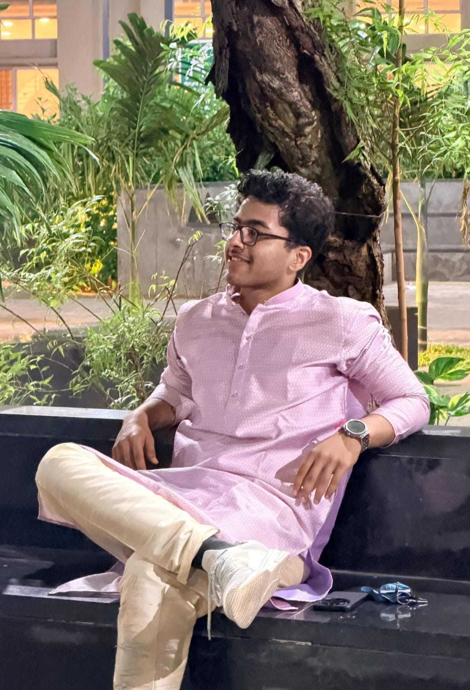

# Project Handoff Document v3.0: Suyash Sharma — 3D Disassembling Laptop & Editorial Portfolio (`My-Portfolio`)

**Document Name:** `handoff-v3.md`  
**Version:** 3.0 (All 8 User Refinements Implemented)  
**Repository:** `https://github.com/suyashcodemaster/My-Portfolio`  
**Live Production URL:** `https://suyashcodemaster.vercel.app`  
**Primary Working Directory:** `E:\Website Portfolio\My-Portfolio`

---

## 1. Summary of the 8 Changes Implemented in v3.0

1. **Single-Line Hero Name + Intact Portrait Size (`#section-hero`)**:
   - Forced `SUYASH` `[Portrait Photo]` `SHARMA` onto **one single horizontal line** (`flex-wrap: nowrap; white-space: nowrap; font-size: clamp(2.1rem, 6.6vw, 7.2rem);`) while preserving the exact portrait dimensions (`width: clamp(140px, 18vw, 280px); height: clamp(180px, 23vw, 360px);`).
2. **Removed CSE Undergrad Tagline on Landing Page**:
   - Removed the `COMPUTER SCIENCE UNDERGRADUATE AT VIT // FULL-STACK & AI SYSTEMS BUILDER` line and top HUD clutter so the landing page is clean and minimal like the template repository (`Jishnu09-siuu/analog-editorial-portfolio`).
3. **Dramatic 3D Laptop Part Separation & Explicit Hardware-to-Section Matching (`#section-laptop`)**:
   - Increased explosion spread distances across X, Y, and Z axes by more than 2.5× so the 6 laptop subsystems (`Display Lid`, `Logic Board & CPU Core`, `Keyboard Matrix`, `Left & Right Acoustic Speakers`, `Precision Touchpad`, and `Battery & Unibody Chassis`) separate cleanly with generous air space.
   - Changed the disassembly curve from `Math.sin(progress * Math.PI)` (which previously re-closed the laptop at the end of scroll) to a monotonic ease-out explosion curve so the laptop **stays fully disassembled** at scroll completion.
   - Added a real-time 3D-projected hardware callout (`#part-link-callout`) and `HARDWARE MATCH` badge that visually connects each 3D laptop part to its corresponding section (*Display → About Me / Vision*, *Logic Board & CPU → The Mission*, *Keyboard Matrix → Technical Skills*, *Acoustic Speakers → Languages I Know*, *Power Core → Courses & Achievements*).
4. **Detached 3D Touchpad with Floating "Download CV" Button at Scroll Completion (Removed All Curriculum Vitae Text)**:
   - Removed the `Curriculum Vitae` text stage (`05 // PRECISION GLASS TOUCHPAD`, title, and description cards) completely.
   - When the scrollable disassembly animation finishes (`progress >= 0.78`), the 3D Touchpad detaches forward toward the viewer and a sleek **`Download CV`** button (`#touchpad-cv-overlay`) appears directly on top of the 3D touchpad's projected coordinates (clicking either the button or the 3D touchpad mesh downloads `Suyash-CV.pdf`).
5. **Mathematics & Mental Math Updated to Class 2 – 10 with Inter- and Intra-School 50+ Teams**:
   - Updated the achievement card under *Courses & Achievements* to:
     - **Heading**: `Mathematics & Mental Math (Class 2 – 10)`
     - **Text**: `Won multiple inter- and intra-school mathematics and mental math competitions competing against 50+ teams`
6. **Scroll-Animated 35mm Camera Reel (`#section-reel`)**:
   - Converted the Hobbies & Aspirations section into a `360vh` vertical-scroll-pinned horizontal 35mm camera film reel (`ScrollTrigger` scrub).
   - As you scroll down, the 35mm film strip glides across the viewport and sequentially reveals `FRAME 01A`, `02A`, `03A`, `04A`, `05A`, `06A`, and `07A` with a live exposure counter.
7. **8 Stacked Library-Book Project Layers (`#section-projects`)**:
   - Replaced the flat 5-column grid with an **8-layer stacked library-book shelf layout** (`01` through `08`).
   - **Layer 01 (`01 // SANITX`)**: Open, interactive volume displaying SanitX with its GitHub-linked shield logo, DevJams '26 Top 11 badge, tech stack pills, and architecture highlights.
   - **Layers 02–08 (`02` through `08`)**: 7 overlapping, tucked library-book layers (`margin-left: -24px`) containing only their vertical spine number (`02`–`08`) and a clean matte-grey photo frame (`.grey-photo-frame`), with `pointer-events: none` (completely non-interactive and zero placeholder text).
8. **Seamless Transition & Separate Minimalist White Contact Section (Julian Garner Style)**:
   - Removed the `04 // COMMS DIRECT INTERFACE` / `INTERACTIVE TERMINAL` / `Let's Talk` headings and dark terminal window chrome.
   - Added a seamless gradient transition (`.dark-to-white-transition`) into a dedicated minimalist warm-white section (`#section-contact`, background `#f7f6f2`, ink `#141413`) with clean Julian Garner–style conversational bubbles, minimalist pill prompts, and understated footer links.

---

## 2. Updated Source Files (Drop Directly into `E:\Website Portfolio\My-Portfolio`)

### File 1: `data/portfolioData.js`
```javascript
export const PORTFOLIO_DATA = {
  profile: {
    firstName: "SUYASH",
    lastName: "SHARMA",
    photoUrl: "./suyash-photo.jpeg",
    cvUrl: "./Suyash-CV.pdf",
    cvDownloadName: "Suyash-Sharma-CV.pdf",
    email: "sharma.suyash.in@gmail.com",
    phone: "+91 7888222223",
    linkedin: "https://linkedin.com/in/suyashsharmadev",
    github: "https://github.com/suyashcodemaster",
    location: "Vellore, Tamil Nadu & Pune, India"
  },

  // 5 Core Developer & Person Disassembly Stages
  // (At scroll completion, the 3D Touchpad detaches forward with the Download CV button directly on it)
  laptopStages: [
    {
      id: "about",
      partKey: "display",
      partLabel: "DISPLAY PANEL & OPTICS",
      traitLabel: "VISION & FOUNDATION",
      index: "01 // DISPLAY SUBSYSTEM",
      title: "About Me",
      accent: "#38bdf8",
      summary: "Computer Science & Engineering undergraduate combining strong academic foundations with hands-on full-stack engineering and AI security architecture.",
      cards: [
        {
          heading: "Vellore Institute of Technology (VIT)",
          sub: "B.Tech in Computer Science & Engineering • July 2026 – May 2030",
          meta: "Tamil Nadu, India"
        },
        {
          heading: "Mahaveer English Medium School",
          sub: "Class XII, CBSE Board",
          meta: "Grade: A1"
        },
        {
          heading: "Delhi Public School, Pune",
          sub: "Class X, CBSE Board",
          meta: "Grade: A1"
        }
      ],
      pillsTitle: "Core Soft Skills",
      pills: [
        "Communication", "Adaptability & Flexibility", "Problem Solving",
        "Teamwork", "Leadership", "Critical Thinking", "Work Ethic & Dependability"
      ]
    },
    {
      id: "mission",
      partKey: "logicBoard",
      partLabel: "LOGIC BOARD & CPU SILICON",
      traitLabel: "CORE PROCESSING & MINDSET",
      index: "02 // LOGIC BOARD & CPU CORE",
      title: "The Mission",
      accent: "#a855f7",
      quote: "My goal is to pair hard work with smart planning to ensure my engineering efforts are highly targeted and deliver the best possible results. Whether managing a team or competing as a regional basketball player, I have learned to adapt quickly and view challenges from multiple perspectives. I am dedicated to bringing this adaptability and grassroots approach to every technical solution I build.",
      pillsTitle: "Core Engineering Pillars",
      pills: ["Targeted Execution", "Cross-Perspective Thinking", "Team Synergy", "Grassroots Problem Solving"]
    },
    {
      id: "skills",
      partKey: "keyboard",
      partLabel: "MECHANICAL KEYBOARD MATRIX",
      traitLabel: "EXECUTION & TOOLKIT",
      index: "03 // KEYBOARD MATRIX & ENGINE",
      title: "Technical Skills",
      accent: "#10b981",
      skillGroups: [
        { label: "Programming Languages", color: "#10b981", items: ["Python", "C", "SQL", "JavaScript", "TypeScript", "HTML/CSS"] },
        { label: "Currently Learning", color: "#f59e0b", items: ["Python", "C++", "Data Structures & Algorithms (DSA)", "Artificial Intelligence"] },
        { label: "Frameworks", color: "#38bdf8", items: ["FastAPI", "Next.js", "React", "Node.js", "Flask", "Tailwind CSS"] },
        { label: "Libraries", color: "#a855f7", items: ["pandas", "NumPy", "Matplotlib", "PyMuPDF"] },
        { label: "Developer Tools", color: "#f43f5e", items: ["Git", "GitHub", "Docker", "VS Code", "Visual Studio", "PyCharm"] }
      ]
    },
    {
      id: "languages",
      partKey: "speakers",
      partLabel: "ACOUSTIC TRANSDUCERS & I/O",
      traitLabel: "VOICE & COLLABORATION",
      index: "04 // ACOUSTIC & I/O ARRAY",
      title: "Languages I Know",
      accent: "#f59e0b",
      summary: "Spoken human languages that power clear cross-functional collaboration, technical presentations, and team leadership.",
      cards: [
        {
          heading: "English",
          sub: "Full Professional & Academic Fluency",
          meta: "Primary Technical & Collaborative Medium"
        },
        {
          heading: "Hindi",
          sub: "Native / Bilingual Proficiency",
          meta: "Native Spoken & Written Fluency"
        }
      ]
    },
    {
      id: "achievements",
      partKey: "battery",
      partLabel: "POWER CORE & UNIBODY CHASSIS",
      traitLabel: "ENDURANCE & MILESTONES",
      index: "05 // POWER CORE & ARCHIVAL STORAGE",
      title: "Courses & Achievements",
      accent: "#6366f1",
      cards: [
        {
          heading: "CS50x: Introduction to Computer Science",
          sub: "Harvard University (HarvardX)",
          meta: "In Progress"
        },
        {
          heading: "AWS Workshop Certificate: Cloud Intelligence",
          sub: "Amazon Web Services",
          meta: "Certified"
        },
        {
          heading: "Basketball (Class 5 – 8)",
          sub: "Won multiple basketball competitions and competed at the District Level",
          meta: "Athletics"
        },
        {
          heading: "Mathematics & Mental Math (Class 2 – 10)",
          sub: "Won multiple inter- and intra-school mathematics and mental math competitions competing against 50+ teams",
          meta: "Competitive Math"
        }
      ]
    }
  ],

  // Section 3: Scroll-Animated 35mm Camera Reel — Hobbies & Aspirations
  reelFrames: [
    { frame: "01A", title: "Human Connections", tag: "COMMUNITY", color: "#f43f5e", desc: "Building meaningful connections with people, collaborating across diverse teams, and sharing ideas." },
    { frame: "02A", title: "Space & Aviation", tag: "AEROSPACE", color: "#38bdf8", desc: "Deep fascination with orbital mechanics, aircraft engineering, and the frontier of flight." },
    { frame: "03A", title: "Basketball & Sports", tag: "COMPETITION", color: "#f59e0b", desc: "District-level basketball player bringing court vision, composure, and fast adaptation to every challenge." },
    { frame: "04A", title: "Martial Arts", tag: "DISCIPLINE", color: "#10b981", desc: "Practicing martial arts for mental focus, kinetic precision, and resilience under pressure." },
    { frame: "05A", title: "Finance & Markets", tag: "STRATEGY", color: "#a855f7", desc: "Studying market dynamics, capital allocation, and quantitative decision-making." },
    { frame: "06A", title: "Nature, Animals & Travel", tag: "EXPLORATION", color: "#2dd4bf", desc: "Exploring new geographies, appreciating wildlife, and staying grounded in the natural world." },
    { frame: "07A", title: "Gaming & AI Aspirations", tag: "FUTURE", color: "#6366f1", desc: "Exploring interactive virtual worlds while aspiring to architect safe, high-impact AI systems." }
  ],

  // Section 4: 8 Stacked Library-Book Project Layers (Layer 01 Active + Layers 02-08 Non-Interactive Grey Photo Frames)
  projects: [
    {
      slot: "01",
      isPlaceholder: false,
      title: "SanitX",
      category: "AI SECURITY // FULL-STACK",
      subtitle: "DevJams '26 Hackathon • Reached Review 3 (Top 11 Teams)",
      accent: "#10b981",
      githubUrl: "https://github.com/suyashcodemaster/SanitX",
      tech: ["Python", "FastAPI", "PyMuPDF", "Gemini API", "Next.js", "TypeScript", "Tailwind CSS"],
      bullets: [
        "Built a document security tool with a team that detects prompt injection hidden inside PDF and Markdown files before they reach an AI system.",
        "Engineered a two-layer pipeline: a rule-based scanner for tiny text, low-contrast text, and hidden content, followed by Gemini analysis deciding document safety.",
        "Contributed across the stack: ideation, FastAPI backend, Next.js frontend, and designing and presenting the system architecture."
      ]
    },
    { slot: "02", isPlaceholder: true },
    { slot: "03", isPlaceholder: true },
    { slot: "04", isPlaceholder: true },
    { slot: "05", isPlaceholder: true },
    { slot: "06", isPlaceholder: true },
    { slot: "07", isPlaceholder: true },
    { slot: "08", isPlaceholder: true }
  ],

  // Section 5: Minimalist White Contact Section (Julian Garner Style)
  chat: {
    introMessages: [
      "Hey, I'm Suyash.",
      "Thanks for scrolling through. Feel free to reach out or grab anything you need below."
    ],
    prompts: [
      {
        id: "contact",
        label: "How can I reach you?",
        replyHtml: `You can email me directly at <a href="mailto:sharma.suyash.in@gmail.com">sharma.suyash.in@gmail.com</a> or call/message <a href="tel:+917888222223">+91 7888222223</a>.<br><br>I'm also on <a href="https://linkedin.com/in/suyashsharmadev" target="_blank" rel="noopener">LinkedIn ↗</a> and <a href="https://github.com/suyashcodemaster" target="_blank" rel="noopener">GitHub ↗</a>.`
      },
      {
        id: "cv",
        label: "Can I grab a copy of your CV?",
        replyHtml: `Of course — here is the direct PDF download:<br><br><a href="./Suyash-CV.pdf" download="Suyash-Sharma-CV.pdf" class="minimal-cv-link">Download Suyash-Sharma-CV.pdf ↓</a>`
      },
      {
        id: "current",
        label: "What are you focused on right now?",
        replyHtml: `I'm pursuing my B.Tech in CSE at VIT Vellore while diving deeper into C++, Data Structures & Algorithms, and Applied AI alongside Harvard's CS50x.`
      },
      {
        id: "hire",
        label: "Let's collaborate on a project",
        replyHtml: `I'd love that. I'm always open to internships, hackathons, and building thoughtful software. <a href="mailto:sharma.suyash.in@gmail.com?subject=Hey%20Suyash%20—%20Let's%20Build%20Together">Send me an email ↗</a>`
      }
    ]
  }
};
```

### File 2: `index.html`
```html
<!DOCTYPE html>
<html lang="en">
<head>
  <meta charset="UTF-8" />
  <meta name="viewport" content="width=device-width, initial-scale=1.0" />
  <title>Suyash Sharma — Portfolio</title>
  <link rel="icon" type="image/svg+xml" href="./favicon.svg" />
  <link rel="preconnect" href="https://fonts.googleapis.com">
  <link rel="preconnect" href="https://fonts.gstatic.com" crossorigin>
  <link href="https://fonts.googleapis.com/css2?family=Instrument+Serif:ital@0;1&family=Inter:wght@300;400;500;600&family=JetBrains+Mono:wght@400;500;600&display=swap" rel="stylesheet">
  <link rel="stylesheet" href="./styles/main.css" />
  <!-- Three.js & GSAP + ScrollTrigger CDN -->
  <script src="https://cdnjs.cloudflare.com/ajax/libs/three.js/r128/three.min.js" defer></script>
  <script src="https://cdnjs.cloudflare.com/ajax/libs/gsap/3.12.5/gsap.min.js" defer></script>
  <script src="https://cdnjs.cloudflare.com/ajax/libs/gsap/3.12.5/ScrollTrigger.min.js" defer></script>
  <script type="module" src="./scripts/main.js" defer></script>
</head>
<body>
  <div class="grain-overlay" aria-hidden="true"></div>

  <!-- 1. HERO SECTION (Clean like template repository: single-line name + inline photo, no tagline) -->
  <section id="section-hero" class="hero-section">
    <div class="hero-center">
      <h1 class="hero-title">
        <span id="hero-first">SUYASH</span>
        <span class="hero-photo-frame">
          
        </span>
        <span id="hero-last">SHARMA</span>
      </h1>
    </div>

    <!-- Bottom-Left Direct Jump Button -->
    <a href="#section-projects" id="btn-jump-projects" class="hero-projects-btn">
      <span class="mono-index">01 // ARCHIVE</span>
      <span class="btn-main-text">JUMP TO PROJECTS ↓</span>
    </a>

    <!-- Bottom-Center Scroll Prompt -->
    <div class="hero-scroll-indicator">
      <span class="mono-tag">SCROLL TO DISASSEMBLE</span>
      <div class="scroll-line"><div class="scroll-pulse"></div></div>
    </div>
  </section>

  <!-- 2. 3D LAPTOP DISASSEMBLY SCROLLABLE SECTION -->
  <section id="section-laptop" class="laptop-section">
    <div class="laptop-sticky-viewport">
      <canvas id="laptop-canvas"></canvas>

      <!-- Live 3D Part-to-Section Callout Overlay (Visibly connects disassembled part to what makes Suyash who he is) -->
      <div id="part-link-callout" class="part-link-callout" aria-hidden="true">
        <span class="callout-dot"></span>
        <span class="callout-line"></span>
        <div class="callout-badge">
          <span id="callout-part-name" class="callout-part">DISPLAY PANEL &amp; OPTICS</span>
          <span id="callout-trait-name" class="callout-trait">→ VISION &amp; FOUNDATION</span>
        </div>
      </div>

      <!-- Hover Tooltip for 3D Disassembled Parts -->
      <div id="part-hover-tooltip" class="part-hover-tooltip" aria-hidden="true"></div>

      <!-- Detached 3D Touchpad "Download CV" Button (Appears directly on the disassembled touchpad when scroll completes) -->
      <div id="touchpad-cv-overlay" class="touchpad-cv-overlay">
        <a id="touchpad-cv-anchor" href="./Suyash-CV.pdf" download="Suyash-Sharma-CV.pdf" class="touchpad-floating-btn">
          <span class="touchpad-btn-dot"></span>
          <span>Download CV</span>
        </a>
      </div>

      <div class="stage-progress-bar">
        <div id="stage-dots" class="stage-dots"></div>
      </div>
    </div>

    <!-- Scroll Stages + Final Full Disassembly Hold Stage for Touchpad CV -->
    <div id="laptop-stages-container" class="laptop-stages-container"></div>
  </section>

  <!-- 3. SCROLL-ANIMATED 35MM CAMERA REEL SECTION (HOBBIES & ASPIRATIONS) -->
  <section id="section-reel" class="reel-scroll-section">
    <div class="reel-sticky-viewport">
      <div class="reel-top-bar">
        <div>
          <span class="mono-tag" style="color:#f59e0b;">02 // 35MM ARCHIVAL FILM REEL</span>
          <h2 class="section-heading">Hobbies &amp; Aspirations</h2>
        </div>
        <div class="reel-counter-box">
          <span class="mono-tag">ACTIVE EXPOSURE</span>
          <span id="reel-active-indicator" class="reel-counter-val">FRAME 01A / 07A</span>
        </div>
      </div>

      <div class="film-strip-stage">
        <div class="film-strip-wrapper" id="film-strip-wrapper">
          <div class="film-edge-code top-edge">
            <span>KODAK 400TX // SUYASH ARCHIVE</span>
            <span>► 01A</span><span>► 02A</span><span>► 03A</span><span>► 04A</span><span>► 05A</span><span>► 06A</span><span>► 07A</span>
          </div>
          <div class="sprocket-row"></div>
          <div id="reel-track" class="reel-track"></div>
          <div class="sprocket-row"></div>
          <div class="film-edge-code bottom-edge">
            <span>SAFETY FILM 5063</span>
            <span>SCROLL DOWN TO ADVANCE REEL ──►</span>
          </div>
        </div>
      </div>

      <div class="reel-progress-bar-wrap">
        <div id="reel-progress-fill" class="reel-progress-fill"></div>
      </div>
    </div>
  </section>

  <!-- 4. 8 STACKED LIBRARY-BOOK PROJECT LAYERS -->
  <section id="section-projects" class="projects-section">
    <div class="section-header-wrap">
      <span class="mono-tag" style="color:#10b981;">03 // ARCHIVAL STACK</span>
      <h2 class="section-heading">Project Layers</h2>
    </div>
    <div id="projects-stack" class="projects-library-stack"></div>
  </section>

  <!-- Seamless Visual Transition into Minimalist White Section -->
  <div class="dark-to-white-transition" aria-hidden="true"></div>

  <!-- 5. MINIMALIST WHITE CONTACT SECTION (JULIAN GARNER STYLE) -->
  <section id="section-contact" class="minimal-white-contact">
    <div class="minimal-contact-inner">
      <div class="minimal-chat-stream" id="chat-messages"></div>
      <div class="minimal-chat-prompts" id="chat-prompts"></div>

      <footer class="minimal-contact-footer">
        <a href="mailto:sharma.suyash.in@gmail.com">sharma.suyash.in@gmail.com</a>
        <span class="footer-sep">/</span>
        <a href="tel:+917888222223">+91 7888222223</a>
        <span class="footer-sep">/</span>
        <a href="https://linkedin.com/in/suyashsharmadev" target="_blank" rel="noopener">LinkedIn ↗</a>
        <span class="footer-sep">/</span>
        <a href="https://github.com/suyashcodemaster" target="_blank" rel="noopener">GitHub ↗</a>
      </footer>
    </div>
  </section>
</body>
</html>
```

### File 3: `styles/main.css`
```css
:root {
  --bg-dark: #09090d;
  --bg-panel: rgba(16, 16, 24, 0.82);
  --text-main: #f4f1ea;
  --text-muted: #9ca3af;
  --border-subtle: rgba(244, 241, 234, 0.12);
  --font-display: 'Instrument Serif', Georgia, serif;
  --font-sans: 'Inter', system-ui, -apple-system, sans-serif;
  --font-mono: 'JetBrains Mono', monospace;
}

* { box-sizing: border-box; margin: 0; padding: 0; }
html { scroll-behavior: smooth; background: var(--bg-dark); color: var(--text-main); font-family: var(--font-sans); }
body { overflow-x: hidden; background: var(--bg-dark); }

.grain-overlay {
  position: fixed; inset: 0; pointer-events: none; z-index: 999;
  opacity: 0.032;
  background-image: radial-gradient(#ffffff 1px, transparent 0);
  background-size: 24px 24px;
}

.mono-tag {
  font-family: var(--font-mono);
  font-size: 0.74rem;
  letter-spacing: 0.14em;
  text-transform: uppercase;
  color: var(--text-muted);
}

/* ==========================================================================
   1. HERO SECTION — Clean like template repo, single-line name + perfect photo
   ========================================================================== */
.hero-section {
  position: relative;
  min-height: 100vh;
  display: flex;
  align-items: center;
  justify-content: center;
  padding: 4rem 2vw;
  overflow: hidden;
  background: radial-gradient(circle at 50% 18%, #151521 0%, #09090d 72%);
}

.hero-center {
  width: 100%;
  max-width: 96vw;
  text-align: center;
  z-index: 2;
}

.hero-title {
  font-family: var(--font-display);
  font-weight: 400;
  font-size: clamp(2.1rem, 6.6vw, 7.2rem);
  line-height: 1;
  letter-spacing: -0.015em;
  display: flex;
  align-items: center;
  justify-content: center;
  flex-wrap: nowrap;
  white-space: nowrap;
  gap: clamp(0.18em, 2.2vw, 0.34em);
  width: 100%;
}

.hero-photo-frame {
  flex-shrink: 0;
  display: inline-flex;
  width: clamp(140px, 18vw, 280px);
  height: clamp(180px, 23vw, 360px);
  border-radius: 18px;
  overflow: hidden;
  border: 2px solid rgba(245, 158, 11, 0.7);
  box-shadow: 0 20px 50px rgba(0, 0, 0, 0.65), 0 0 34px rgba(245, 158, 11, 0.28);
  transition: transform 0.45s cubic-bezier(0.22, 1, 0.36, 1), border-color 0.3s;
}

.hero-photo-frame:hover {
  transform: scale(1.05) rotate(-1.5deg);
  border-color: #38bdf8;
}

.hero-photo-frame img {
  width: 100%;
  height: 100%;
  object-fit: cover;
  object-position: center 22%;
}

/* Hero Bottom-Left Jump Button & Center Scroll Indicator */
.hero-projects-btn {
  position: absolute;
  bottom: 2.5rem;
  left: 2.5rem;
  z-index: 5;
  display: flex;
  flex-direction: column;
  gap: 0.25rem;
  padding: 0.85rem 1.3rem;
  border-radius: 12px;
  text-decoration: none;
  background: rgba(255, 255, 255, 0.03);
  border: 1px solid rgba(244, 241, 234, 0.2);
  color: var(--text-main);
  transition: all 0.25s ease;
}

.hero-projects-btn:hover {
  background: var(--text-main);
  color: #09090d;
  transform: translateY(-3px);
}

.hero-projects-btn .mono-index {
  font-family: var(--font-mono);
  font-size: 0.64rem;
  opacity: 0.7;
}

.hero-projects-btn .btn-main-text {
  font-family: var(--font-mono);
  font-weight: 600;
  font-size: 0.82rem;
  letter-spacing: 0.08em;
}

.hero-scroll-indicator {
  position: absolute;
  bottom: 2rem;
  left: 50%;
  transform: translateX(-50%);
  display: flex;
  flex-direction: column;
  align-items: center;
  gap: 0.6rem;
}

.scroll-line {
  width: 2px;
  height: 48px;
  background: rgba(255, 255, 255, 0.12);
  position: relative;
  overflow: hidden;
}

.scroll-pulse {
  width: 100%;
  height: 50%;
  background: linear-gradient(180deg, transparent, #f59e0b, #38bdf8);
  animation: pulseDown 1.6s infinite ease-in-out;
}

@keyframes pulseDown {
  0% { transform: translateY(-100%); }
  100% { transform: translateY(200%); }
}

/* ==========================================================================
   2. 3D LAPTOP DISASSEMBLY SECTION — High Separation + Part Callouts + Touchpad CV
   ========================================================================== */
.laptop-section {
  position: relative;
  width: 100%;
}

.laptop-sticky-viewport {
  position: sticky;
  top: 0;
  width: 100%;
  height: 100vh;
  overflow: hidden;
  z-index: 1;
}

#laptop-canvas {
  width: 100%;
  height: 100%;
  display: block;
}

/* Dynamic 3D Part-to-Section Callout Badge */
.part-link-callout {
  position: absolute;
  left: 28%;
  top: 48%;
  transform: translate(-50%, -100%);
  display: flex;
  align-items: center;
  gap: 0.55rem;
  pointer-events: none;
  z-index: 12;
  opacity: 0;
  transition: opacity 0.35s ease;
}

.part-link-callout.visible {
  opacity: 1;
}

.callout-dot {
  width: 11px;
  height: 11px;
  border-radius: 50%;
  background: var(--callout-color, #38bdf8);
  box-shadow: 0 0 16px var(--callout-color, #38bdf8);
  position: relative;
}

.callout-dot::after {
  content: '';
  position: absolute;
  inset: -5px;
  border-radius: 50%;
  border: 1.5px solid var(--callout-color, #38bdf8);
  animation: pingRing 1.8s infinite ease-out;
}

@keyframes pingRing {
  0% { transform: scale(0.8); opacity: 0.9; }
  100% { transform: scale(1.9); opacity: 0; }
}

.callout-line {
  width: 46px;
  height: 1.5px;
  background: linear-gradient(90deg, var(--callout-color, #38bdf8), rgba(255,255,255,0.25));
}

.callout-badge {
  display: flex;
  flex-direction: column;
  gap: 0.15rem;
  padding: 0.45rem 0.8rem;
  border-radius: 8px;
  background: rgba(9, 9, 13, 0.86);
  border: 1px solid var(--callout-color, #38bdf8);
  backdrop-filter: blur(10px);
  box-shadow: 0 8px 24px rgba(0, 0, 0, 0.55);
}

.callout-part {
  font-family: var(--font-mono);
  font-size: 0.68rem;
  font-weight: 600;
  letter-spacing: 0.1em;
  color: var(--callout-color, #38bdf8);
}

.callout-trait {
  font-family: var(--font-mono);
  font-size: 0.64rem;
  letter-spacing: 0.08em;
  color: #e2e8f0;
}

/* 3D Part Hover Tooltip */
.part-hover-tooltip {
  position: fixed;
  pointer-events: none;
  z-index: 40;
  padding: 0.45rem 0.75rem;
  border-radius: 6px;
  background: rgba(9, 9, 13, 0.92);
  border: 1px solid rgba(56, 189, 248, 0.6);
  font-family: var(--font-mono);
  font-size: 0.72rem;
  color: #f4f1ea;
  letter-spacing: 0.08em;
  opacity: 0;
  transform: translate(14px, -50%);
  transition: opacity 0.15s ease;
}

.part-hover-tooltip.visible {
  opacity: 1;
}

/* Detached 3D Touchpad "Download CV" Button Overlay */
.touchpad-cv-overlay {
  position: absolute;
  left: 50%;
  top: 68%;
  transform: translate(-50%, -50%) scale(0.88);
  z-index: 30;
  opacity: 0;
  pointer-events: none;
  transition: opacity 0.4s cubic-bezier(0.22, 1, 0.36, 1), transform 0.4s cubic-bezier(0.22, 1, 0.36, 1);
}

.touchpad-cv-overlay.visible {
  opacity: 1;
  pointer-events: auto;
  transform: translate(-50%, -50%) scale(1);
}

.touchpad-floating-btn {
  display: inline-flex;
  align-items: center;
  gap: 0.65rem;
  padding: 0.8rem 1.5rem;
  border-radius: 999px;
  background: rgba(14, 14, 20, 0.9);
  border: 1.5px solid #ec4899;
  color: #f4f1ea;
  font-family: var(--font-mono);
  font-size: 0.82rem;
  font-weight: 600;
  letter-spacing: 0.08em;
  text-transform: uppercase;
  text-decoration: none;
  backdrop-filter: blur(12px);
  box-shadow: 0 12px 32px rgba(0, 0, 0, 0.7), 0 0 28px rgba(236, 72, 153, 0.45);
  transition: transform 0.25s ease, background 0.25s ease, box-shadow 0.25s ease;
}

.touchpad-floating-btn:hover {
  background: #ec4899;
  color: #09090d;
  transform: scale(1.06);
  box-shadow: 0 16px 40px rgba(236, 72, 153, 0.7);
}

.touchpad-btn-dot {
  width: 8px;
  height: 8px;
  border-radius: 50%;
  background: #ec4899;
  box-shadow: 0 0 10px #ec4899;
}

.touchpad-floating-btn:hover .touchpad-btn-dot {
  background: #09090d;
}

.stage-progress-bar {
  position: absolute;
  left: 2rem;
  top: 50%;
  transform: translateY(-50%);
  z-index: 10;
}

.stage-dots {
  display: flex;
  flex-direction: column;
  gap: 0.75rem;
}

.stage-dot {
  width: 10px;
  height: 10px;
  border-radius: 50%;
  background: rgba(255, 255, 255, 0.2);
  transition: transform 0.3s, background 0.3s;
}

.stage-dot.active {
  transform: scale(1.45);
}

.laptop-stages-container {
  position: relative;
  z-index: 5;
  margin-top: -100vh;
  pointer-events: none;
}

.laptop-stage {
  min-height: 108vh;
  display: flex;
  align-items: center;
  justify-content: flex-end;
  padding: 4rem 4.5vw;
}

/* Final Disassembly Hold Stage (Allows inspecting disassembled 3D model + detached Touchpad Download CV button) */
.laptop-stage.final-disassembly-hold {
  min-height: 115vh;
  justify-content: center;
  align-items: flex-end;
  padding-bottom: 3.5rem;
}

.stage-bento-panel {
  pointer-events: auto;
  width: min(50vw, 680px);
  padding: 2.5rem;
  border-radius: 24px;
  background: var(--bg-panel);
  backdrop-filter: blur(20px);
  border: 1px solid var(--stage-accent, #38bdf8);
  box-shadow: 0 24px 60px rgba(0, 0, 0, 0.65), 0 0 40px color-mix(in srgb, var(--stage-accent, #38bdf8) 16%, transparent);
  display: flex;
  flex-direction: column;
  justify-content: center;
  gap: 1.4rem;
}

.stage-part-chip {
  display: inline-flex;
  align-items: center;
  gap: 0.5rem;
  align-self: flex-start;
  padding: 0.35rem 0.75rem;
  border-radius: 999px;
  background: rgba(255, 255, 255, 0.04);
  border: 1px solid var(--stage-accent, #38bdf8);
  font-family: var(--font-mono);
  font-size: 0.7rem;
  color: var(--stage-accent, #38bdf8);
  letter-spacing: 0.08em;
}

.stage-title {
  font-family: var(--font-display);
  font-size: clamp(2.3rem, 3.8vw, 3.4rem);
  font-weight: 400;
  line-height: 1.05;
}

.stage-summary {
  font-size: 1.02rem;
  line-height: 1.65;
  color: #d1d5db;
}

.stage-quote {
  font-family: var(--font-display);
  font-size: clamp(1.4rem, 2.1vw, 1.85rem);
  line-height: 1.45;
  color: #ffffff;
  border-left: 4px solid var(--stage-accent);
  padding-left: 1.25rem;
}

.stage-cards-grid {
  display: grid;
  grid-template-columns: repeat(auto-fit, minmax(210px, 1fr));
  gap: 0.95rem;
}

.stage-subcard {
  padding: 1.1rem;
  border-radius: 14px;
  background: rgba(255, 255, 255, 0.035);
  border: 1px solid rgba(255, 255, 255, 0.1);
}

.stage-subcard h4 {
  font-size: 0.98rem;
  color: #fff;
  margin-bottom: 0.3rem;
}

.stage-subcard p {
  font-size: 0.85rem;
  color: #9ca3af;
  line-height: 1.45;
}

.stage-subcard .subcard-meta {
  display: inline-block;
  margin-top: 0.55rem;
  font-family: var(--font-mono);
  font-size: 0.71rem;
  color: var(--stage-accent);
}

.skill-groups-wrap {
  display: flex;
  flex-direction: column;
  gap: 0.95rem;
}

.skill-group-row {
  display: flex;
  flex-direction: column;
  gap: 0.42rem;
}

.skill-group-label {
  font-family: var(--font-mono);
  font-size: 0.74rem;
  font-weight: 600;
}

.pills-wrap {
  display: flex;
  flex-wrap: wrap;
  gap: 0.5rem;
}

.color-pill {
  padding: 0.42rem 0.85rem;
  border-radius: 8px;
  font-family: var(--font-mono);
  font-size: 0.78rem;
  background: rgba(255, 255, 255, 0.05);
  border: 1px solid var(--pill-color, #38bdf8);
  color: #fff;
  box-shadow: inset 0 0 12px color-mix(in srgb, var(--pill-color, #38bdf8) 20%, transparent);
  transition: transform 0.2s;
}

.color-pill:hover {
  transform: translateY(-2px);
  background: var(--pill-color, #38bdf8);
  color: #09090d;
  font-weight: 600;
}

/* ==========================================================================
   3. SCROLL-ANIMATED 35MM CAMERA REEL (HOBBIES & ASPIRATIONS)
   ========================================================================== */
.reel-scroll-section {
  position: relative;
  height: 360vh;
  z-index: 5;
}

.reel-sticky-viewport {
  position: sticky;
  top: 0;
  height: 100vh;
  width: 100%;
  overflow: hidden;
  display: flex;
  flex-direction: column;
  justify-content: space-between;
  padding: 4.5rem 0 3.5rem;
  background: radial-gradient(circle at 50% 50%, #12121c 0%, #09090d 78%);
}

.reel-top-bar {
  display: flex;
  justify-content: space-between;
  align-items: flex-end;
  padding: 0 4.5vw;
}

.section-heading {
  font-family: var(--font-display);
  font-size: clamp(2.5rem, 4.5vw, 4rem);
  font-weight: 400;
  margin-top: 0.3rem;
}

.reel-counter-box {
  display: flex;
  flex-direction: column;
  align-items: flex-end;
  gap: 0.25rem;
}

.reel-counter-val {
  font-family: var(--font-mono);
  font-size: 0.95rem;
  font-weight: 600;
  color: #f59e0b;
  letter-spacing: 0.1em;
}

.film-strip-stage {
  width: 100%;
  overflow: hidden;
  display: flex;
  align-items: center;
  padding: 1rem 0;
}

.film-strip-wrapper {
  background: #0e0e13;
  border-top: 2px solid #2b2b36;
  border-bottom: 2px solid #2b2b36;
  padding: 0.65rem 0;
  width: max-content;
  box-shadow: 0 28px 70px rgba(0, 0, 0, 0.85);
  will-change: transform;
  transform: rotate(-1.2deg);
}

.film-edge-code {
  display: flex;
  justify-content: space-between;
  padding: 0.15rem 3rem;
  font-family: var(--font-mono);
  font-size: 0.64rem;
  letter-spacing: 0.18em;
  color: rgba(245, 158, 11, 0.72);
}

.sprocket-row {
  height: 18px;
  margin: 0.35rem 0;
  background-image: repeating-linear-gradient(
    90deg,
    transparent 0 14px,
    #050507 14px 32px
  );
  border-top: 1px solid rgba(255, 255, 255, 0.05);
  border-bottom: 1px solid rgba(255, 255, 255, 0.05);
}

.reel-track {
  display: flex;
  gap: 2.25rem;
  padding: 1.5rem 12vw;
  min-width: max-content;
}

.reel-card {
  width: 350px;
  min-height: 280px;
  padding: 1.85rem;
  border-radius: 14px;
  background: #15151f;
  border-top: 4px solid var(--frame-color);
  border-left: 1px solid rgba(255, 255, 255, 0.08);
  border-right: 1px solid rgba(255, 255, 255, 0.08);
  border-bottom: 1px solid rgba(255, 255, 255, 0.08);
  display: flex;
  flex-direction: column;
  justify-content: space-between;
  gap: 1.15rem;
  opacity: 0.18;
  transform: scale(0.92) translateY(16px);
  filter: grayscale(0.85) brightness(0.5);
  transition: opacity 0.45s ease, transform 0.45s cubic-bezier(0.22, 1, 0.36, 1), filter 0.45s ease, box-shadow 0.45s ease;
}

.reel-card.revealed {
  opacity: 1;
  transform: scale(1) translateY(0);
  filter: grayscale(0) brightness(1);
  box-shadow: 0 20px 45px rgba(0, 0, 0, 0.6), 0 0 32px color-mix(in srgb, var(--frame-color) 20%, transparent);
}

.reel-frame-meta {
  display: flex;
  justify-content: space-between;
  font-family: var(--font-mono);
  font-size: 0.74rem;
  font-weight: 600;
  color: var(--frame-color);
}

.reel-card-body {
  display: flex;
  flex-direction: column;
  gap: 0.65rem;
}

.reel-card h3 {
  font-family: var(--font-display);
  font-size: 2rem;
  font-weight: 400;
  color: #ffffff;
}

.reel-card p {
  font-size: 0.94rem;
  line-height: 1.6;
  color: #cbd5e1;
}

.reel-frame-footer {
  display: flex;
  justify-content: space-between;
  align-items: center;
  padding-top: 0.75rem;
  border-top: 1px dashed rgba(255, 255, 255, 0.1);
  font-family: var(--font-mono);
  font-size: 0.66rem;
  color: #64748b;
}

.reel-progress-bar-wrap {
  margin: 0 4.5vw;
  height: 3px;
  background: rgba(255, 255, 255, 0.1);
  border-radius: 999px;
  overflow: hidden;
}

.reel-progress-fill {
  width: 14%;
  height: 100%;
  background: linear-gradient(90deg, #f43f5e, #f59e0b, #10b981, #38bdf8, #a855f7);
  transition: width 0.12s linear;
}

/* ==========================================================================
   4. 8 STACKED LIBRARY-BOOK PROJECT LAYERS (Template Repo Style)
   ========================================================================== */
.projects-section {
  padding: 6.5rem 4.5vw 7.5rem;
  position: relative;
  z-index: 5;
}

.section-header-wrap {
  margin-bottom: 2.75rem;
}

/* Library-Shelf Stacked Accordion / Overlapping Spine Rack (8 Layers) */
.projects-library-stack {
  display: flex;
  align-items: stretch;
  width: 100%;
  min-height: 540px;
  gap: 0;
  perspective: 1400px;
}

/* Layer 01: Featured Open Book / Active Layer (SanitX) */
.library-layer {
  position: relative;
  border-radius: 18px;
  transition: transform 0.4s cubic-bezier(0.22, 1, 0.36, 1), box-shadow 0.4s ease;
}

.library-layer.active-book {
  flex: 1 1 540px;
  max-width: 640px;
  z-index: 20;
  background: linear-gradient(155deg, rgba(16, 185, 129, 0.13), rgba(16, 16, 24, 0.98));
  border: 1.5px solid #10b981;
  box-shadow: 18px 0 45px rgba(0, 0, 0, 0.75), 0 0 38px rgba(16, 185, 129, 0.16);
  display: flex;
  overflow: hidden;
}

.library-layer.active-book:hover {
  transform: translateY(-6px);
}

.book-spine {
  width: 52px;
  flex-shrink: 0;
  border-right: 1px solid rgba(255, 255, 255, 0.1);
  background: rgba(9, 9, 13, 0.65);
  display: flex;
  flex-direction: column;
  align-items: center;
  justify-content: space-between;
  padding: 1.4rem 0;
}

.spine-num {
  font-family: var(--font-mono);
  font-size: 0.78rem;
  font-weight: 600;
  color: #10b981;
}

.spine-vertical-label {
  writing-mode: vertical-rl;
  transform: rotate(180deg);
  font-family: var(--font-mono);
  font-size: 0.68rem;
  letter-spacing: 0.18em;
  text-transform: uppercase;
  color: #9ca3af;
}

.book-body {
  flex: 1;
  padding: 2rem;
  display: flex;
  flex-direction: column;
  justify-content: space-between;
  gap: 1.35rem;
}

.project-logo-link {
  display: flex;
  flex-direction: column;
  align-items: center;
  justify-content: center;
  padding: 1.5rem;
  border-radius: 14px;
  background: rgba(9, 9, 13, 0.78);
  border: 1px solid rgba(16, 185, 129, 0.4);
  text-decoration: none;
  color: #fff;
  transition: border-color 0.25s, transform 0.25s;
}

.project-logo-link:hover {
  border-color: #38bdf8;
  transform: scale(1.015);
}

.project-logo-caption {
  margin-top: 0.7rem;
  font-family: var(--font-mono);
  font-size: 0.71rem;
  color: #10b981;
}

.project-bullets {
  padding-left: 1.1rem;
  display: flex;
  flex-direction: column;
  gap: 0.5rem;
  color: #d1d5db;
  font-size: 0.88rem;
  line-height: 1.52;
}

/* Layers 02–08: Stacked Not-Fully-Visible Library Books with Grey Photo Frame (Non-Interactive) */
.library-layer.stacked-book {
  flex: 1 1 88px;
  min-width: 68px;
  margin-left: -24px;
  background: linear-gradient(165deg, #1b1b22 0%, #121217 100%);
  border: 1px solid rgba(255, 255, 255, 0.11);
  box-shadow: -12px 0 28px rgba(0, 0, 0, 0.75);
  display: flex;
  overflow: hidden;
  pointer-events: none;
  user-select: none;
}

.library-layer.stacked-book .book-spine {
  width: 44px;
  background: rgba(14, 14, 19, 0.92);
  border-right: 1px solid rgba(255, 255, 255, 0.06);
}

.library-layer.stacked-book .spine-num {
  color: #71717a;
}

.library-layer.stacked-book .spine-vertical-label {
  color: #52525b;
}

.stacked-book-inner {
  flex: 1;
  padding: 1.35rem 0.9rem;
  display: flex;
  align-items: center;
  justify-content: center;
  background: #15151b;
}

/* Matte Grey Photo Frame inside Stacked Non-Interactive Layers */
.grey-photo-frame {
  width: 100%;
  height: 100%;
  border-radius: 10px;
  background: linear-gradient(145deg, #26262e 0%, #1d1d24 100%);
  border: 1px solid rgba(255, 255, 255, 0.08);
  box-shadow: inset 0 2px 12px rgba(0, 0, 0, 0.45);
  position: relative;
  overflow: hidden;
}

.grey-photo-frame::after {
  content: '';
  position: absolute;
  inset: 10px;
  border-radius: 6px;
  background: #222229;
  border: 1px solid rgba(255, 255, 255, 0.04);
}

/* ==========================================================================
   5. SEAMLESS TRANSITION & MINIMALIST WHITE CONTACT SECTION (Julian Garner Style)
   ========================================================================== */
.dark-to-white-transition {
  width: 100%;
  height: 160px;
  background: linear-gradient(180deg, #09090d 0%, #f7f6f2 100%);
}

.minimal-white-contact {
  background: #f7f6f2;
  color: #141413;
  min-height: 88vh;
  display: flex;
  align-items: center;
  justify-content: center;
  padding: 5.5rem 5vw 4.5rem;
  position: relative;
  z-index: 10;
}

.minimal-contact-inner {
  width: 100%;
  max-width: 660px;
  display: flex;
  flex-direction: column;
  gap: 2.25rem;
}

.minimal-chat-stream {
  display: flex;
  flex-direction: column;
  gap: 0.85rem;
  min-height: 220px;
}

.minimal-bubble {
  max-width: 82%;
  padding: 0.95rem 1.35rem;
  border-radius: 22px;
  font-size: 1.02rem;
  line-height: 1.55;
  letter-spacing: -0.01em;
  animation: minimalFadeUp 0.35s cubic-bezier(0.22, 1, 0.36, 1) forwards;
}

@keyframes minimalFadeUp {
  from { opacity: 0; transform: translateY(10px); }
  to { opacity: 1; transform: translateY(0); }
}

.minimal-bubble.bot {
  align-self: flex-start;
  background: #e9e7e0;
  color: #141413;
  border-bottom-left-radius: 6px;
}

.minimal-bubble.bot a {
  color: #141413;
  font-weight: 500;
  text-decoration: underline;
  text-underline-offset: 3px;
}

.minimal-bubble.user {
  align-self: flex-end;
  background: #141413;
  color: #f7f6f2;
  border-bottom-right-radius: 6px;
}

.minimal-cv-link {
  display: inline-block;
  margin-top: 0.25rem;
  padding: 0.5rem 1rem;
  border-radius: 999px;
  background: #141413;
  color: #f7f6f2 !important;
  text-decoration: none !important;
  font-size: 0.88rem;
  font-weight: 500;
}

/* Typing dots for minimalist white chat */
.minimal-typing {
  align-self: flex-start;
  display: inline-flex;
  align-items: center;
  gap: 5px;
  padding: 0.9rem 1.2rem;
  border-radius: 20px;
  border-bottom-left-radius: 6px;
  background: #e9e7e0;
}

.minimal-typing span {
  width: 6px;
  height: 6px;
  border-radius: 50%;
  background: #78756e;
  animation: minimalBounce 1.2s infinite ease-in-out;
}

.minimal-typing span:nth-child(2) { animation-delay: 0.15s; }
.minimal-typing span:nth-child(3) { animation-delay: 0.3s; }

@keyframes minimalBounce {
  0%, 80%, 100% { transform: translateY(0); opacity: 0.45; }
  40% { transform: translateY(-4px); opacity: 1; }
}

.minimal-chat-prompts {
  display: flex;
  flex-wrap: wrap;
  gap: 0.6rem;
}

.minimal-prompt-pill {
  padding: 0.68rem 1.2rem;
  border-radius: 999px;
  background: #ffffff;
  border: 1px solid #d5d2c8;
  color: #141413;
  font-family: var(--font-sans);
  font-size: 0.92rem;
  font-weight: 400;
  cursor: pointer;
  transition: all 0.2s ease;
}

.minimal-prompt-pill:hover {
  background: #141413;
  border-color: #141413;
  color: #f7f6f2;
  transform: translateY(-1px);
}

.minimal-contact-footer {
  margin-top: 2rem;
  padding-top: 1.75rem;
  border-top: 1px solid #dfdcd3;
  display: flex;
  flex-wrap: wrap;
  align-items: center;
  gap: 0.75rem;
  font-size: 0.88rem;
  color: #6e6b64;
}

.minimal-contact-footer a {
  color: #141413;
  text-decoration: none;
  transition: opacity 0.2s;
}

.minimal-contact-footer a:hover {
  opacity: 0.6;
}

.footer-sep {
  color: #c4c0b6;
}

@media (max-width: 980px) {
  .stage-bento-panel { width: 92vw; }
  .part-link-callout { display: none; }
  .projects-library-stack { flex-direction: column; gap: 0.75rem; }
  .library-layer.active-book { max-width: 100%; }
  .library-layer.stacked-book {
    margin-left: 0;
    margin-top: -14px;
    min-height: 84px;
  }
}
```

### File 4: `scripts/laptop3d.js`
```javascript
export function initLaptop3D(canvas, onTouchpadClick, onPartHover, onScreenProjectUpdate) {
  const scene = new THREE.Scene();
  const camera = new THREE.PerspectiveCamera(42, window.innerWidth / window.innerHeight, 0.1, 100);
  camera.position.set(0, 1.35, 6.2);

  const renderer = new THREE.WebGLRenderer({ canvas, antialias: true, alpha: true });
  renderer.setSize(window.innerWidth, window.innerHeight);
  renderer.setPixelRatio(Math.min(window.devicePixelRatio, 2));
  renderer.toneMapping = THREE.ACESFilmicToneMapping;
  renderer.toneMappingExposure = 1.15;

  // Dynamic Multi-Point Lighting
  const ambient = new THREE.AmbientLight(0xffffff, 0.75);
  const keyLight = new THREE.DirectionalLight(0x38bdf8, 2.0);
  keyLight.position.set(4, 7, 6);
  const rimLight = new THREE.DirectionalLight(0xa855f7, 1.4);
  rimLight.position.set(-5, 3, -4);
  const accentLight = new THREE.PointLight(0xf59e0b, 2.5, 16);
  accentLight.position.set(-2.5, 2, 4);
  scene.add(ambient, keyLight, rimLight, accentLight);

  const root = new THREE.Group();
  root.position.set(-1.35, -0.1, 0);
  root.rotation.set(0.28, 0.52, 0);
  scene.add(root);

  // PBR Materials
  const matChassis = new THREE.MeshStandardMaterial({ color: 0x242734, metalness: 0.82, roughness: 0.24 });
  const matScreen = new THREE.MeshStandardMaterial({ color: 0x0b1528, emissive: 0x38bdf8, emissiveIntensity: 0.45, roughness: 0.12 });
  const matBoard = new THREE.MeshStandardMaterial({ color: 0x0e2a1f, emissive: 0x10b981, emissiveIntensity: 0.35, metalness: 0.65, roughness: 0.28 });
  const matCpu = new THREE.MeshStandardMaterial({ color: 0x3b1d5e, emissive: 0xa855f7, emissiveIntensity: 0.75, metalness: 0.7, roughness: 0.2 });
  const matCopper = new THREE.MeshStandardMaterial({ color: 0xd97706, emissive: 0xf59e0b, emissiveIntensity: 0.25, metalness: 0.88, roughness: 0.2 });
  const matKeyDeck = new THREE.MeshStandardMaterial({ color: 0x181a24, metalness: 0.7, roughness: 0.35 });
  const matKey = new THREE.MeshStandardMaterial({ color: 0x101218, emissive: 0x10b981, emissiveIntensity: 0.28, roughness: 0.35 });
  const matSpeaker = new THREE.MeshStandardMaterial({ color: 0x2e2518, emissive: 0xf59e0b, emissiveIntensity: 0.5, metalness: 0.75, roughness: 0.25 });
  const matTouchpad = new THREE.MeshStandardMaterial({ color: 0x2d122b, emissive: 0xec4899, emissiveIntensity: 0.65, roughness: 0.12, metalness: 0.55 });
  const matBattery = new THREE.MeshStandardMaterial({ color: 0x161936, emissive: 0x6366f1, emissiveIntensity: 0.45, metalness: 0.65, roughness: 0.28 });

  // 1. Display Subsystem (About Me — Vision & Foundation)
  const display = new THREE.Group();
  const lidMesh = new THREE.Mesh(new THREE.BoxGeometry(3.0, 1.92, 0.07), matChassis);
  const lcdMesh = new THREE.Mesh(new THREE.PlaneGeometry(2.82, 1.72), matScreen);
  lcdMesh.position.z = 0.04;
  const hingeMesh = new THREE.Mesh(new THREE.CylinderGeometry(0.045, 0.045, 2.2, 16), matChassis);
  hingeMesh.rotation.z = Math.PI / 2;
  hingeMesh.position.set(0, -0.95, 0);
  display.add(lidMesh, lcdMesh, hingeMesh);
  display.position.set(0, 1.02, -0.95);
  display.rotation.x = -0.16;

  // 2. Logic Board & CPU Core (The Mission — Core Processing & Mindset)
  const logicBoard = new THREE.Group();
  const pcb = new THREE.Mesh(new THREE.BoxGeometry(2.55, 0.05, 1.52), matBoard);
  const cpuDie = new THREE.Mesh(new THREE.BoxGeometry(0.62, 0.1, 0.62), matCpu);
  cpuDie.position.set(0, 0.05, -0.1);
  const heatPipe = new THREE.Mesh(new THREE.BoxGeometry(1.9, 0.04, 0.14), matCopper);
  heatPipe.position.set(0, 0.06, -0.42);
  const fanL = new THREE.Mesh(new THREE.CylinderGeometry(0.34, 0.34, 0.06, 20), matChassis);
  const fanR = fanL.clone();
  fanL.position.set(-0.78, 0.04, -0.35);
  fanR.position.set(0.78, 0.04, -0.35);
  logicBoard.add(pcb, cpuDie, heatPipe, fanL, fanR);
  logicBoard.position.set(0, 0.02, 0);

  // 3. Keyboard Matrix & Engine (Technical Skills — Execution & Toolkit)
  const keyboard = new THREE.Group();
  const deckPlate = new THREE.Mesh(new THREE.BoxGeometry(2.65, 0.03, 1.15), matKeyDeck);
  deckPlate.position.set(0, 0.08, -0.14);
  keyboard.add(deckPlate);
  for (let r = 0; r < 4; r++) {
    for (let c = 0; c < 11; c++) {
      const key = new THREE.Mesh(new THREE.BoxGeometry(0.19, 0.055, 0.19), matKey);
      key.position.set(-1.0 + c * 0.2, 0.12, -0.52 + r * 0.24);
      keyboard.add(key);
    }
  }

  // 4. Acoustic & I/O Array (Languages I Know — Voice & Collaboration)
  const speakers = new THREE.Group();
  const spkL = new THREE.Mesh(new THREE.BoxGeometry(0.28, 0.08, 1.48), matSpeaker);
  const spkR = spkL.clone();
  spkL.position.set(-1.32, 0.1, 0);
  spkR.position.set(1.32, 0.1, 0);
  speakers.add(spkL, spkR);

  // 5. Precision Glass Touchpad (Detaches at scroll end with Download CV button on it)
  const touchpad = new THREE.Group();
  const padRim = new THREE.Mesh(
    new THREE.BoxGeometry(1.06, 0.04, 0.68),
    new THREE.MeshStandardMaterial({ color: 0xf43f5e, emissive: 0xec4899, emissiveIntensity: 0.45, metalness: 0.8, roughness: 0.2 })
  );
  const padMesh = new THREE.Mesh(new THREE.BoxGeometry(1.0, 0.05, 0.62), matTouchpad);
  padRim.position.set(0, 0.11, 0.6);
  padMesh.position.set(0, 0.115, 0.6);
  padMesh.userData.isTouchpad = true;
  touchpad.add(padRim, padMesh);

  // 6. Battery & Lower Unibody Chassis (Courses & Achievements — Endurance & Milestones)
  const battery = new THREE.Group();
  const baseMesh = new THREE.Mesh(new THREE.BoxGeometry(3.0, 0.12, 2.0), matChassis);
  const cellsMesh = new THREE.Mesh(new THREE.BoxGeometry(2.35, 0.09, 0.78), matBattery);
  cellsMesh.position.set(0, -0.02, 0.42);
  baseMesh.position.y = -0.12;
  battery.add(baseMesh, cellsMesh);

  const parts = { display, logicBoard, keyboard, speakers, touchpad, battery };
  const partLabels = {
    display: "01 // DISPLAY PANEL & OPTICS — ABOUT ME",
    logicBoard: "02 // LOGIC BOARD & CPU CORE — THE MISSION",
    keyboard: "03 // KEYBOARD MATRIX — TECHNICAL SKILLS",
    speakers: "04 // ACOUSTIC TRANSDUCERS — LANGUAGES I KNOW",
    battery: "05 // POWER CORE & CELLS — ACHIEVEMENTS",
    touchpad: "PRECISION TOUCHPAD — CLICK TO DOWNLOAD CV"
  };

  Object.entries(parts).forEach(([key, group]) => {
    group.traverse((child) => {
      if (child.isMesh) {
        child.userData.partKey = key;
        child.userData.partLabel = partLabels[key];
      }
    });
    root.add(group);
  });

  // Raycaster for Hover Tooltips + 3D Touchpad Click
  const raycaster = new THREE.Raycaster();
  const mouse = new THREE.Vector2(-999, -999);

  window.addEventListener('mousemove', (e) => {
    mouse.x = (e.clientX / window.innerWidth) * 2 - 1;
    mouse.y = -(e.clientY / window.innerHeight) * 2 + 1;
    raycaster.setFromCamera(mouse, camera);
    const hits = raycaster.intersectObjects(root.children, true);
    if (hits.length > 0) {
      const hitMesh = hits[0].object;
      canvas.style.cursor = hitMesh.userData.partKey === 'touchpad' ? 'pointer' : 'crosshair';
      if (onPartHover) onPartHover(hitMesh.userData.partLabel, e.clientX, e.clientY);
    } else {
      canvas.style.cursor = 'default';
      if (onPartHover) onPartHover(null, 0, 0);
    }
  });

  window.addEventListener('click', (e) => {
    mouse.x = (e.clientX / window.innerWidth) * 2 - 1;
    mouse.y = -(e.clientY / window.innerHeight) * 2 + 1;
    raycaster.setFromCamera(mouse, camera);
    const hits = raycaster.intersectObjects(touchpad.children, true);
    if (hits.length > 0 && onTouchpadClick) onTouchpadClick();
  });

  // Helper to project a 3D group's world center onto 2D viewport coordinates
  function getScreenCoords(group, localOffset = new THREE.Vector3(0, 0, 0)) {
    const worldPos = localOffset.clone();
    group.localToWorld(worldPos);
    worldPos.project(camera);
    return {
      x: (worldPos.x * 0.5 + 0.5) * window.innerWidth,
      y: (-(worldPos.y * 0.5) + 0.5) * window.innerHeight
    };
  }

  let currentActiveKey = 'display';
  let currentProgress = 0;

  // High-Separation Disassembly State Controller (Stays fully disassembled at scroll completion!)
  function setDisassemblyState(progress, activeKey, hexAccent) {
    currentProgress = progress;
    currentActiveKey = activeKey;

    // Monotonic ease-out explosion curve: 0 -> assembled, 1 -> stays wide open in full exploded state!
    const spread = Math.min(1, Math.pow(Math.min(1, progress * 1.18), 0.82));
    // Extra touchpad detachment when scrolling finishes (progress > 0.78)
    const touchpadDetach = Math.max(0, Math.min(1, (progress - 0.74) / 0.22));

    // Wide vertical, lateral, and depth separation so every single part is unmistakably distinct
    display.position.set(0, 1.02 + spread * 2.15, -0.95 - spread * 0.85);
    display.rotation.x = -0.16 - spread * 0.28;

    keyboard.position.set(0, spread * 1.18, spread * 0.22);

    logicBoard.position.set(0, 0.02 + spread * 0.25, -spread * 0.15);

    // Separate Left and Right Speakers far outward on X axis
    spkL.position.x = -1.32 - spread * 1.15;
    spkR.position.x = 1.32 + spread * 1.15;
    speakers.position.y = spread * 0.55;

    // Battery & Unibody drops far down
    battery.position.set(0, -spread * 1.65, -spread * 0.2);

    // Touchpad disassembles forward and detaches toward viewer at completion
    touchpad.position.set(
      touchpadDetach * 1.15,
      spread * 0.45 - touchpadDetach * 0.25,
      spread * 1.55 + touchpadDetach * 0.85
    );
    touchpad.rotation.x = touchpadDetach * 0.38;
    touchpad.rotation.y = -touchpadDetach * 0.32;

    // Smoothly orbit root model to showcase internal layers and center at completion
    root.position.x = -1.35 + touchpadDetach * 0.95;
    root.rotation.y = 0.52 + progress * Math.PI * 0.78;
    root.rotation.x = 0.28 + spread * 0.1;

    if (hexAccent) accentLight.color.set(hexAccent);

    // Spotlight the active section's matching 3D subsystem
    Object.entries(parts).forEach(([key, group]) => {
      const isFocused = (touchpadDetach > 0.5 && key === 'touchpad') || (touchpadDetach <= 0.5 && key === activeKey);
      const targetScale = isFocused ? 1.16 : 0.96;
      group.scale.setScalar(targetScale);
    });
  }

  window.addEventListener('resize', () => {
    camera.aspect = window.innerWidth / window.innerHeight;
    camera.updateProjectionMatrix();
    renderer.setSize(window.innerWidth, window.innerHeight);
  });

  function animate() {
    requestAnimationFrame(animate);
    renderer.render(scene, camera);

    if (onScreenProjectUpdate) {
      const activeGroup = parts[currentActiveKey] || display;
      const activeCoords = getScreenCoords(activeGroup, new THREE.Vector3(0, 0.1, 0));
      const touchpadCoords = getScreenCoords(touchpad, new THREE.Vector3(0, 0.12, 0.6));
      onScreenProjectUpdate({
        activeCoords,
        touchpadCoords,
        progress: currentProgress
      });
    }
  }
  animate();

  return { setDisassemblyState };
}
```

### File 5: `scripts/main.js`
```javascript
import { PORTFOLIO_DATA } from '../data/portfolioData.js';
import { initLaptop3D } from './laptop3d.js';

window.addEventListener('DOMContentLoaded', () => {
  const { profile, laptopStages, reelFrames, projects, chat } = PORTFOLIO_DATA;

  // 1. Populate Hero (Single-line name + inline photo, no tagline)
  document.getElementById('hero-first').textContent = profile.firstName;
  document.getElementById('hero-last').textContent = profile.lastName;

  // 2. Render 5 Developer/Person Laptop Disassembly Stages + Final Detached Touchpad Hold Stage
  const stagesContainer = document.getElementById('laptop-stages-container');
  const dotsContainer = document.getElementById('stage-dots');

  laptopStages.forEach((st, idx) => {
    const dot = document.createElement('div');
    dot.className = `stage-dot ${idx === 0 ? 'active' : ''}`;
    dot.style.background = idx === 0 ? st.accent : 'rgba(255,255,255,0.2)';
    dotsContainer.appendChild(dot);

    const cardsHtml = st.cards ? `<div class="stage-cards-grid">${st.cards.map(c => `
      <div class="stage-subcard">
        <h4>${c.heading}</h4>
        <p>${c.sub}</p>
        <span class="subcard-meta">${c.meta}</span>
      </div>`).join('')}</div>` : '';

    const skillsHtml = st.skillGroups ? `<div class="skill-groups-wrap">${st.skillGroups.map(g => `
      <div class="skill-group-row">
        <span class="skill-group-label" style="color:${g.color}">${g.label}</span>
        <div class="pills-wrap">${g.items.map(item => `<span class="color-pill" style="--pill-color:${g.color}">${item}</span>`).join('')}</div>
      </div>`).join('')}</div>` : '';

    const pillsHtml = st.pills ? `
      <div>
        <p class="mono-tag" style="margin-bottom:0.55rem;color:${st.accent}">${st.pillsTitle}</p>
        <div class="pills-wrap">${st.pills.map(p => `<span class="color-pill" style="--pill-color:${st.accent}">${p}</span>`).join('')}</div>
      </div>` : '';

    const section = document.createElement('div');
    section.className = 'laptop-stage';
    section.innerHTML = `
      <article class="stage-bento-panel" style="--stage-accent:${st.accent}">
        <div class="stage-part-chip">
          <span>HARDWARE MATCH: ${st.partLabel}</span>
          <span>•</span>
          <span>${st.traitLabel}</span>
        </div>
        <span class="mono-tag" style="color:${st.accent}">${st.index}</span>
        <h2 class="stage-title">${st.title}</h2>
        ${st.summary ? `<p class="stage-summary">${st.summary}</p>` : ''}
        ${st.quote ? `<blockquote class="stage-quote">“${st.quote}”</blockquote>` : ''}
        ${cardsHtml}
        ${skillsHtml}
        ${pillsHtml}
      </article>`;
    stagesContainer.appendChild(section);
  });

  // Final Scroll Hold Stage: Laptop disassembly completes and Touchpad detaches with "Download CV" button on it
  const finalHoldStage = document.createElement('div');
  finalHoldStage.className = 'laptop-stage final-disassembly-hold';
  stagesContainer.appendChild(finalHoldStage);

  const calloutEl = document.getElementById('part-link-callout');
  const calloutPartName = document.getElementById('callout-part-name');
  const calloutTraitName = document.getElementById('callout-trait-name');
  const hoverTooltip = document.getElementById('part-hover-tooltip');
  const touchpadOverlay = document.getElementById('touchpad-cv-overlay');
  const touchpadAnchor = document.getElementById('touchpad-cv-anchor');

  if (touchpadAnchor) {
    touchpadAnchor.href = profile.cvUrl;
    touchpadAnchor.download = profile.cvDownloadName;
  }

  // Initialize 3D Laptop & Real-Time Screen-Space Callout / Touchpad Button Tracking
  const canvas = document.getElementById('laptop-canvas');
  const laptop3D = initLaptop3D(
    canvas,
    () => {
      const link = document.createElement('a');
      link.href = profile.cvUrl;
      link.download = profile.cvDownloadName;
      link.click();
    },
    (label, clientX, clientY) => {
      if (label) {
        hoverTooltip.textContent = `[ ${label} ]`;
        hoverTooltip.style.left = `${clientX}px`;
        hoverTooltip.style.top = `${clientY}px`;
        hoverTooltip.classList.add('visible');
      } else {
        hoverTooltip.classList.remove('visible');
      }
    },
    ({ activeCoords, touchpadCoords, progress }) => {
      // Position active part-to-section callout
      if (progress > 0.03 && progress < 0.80) {
        calloutEl.classList.add('visible');
        const clampedX = Math.max(120, Math.min(window.innerWidth * 0.46, activeCoords.x));
        const clampedY = Math.max(110, Math.min(window.innerHeight - 110, activeCoords.y));
        calloutEl.style.left = `${clampedX}px`;
        calloutEl.style.top = `${clampedY}px`;
      } else {
        calloutEl.classList.remove('visible');
      }

      // Position Download CV button directly on the disassembled 3D Touchpad when scroll animation completes
      if (progress >= 0.78) {
        touchpadOverlay.classList.add('visible');
        const padX = Math.max(140, Math.min(window.innerWidth - 140, touchpadCoords.x));
        const padY = Math.max(120, Math.min(window.innerHeight - 90, touchpadCoords.y));
        touchpadOverlay.style.left = `${padX}px`;
        touchpadOverlay.style.top = `${padY}px`;
      } else {
        touchpadOverlay.classList.remove('visible');
      }
    }
  );

  // 3. Render 35mm Camera Reel (Hobbies & Aspirations)
  const reelTrack = document.getElementById('reel-track');
  reelFrames.forEach((rf, idx) => {
    const card = document.createElement('article');
    card.className = `reel-card ${idx === 0 ? 'revealed' : ''}`;
    card.style.setProperty('--frame-color', rf.color);
    card.innerHTML = `
      <div class="reel-frame-meta">
        <span>FRAME ${rf.frame}</span>
        <span>${rf.tag}</span>
      </div>
      <div class="reel-card-body">
        <h3>${rf.title}</h3>
        <p>${rf.desc}</p>
      </div>
      <div class="reel-frame-footer">
        <span>ISO 400 // 35MM</span>
        <span>EXP 0${idx + 1}</span>
      </div>`;
    reelTrack.appendChild(card);
  });

  // 4. Render 8 Stacked Library-Book Project Layers (Layer 01 Active + Layers 02-08 Non-Interactive Grey Photo Frames)
  const projectsStack = document.getElementById('projects-stack');
  projects.forEach((proj, idx) => {
    const layer = document.createElement('article');
    layer.style.zIndex = String(20 - idx);

    if (!proj.isPlaceholder) {
      layer.className = 'library-layer active-book';
      layer.innerHTML = `
        <div class="book-spine">
          <span class="spine-num">${proj.slot}</span>
          <span class="spine-vertical-label">${proj.title} // ${proj.category}</span>
          <span class="spine-num">●</span>
        </div>
        <div class="book-body">
          <div>
            <span class="mono-tag" style="color:${proj.accent}">LAYER ${proj.slot} // ${proj.category}</span>
            <h3 class="stage-title" style="font-size:2.3rem;margin-top:0.3rem">${proj.title}</h3>
            <p class="mono-tag" style="color:#f59e0b;margin-top:0.25rem">${proj.subtitle}</p>
          </div>
          <a href="${proj.githubUrl}" target="_blank" rel="noopener noreferrer" class="project-logo-link" title="Open SanitX GitHub Repository">
            <svg width="88" height="88" viewBox="0 0 96 96" fill="none" xmlns="http://www.w3.org/2000/svg">
              <path d="M48 8L16 22V46C16 67.2 29.6 86.8 48 92C66.4 86.8 80 67.2 80 46V22L48 8Z" stroke="#10b981" stroke-width="4" fill="rgba(16,185,129,0.12)"/>
              <rect x="34" y="28" width="28" height="36" rx="4" stroke="#38bdf8" stroke-width="3"/>
              <path d="M41 40H55M41 48H55M41 56H49" stroke="#f59e0b" stroke-width="3" stroke-linecap="round"/>
            </svg>
            <span class="project-logo-caption">SANITX // OPEN GITHUB REPOSITORY ↗</span>
          </a>
          <div class="pills-wrap">${proj.tech.map(t => `<span class="color-pill" style="--pill-color:${proj.accent}">${t}</span>`).join('')}</div>
          <ul class="project-bullets">${proj.bullets.map(b => `<li>${b}</li>`).join('')}</ul>
        </div>`;
    } else {
      layer.className = 'library-layer stacked-book';
      layer.setAttribute('aria-hidden', 'true');
      layer.innerHTML = `
        <div class="book-spine">
          <span class="spine-num">${proj.slot}</span>
          <span class="spine-vertical-label">LAYER ${proj.slot}</span>
          <span class="spine-num"></span>
        </div>
        <div class="stacked-book-inner">
          <div class="grey-photo-frame"></div>
        </div>`;
    }
    projectsStack.appendChild(layer);
  });

  // GSAP ScrollTrigger Animations (Laptop Disassembly + Scrollable 35mm Film Reel)
  if (window.gsap && window.ScrollTrigger) {
    gsap.registerPlugin(ScrollTrigger);
    const stageEls = document.querySelectorAll('.laptop-stage:not(.final-disassembly-hold)');
    const dotEls = document.querySelectorAll('.stage-dot');

    ScrollTrigger.create({
      trigger: '#section-laptop',
      start: 'top top',
      end: 'bottom bottom',
      scrub: 0.6,
      onUpdate: (self) => {
        // First 80% of scroll covers the 5 sections; final 20% holds full disassembly with detached touchpad CV button
        const stageScrollPortion = Math.min(0.999, self.progress / 0.80);
        const idx = Math.min(laptopStages.length - 1, Math.floor(stageScrollPortion * laptopStages.length));
        const activeStage = laptopStages[idx];

        laptop3D.setDisassemblyState(self.progress, activeStage.partKey, activeStage.accent);

        calloutEl.style.setProperty('--callout-color', activeStage.accent);
        calloutPartName.textContent = activeStage.partLabel;
        calloutTraitName.textContent = `→ ${activeStage.traitLabel} (${activeStage.title.toUpperCase()})`;

        dotEls.forEach((d, i) => {
          d.classList.toggle('active', i === idx);
          d.style.background = i === idx ? laptopStages[i].accent : 'rgba(255,255,255,0.2)';
        });
      }
    });

    stageEls.forEach((el) => {
      const panel = el.querySelector('.stage-bento-panel');
      if (panel) {
        gsap.fromTo(
          panel,
          { opacity: 0.12, y: 45 },
          {
            opacity: 1,
            y: 0,
            scrollTrigger: { trigger: el, start: 'top 78%', end: 'top 28%', scrub: true }
          }
        );
      }
    });

    // Scroll-Driven 35mm Camera Reel Animation & Sequential Frame Reveal
    const filmStripWrapper = document.getElementById('film-strip-wrapper');
    const reelCards = document.querySelectorAll('.reel-card');
    const reelActiveIndicator = document.getElementById('reel-active-indicator');
    const reelProgressFill = document.getElementById('reel-progress-fill');

    ScrollTrigger.create({
      trigger: '#section-reel',
      start: 'top top',
      end: 'bottom bottom',
      scrub: 0.5,
      onUpdate: (self) => {
        const maxShift = Math.max(0, filmStripWrapper.scrollWidth - window.innerWidth + 120);
        const shiftX = -self.progress * maxShift;
        filmStripWrapper.style.transform = `rotate(-1.2deg) translate3d(${shiftX}px, 0, 0)`;

        const totalFrames = reelFrames.length;
        const activeFrameIdx = Math.min(totalFrames - 1, Math.floor(self.progress * totalFrames));

        reelCards.forEach((card, i) => {
          const threshold = (i / totalFrames) * 0.85;
          if (self.progress >= threshold || i === 0) {
            card.classList.add('revealed');
          } else {
            card.classList.remove('revealed');
          }
        });

        if (reelActiveIndicator) {
          reelActiveIndicator.textContent = `FRAME ${reelFrames[activeFrameIdx].frame} / 0${totalFrames}A`;
          reelActiveIndicator.style.color = reelFrames[activeFrameIdx].color;
        }
        if (reelProgressFill) {
          reelProgressFill.style.width = `${Math.max(14, self.progress * 100)}%`;
        }
      }
    });
  }

  // 5. Minimalist White Contact Section (Julian Garner Style — Scroll-Triggered)
  const chatMessages = document.getElementById('chat-messages');
  const chatPrompts = document.getElementById('chat-prompts');

  function appendBubble(html, type = 'bot') {
    const b = document.createElement('div');
    b.className = `minimal-bubble ${type}`;
    b.innerHTML = html;
    chatMessages.appendChild(b);
  }

  function showTypingThenMessage(html, delay = 650) {
    return new Promise((resolve) => {
      const typing = document.createElement('div');
      typing.className = 'minimal-typing';
      typing.innerHTML = '<span></span><span></span><span></span>';
      chatMessages.appendChild(typing);
      setTimeout(() => {
        typing.remove();
        appendBubble(html, 'bot');
        resolve();
      }, delay);
    });
  }

  let chatInitialized = false;
  async function startMinimalChat() {
    if (chatInitialized) return;
    chatInitialized = true;
    for (const msg of chat.introMessages) {
      await showTypingThenMessage(msg, 600);
    }
    chat.prompts.forEach((p) => {
      const btn = document.createElement('button');
      btn.className = 'minimal-prompt-pill';
      btn.textContent = p.label;
      btn.addEventListener('click', async () => {
        appendBubble(p.label, 'user');
        await showTypingThenMessage(p.replyHtml, 550);
      });
      chatPrompts.appendChild(btn);
    });
  }

  const contactSection = document.getElementById('section-contact');
  if ('IntersectionObserver' in window && contactSection) {
    const obs = new IntersectionObserver((entries) => {
      entries.forEach((entry) => {
        if (entry.isIntersecting) {
          startMinimalChat();
          obs.disconnect();
        }
      });
    }, { threshold: 0.2 });
    obs.observe(contactSection);
  } else {
    startMinimalChat();
  }
});
```

---

## 3. Deployment Commands
```bash
cd "E:\Website Portfolio\My-Portfolio"
git add data/portfolioData.js index.html styles/main.css scripts/laptop3d.js scripts/main.js
git commit -m "feat: implement v3 portfolio refinements (1-line hero, detached touchpad CV, scroll reel, 8 stacked book layers, minimalist white contact)"
git push origin main
```
